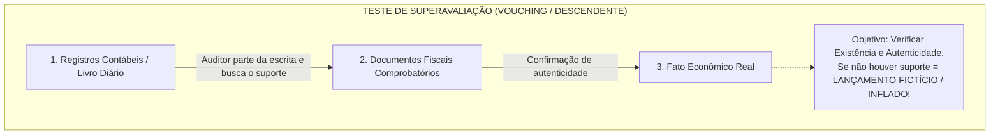
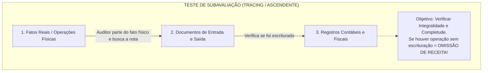
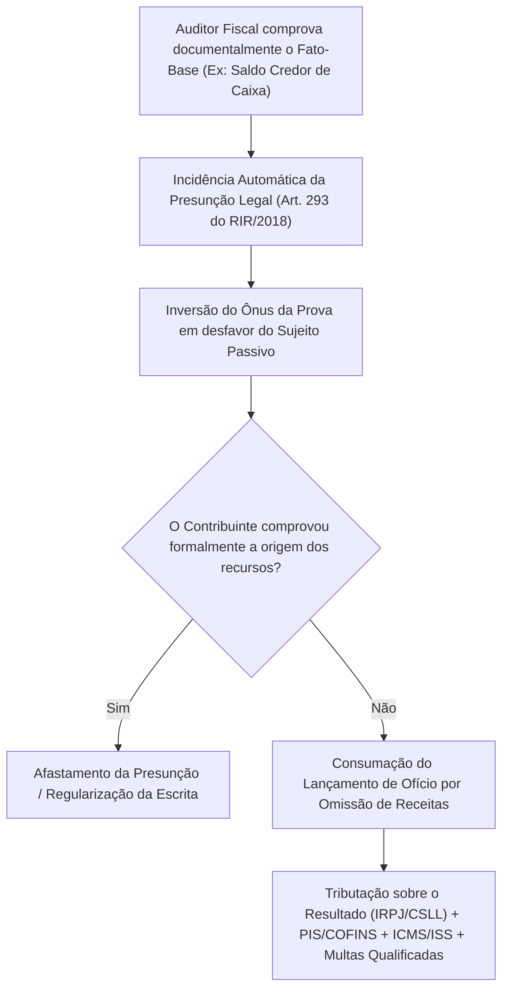
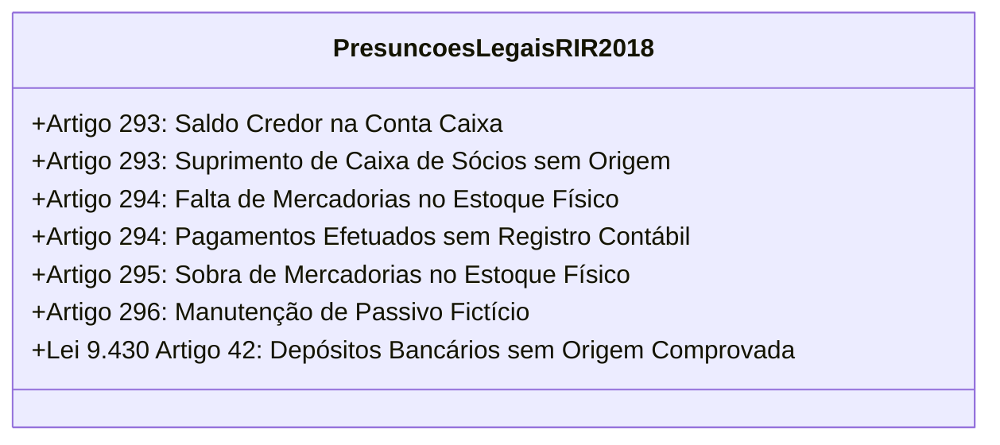
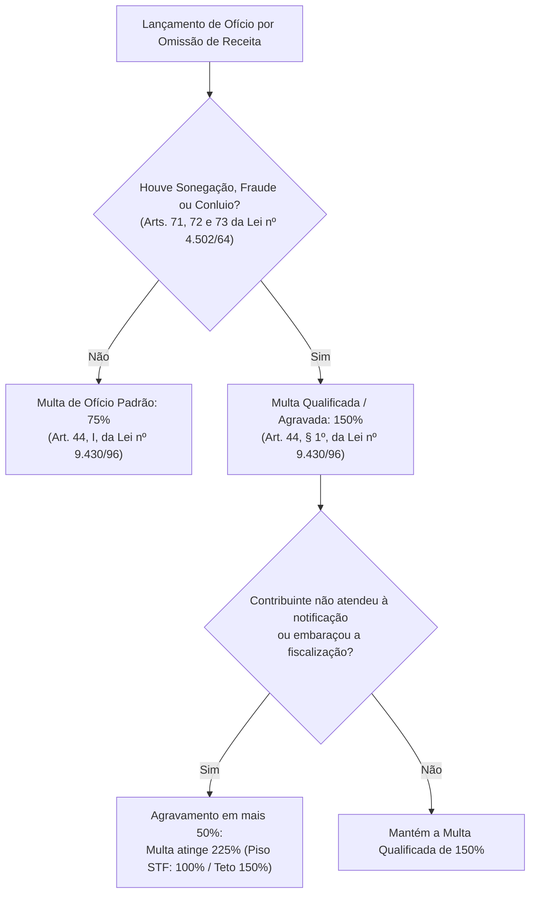
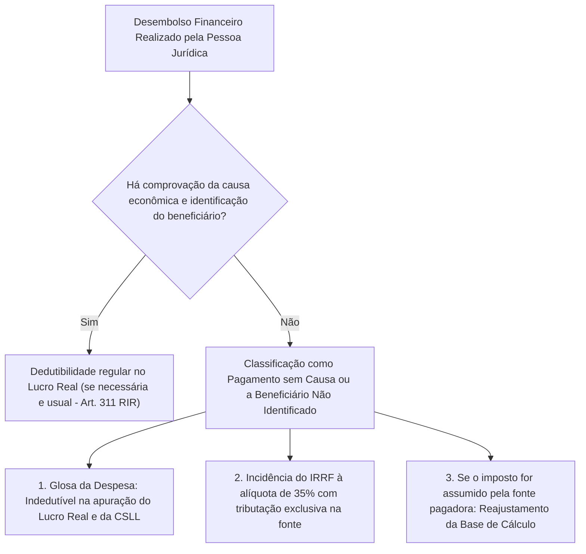

# Presunções Legais, Sentido dos Testes e Omissão de Receita (DL nº 1.598/1977, Lei nº 9.430/1996 e RIR/2018)

---

## 1. O Sentido dos Testes de Auditoria Fiscal: Superavaliação (*Vouching*) vs. Subavaliação (*Tracing*)

Em auditoria contábil e fiscal tributária, o direcionamento metodológico dos testes é a ferramenta cardeal para detecção de fraudes patrimoniais e evasão fiscal. O auditor orienta seus exames conforme a afirmação contábil que pretende validar:

### Quadro Comparativo: Vouching vs. Tracing na Prática Fiscal:

| Dimensão de Análise | Teste de Superavaliação (*Vouching*) | Teste de Subavaliação (*Tracing*) |
| :--- | :--- | :--- |
| **Ponto de Partida** | A escrituração contábil (saldos no Livro Razão). | A documentação primária ou realidade física (fatos reais). |
| **Sentido da Verificação** | **Descendente:** do registro contábil para o documento comprobatório. | **Ascendente:** do documento/fato real para o registro contábil. |
| **Afirmação Auditada** | **Existência**, Ocorrência, Validade e Propriedade. | **Completude**, Integridade e Abrangência. |
| **Patologia Investigada** | Contabilização de despesas fictícias, duplicatas simuladas ou ativos inexistentes. | **Omissão de receitas**, vendas sem nota fiscal, passivos não registrados. |
| **Contas Típicas** | Despesas Operacionais, Ativo Imobilizado e Investimentos. | Receitas de Vendas, Duplicatas a Pagar e Caixa Geral. |

---

## 2. A Teoria das Presunções Legais no Direito Tributário

O direito tributário brasileiro agasalha a técnica das **presunções legais de omissão de receita**, permitindo que o Fisco, diante da constatação de um fato-índice objetivo e comprovado, deduza com base na lei a ocorrência de receitas não tributadas.

### 2.1. Natureza Jurídica: Presunções *Juris Tantum* e Inversão do Ônus Probatório

As presunções tributárias previstas na legislação federal e estadual possuem natureza jurídica de **presunções relativas (*juris tantum*)**:
- **Ônus da Prova do Fisco:** O auditor fiscal tem o dever de demonstrar e comprovar materialmente a ocorrência do fato-base (ex.: provar que houve saldo credor de caixa, provar que houve passivo fictício, provar que houve crédito bancário não justificado);
- **Inversão Legal do Ônus:** Uma vez comprovado o fato-base pelo auditor, **inverte-se ope legis o ônus da prova em desfavor do contribuinte**, cabendo a este comprovar a legitimidade dos recursos e a inexistência de sonegação fiscal. A mera alegação desprovida de lastro contábil idôneo é ineficaz para elidir a presunção legal.

---

## 3. O Catálogo das Presunções Legais de Omissão de Receitas (RIR/2018 e Leis nº 8.981/95 e 9.430/96)

O Regulamento do Imposto sobre a Renda (**RIR/2018 - Decreto nº 9.580/2018**, arts. 293 a 301) e a legislação correlata tipificam taxativamente as seguintes presunções legais:

### Análise Individual das Principais Hipóteses Legais:

### 3.1. Saldo Credor da Conta Caixa (Art. 293 do RIR/2018)
A constatação de saldo credor na conta Caixa em qualquer dia do período fiscalizado gera presunção legal absoluta/relativa de que foram introduzidos recursos financeiros clandestinos para suportar pagamentos reais, decorrentes de faturamento pretérito omitido da tributação.

### 3.2. Suprimento de Caixa por Sócios sem Comprovação (Art. 293 c/c Súmula CARF nº 107)
A injeção de recursos sob a rubrica de empréstimos ou mútuos de sócios sem a comprovação simultânea da capacidade econômico-financeira do titular e do trânsito eletrônico bancário prévio a partir da conta pessoal do sócio equipara-se juridicamente a saldo credor de caixa, presumindo-se a omissão de receita operacional da empresa.

### 3.3. Pagamento de Despesas e Compras não Contabilizadas (Art. 294 do RIR/2018)
Se a empresa realiza pagamentos de fornecedores, salários, aluguéis ou reformas sem escriturá-los nos livros Diário e Caixa, presume-se que tais despesas foram honradas com recursos que ingressaram na sociedade sem a correspondente emissão de notas fiscais de vendas.

### 3.4. Manutenção de Passivo Fictício (Art. 296 do RIR/2018 c/c Súmula CARF nº 26)
A manutenção no balanço patrimonial de dívidas e obrigações já quitadas (sem que a liquidação tenha transitado pela contabilidade) ou de obrigações simuladas e inexistentes autoriza a presunção legal de omissão de receitas pelo montante do passivo irreal mantido.

### 3.5. Depósitos e Créditos Bancários sem Origem Comprovada (Art. 42 da Lei nº 9.430/1996)
Valores creditados em contas bancárias ou de investimentos em relação aos quais o contribuinte, regularmente intimado, não comprove mediante documentação hábil e idônea a origem lícita e tributada do numerário.

---

## 4. Repercussões Tributárias e o Regime das Multas de Ofício

A caracterização da omissão de receitas acarreta repercussões materiais em cadeia nos tributos federais, estaduais e municipais:

### 4.1. Desdobramentos da Base Tributável Omitida:
- **No IRPJ e na CSLL:** Os valores omitidos são adicionados ao lucro líquido na apuração do Lucro Real, ou somados à receita bruta para tributação no Lucro Presumido e Arbitrado (acrescidos de juros SELIC e multa de ofício);
- **No PIS e na COFINS:** Exige-se a incidência das contribuições sociais sobre o faturamento omitido;
- **No ICMS e no IPI:** Presume-se a saída de mercadorias sem emissão de documento fiscal, exigindo-se o imposto estadual e federal correspondente;
- **Pagamentos sem Causa (Art. 61 da Lei nº 8.981/1995):** Se a omissão de receitas decorrer de pagamentos efetuados a beneficiários não identificados ou sem causa econômica legítima, incide o **IRRF exclusivo de 35%** sobre o valor bruto da operação.

### 4.2. Gradação das Multas de Ofício (Art. 44 da Lei nº 9.430/1996):

---

## 5. Pagamentos a Beneficiários Não Identificados ou Sem Causa (Art. 61 da Lei nº 8.981/1995)

Em auditorias contábeis e fiscais de despesas e custos, a constatação de desembolsos em que não se comprove a efetiva contraprestação de serviços ou a identificação do beneficiário final atrai regime tributário gravoso específico:

$$
\text{Tributação Exclusiva na Fonte (Art. 61)} = 35\% \text{ sobre o Rendimento Bruto Pago}
$$

### 5.1. Fórmula de Reajustamento da Base de Cálculo (*Gross-up*)

Quando a pessoa jurídica assume o ônus do imposto devido, a legislação federal impõe o reajustamento da base de cálculo para apurar o montante bruto que, deduzido do imposto de 35%, produza o valor líquido entregue:

$$
\text{Rendimento Bruto Reajustado} = \frac{\text{Valor Líquido Pago}}{1 - 0,35} = \frac{\text{Valor Líquido Pago}}{0,65}
$$

$$
\text{IRRF a Recolher} = \text{Rendimento Bruto Reajustado} \times 35\%
$$

---

## 6. Estudo de Caso Prático Numérico de Auditoria Fiscal

### Cenário de Fiscalização: Indústria Cerâmica Planalto Ltda.
- **Regime Declarado:** Lucro Real Trimestral (1º Trimestre de 2025).
- **Constatações da Fiscalização Tributária:**
  1. No dia 24 de fevereiro de 2025, o Razão da conta Caixa apresentou saldo credor no valor de R\$ 120.000,00;
  2. No dia 25 de fevereiro de 2025, a empresa registrou um lançamento a crédito na conta Caixa no valor de R\$ 120.000,00, a título de "Suprimento de Caixa pelo Sócio José", sem contrato de mútuo registrado e sem trânsito de numerário por conta bancária do sócio;
  3. No dia 10 de março de 2025, a empresa efetuou pagamento de R\$ 65.000,00 a título de "Consultoria Técnica" sem qualquer relatório ou nota fiscal idônea emitida (pagamento sem causa).

### Resolução e Memória de Cálculo Fiscal:
1. **Omissão de Receitas por Saldo Credor e Suprimento Fictício:** O montante de R\$ 120.000,00 é tipificado como omissão de receitas operacionais (art. 293 do RIR/2018), sendo adicionado ao Lucro Real do trimestre;
   - IRPJ Básico (15%): $R\$\ 120.000,00 \times 15\% = R\$\ 18.000,00$;
   - Adicional IRPJ (10%): $R\$\ 120.000,00 \times 10\% = R\$\ 12.000,00$;
   - CSLL (9%): $R\$\ 120.000,00 \times 9\% = R\$\ 10.800,00$;
   - PIS/COFINS (regime não cumulativo - 9,25%): $R\$\ 120.000,00 \times 9,25\% = R\$\ 11.100,00$.
2. **Pagamento sem Causa com Ônus Assumido pela Empresa:**
   - Base Bruta Reajustada: $\frac{R\$\ 65.000,00}{0,65} = R\$\ 100.000,00$;
   - IRRF devido (35%): $R\$\ 100.000,00 \times 35\% = R\$\ 35.000,00$;
   - Glosa da despesa na apuração do Lucro Real.

---

## 7. Mnemônicos & Âncoras Cognitivas

> [!TIP]
> **Mnemônico: `VOUCHING DESCE, TRACING SOBE`**
> - **Vouching (Superavaliação):** Desce da Contabilidade para o Papel $\rightarrow$ Procura *Despesa Fictícia* e *Ativo Inflado*.
> - **Tracing (Subavaliação):** Sobe do Fato Real para a Contabilidade $\rightarrow$ Procura *Receita Omitida* e *Passivo Oculto*.

> [!TIP]
> **Mnemônico das 4 Grandes Presunções: `C-P-E-B`**
> - **C** $\rightarrow$ **C**aixa Credor / Suprimento de Sócios sem origem.
> - **P** $\rightarrow$ **P**assivo Fictício (dívida fantasma no balanço).
> - **E** $\rightarrow$ **E**stoque (falta de estoque = vendeu sem nota; sobra = comprou sem nota).
> - **B** $\rightarrow$ **B**anco (depósito sem origem do Art. 42 da Lei 9.430/96).

---

## 8. Bateria de Questões Oficiais Comentadas (QConcursos)

### [Questão 01](https://www.qconcursos.com/questoes-de-concursos/questoes/dde2b7ce-c6) — [FGV — Receita Federal do Brasil / Auditor-Fiscal da Receita Federal — 2023]

O auditor fiscal realizou testes de auditoria partindo dos registros contábeis do Livro Razão em direção aos documentos comprobatórios primários (notas fiscais de despesas e contratos de serviços). Esse procedimento de auditoria orienta-se para a detecção de:
* **A)** Subavaliação de passivos exigíveis e omissão de obrigações tributárias.
* **B)** Superavaliação de contas de resultado ou de ativo, testando afirmações de existência, validade e ocorrência dos lançamentos.
* **C)** Subavaliação de receitas operacionais brutas decorrentes de vendas mercantis clandestinas.
* **D)** Exclusivamente o cálculo de juros sobre o capital próprio devidos aos acionistas preferenciais.
* **E)** Falta de registro de compras de mercadorias no livro fiscal Registro de Entradas.

#### Gabarito: **B**

* **B (Certa):** O teste que parte da escrituração contábil em direção à documentação comprobatória de suporte é o teste de **superavaliação (*vouching*)**, voltado a averiguar se as despesas registradas e ativos escriturados de fato **existem**, ocorreram e são válidos, identificando gastos fictícios e ativos inflados.
* **A, C e E (Erradas):** A investigação de subavaliação (omissão de receitas, passivos ocultos ou compras omitidas) exige o teste em sentido inverso (*tracing*), partindo dos documentos físicos/fatos reais para a escrituração contábil.
* **D (Errada):** O teste de superavaliação é método geral e não se restringe a JCP.

> **Fique Ligado:** O teste que parte da escrituração contábil em direção à documentação comprobatória de suporte é o teste de **superavaliação (*vouching*)**, voltado a averiguar se as despesas registradas e ativos escriturados de fato **existem**, ocorreram e são válidos, identificando gastos fictícios e ativos inflados.

---

### [Questão 02](https://www.qconcursos.com/questoes-de-concursos/questoes/aa16e904-81) — [CESPE / CEBRASPE — SEFAZ-CE / Auditor Fiscal da Receita Estadual — 2021]

A respeito das presunções legais de omissão de receita previstas no Regulamento do Imposto de Renda e na legislação tributária estadual, assinale a opção correta:
* **A)** A constatação de saldo credor na conta Caixa em determinado dia do mês constitui mera irregularidade formal que não autoriza a cobrança de tributos.
* **B)** As presunções legais de omissão de receita possuem natureza relativa (*juris tantum*), incumbindo ao contribuinte, uma vez comprovado o fato-base pelo Fisco, o ônus de provar a inocorrência da sonegação ou a origem lícita dos recursos.
* **C)** A manutenção de passivo fictício no balanço patrimonial somente caracteriza omissão de receita se o Fisco comprovar a identidade física dos credores simulados.
* **D)** Para aplicar a presunção do art. 42 da Lei nº 9.430/1996 sobre depósitos bancários, a fiscalização deve dispensar a intimação prévia do contribuinte correntista.
* **E)** O auditor fiscal é obrigado a provar judicialmente a má-fé do contribuinte antes de efetuar o lançamento de ofício por presunção legal.

#### Gabarito: **B**

* **B (Certa):** As presunções legais tributárias são *juris tantum*, operando a inversão legal do ônus da prova em benefício da Fazenda Pública a partir da demonstração cabal do fato-índice pela fiscalização.
* **A (Errada):** O saldo credor de caixa é hipótese clássica de presunção de omissão de receitas (art. 293 do RIR/2018).
* **C (Errada):** A comprovação de que a dívida é inexistente ou já quitada basta para configurar a presunção (Súmula CARF nº 26).
* **D (Errada):** A intimação formal prévia é requisito constitutivo essencial do art. 42.
* **E (Errada):** O lançamento tributário administrativo prescinde de ação judicial prévia.

> **Fique Ligado:** As presunções legais tributárias são *juris tantum*, operando a inversão legal do ônus da prova em benefício da Fazenda Pública a partir da demonstração cabal do fato-índice pela fiscalização.

---

### [Questão 03](https://www.qconcursos.com/questoes-de-concursos/questoes/6e3270ee-7b) — [FCC — SEFAZ-SC / Auditor Fiscal da Receita Estadual — 2018]

Em ação de auditoria fiscal sobre uma sociedade empresária, o Auditor Fiscal constatou a existência de diversos lançamentos a crédito na conta Caixa intitulados "Suprimentos de Sócios", no montante total de R\$ 1.500.000,00, sem contratos contemporâneos e sem que houvesse transferência a partir das contas bancárias dos sócios. Intimado a comprovar a origem dos recursos, o contribuinte limitou-se a afirmar que os sócios guardavam o dinheiro em espécie em suas residências ("guardados no colchão"). Diante desse quadro probatório e da jurisprudência consolidada do CARF:
* **A)** A fiscalização deve aceitar a justificativa apresentada em observância ao princípio da não surpresa tributária.
* **B)** A alegação de entrega de recursos em moeda corrente mantida em poder dos sócios, desacompanhada de prova documental idônea da efetiva disponibilidade econômico-financeira e do trânsito bancário prévio, não elide a presunção legal de omissão de receitas.
* **C)** Os suprimentos de sócios são considerados receitas isentas de tributação para a pessoa jurídica em qualquer hipótese.
* **D)** A fiscalização fica impedida de cobrar tributos enquanto não houver decisão transitada em julgado na esfera cível anulando os contratos societários.
* **E)** O lançamento fiscal deve ser anulado por violação à intimidade financeira dos sócios.

#### Gabarito: **B**

* **B (Certa):** A jurisprudência sumulada do CARF (Súmula CARF nº 107) e do STJ é taxativa: o suprimento de caixa por recursos atribuídos a sócios exige comprovação documental hábil da efetiva disponibilidade financeira do sócio na época do aporte e a comprovação da transferência bancária a partir de suas contas. Alegações desprovidas de lastro não afastam a presunção de omissão de receita.
* **A, C, D e E (Erradas):** A presunção legal impõe a tributação; suprimentos fictícios caracterizam receitas omitidas; a competência fazendária é autônoma; e a exigência de prova bancária não viola a intimidade.

> **Fique Ligado:** A jurisprudência sumulada do CARF (Súmula CARF nº 107) e do STJ é taxativa: o suprimento de caixa por recursos atribuídos a sócios exige comprovação documental hábil da efetiva disponibilidade financeira do sócio na época do aporte e a comprovação da transferência bancária a partir de suas contas.

---

### [Questão 04](https://www.qconcursos.com/questoes-de-concursos/questoes/1f5b7033-c3) — [FGV — SEFAZ-MG / Auditor Fiscal da Receita Estadual — 2023]

A respeito da aplicação de penalidades em autos de infração decorrentes de lançamento de ofício por omissão de receitas comprovada por presunções legais da Lei nº 9.430/1996:
* **A)** A multa de ofício básica geral é de 75% sobre a totalidade ou diferença do tributo omitido.
* **B)** A multa básica de ofício é de 20%, equiparada à multa de mora aplicada ao recolhimento espontâneo intempestivo.
* **C)** É vedada a qualificação da multa de ofício para 150% em casos de conluio ou fraude documental comprovada.
* **D)** O contribuinte autuado com base em presunção legal fica dispensado do pagamento de juros de mora pela taxa SELIC.
* **E)** As multas de ofício de auditoria tributária são inexigíveis em pessoas jurídicas de capital fechado.

#### Gabarito: **A**

* **A (Certa):** O art. 44, inciso I, da Lei nº 9.430/1996 fixa a multa de ofício básica em **75%** nos casos de falta de declaração e nos de declaração inexata decorrente de lançamento de ofício.
* **B (Errada):** 20% é o teto da multa de mora para pagamento espontâneo atrasado (art. 61 da Lei 9.430/96).
* **C (Errada):** Em caso de evidente intuito de fraude, conluio ou sonegação (arts. 71 a 73 da Lei 4.502/64), a multa é qualificada para 150% (art. 44, § 1º).
* **D e E (Erradas):** A taxa SELIC incide compulsoriamente sobre todos os créditos fiscais federais e a multa é plenamente exigível de todas as pessoas jurídicas.

> **Fique Ligado:** O art.

---

### [Questão 05](https://www.qconcursos.com/questoes-de-concursos/questoes/78999538-91) — [CESPE / CEBRASPE — SEFAZ-RR / Auditor Fiscal de Tributos Estaduais — 2023]

Na realização de auditoria tributária para verificar a ocorrência de omissão de receitas de prestação de serviços no âmbito municipal ou estadual, o teste de conformidade que parte das ordens de serviços executadas pelos funcionários para os livros contábeis de faturamento classifica-se como:
* **A)** Teste de Superavaliação (*Vouching*).
* **B)** Teste de Subavaliação (*Tracing*).
* **C)** Procedimento analítico de dupla datação.
* **D)** Circularização passiva negativa.
* **E)** Teste de contingência retroativa.

#### Gabarito: **B**

* **B (Certa):** O exame que parte da realidade física/operacional (ordens de serviços executadas) em direção aos registros contábeis de faturamento é o teste de **subavaliação (*tracing*)**, destinado a verificar a completude e identificar serviços efetivamente prestados que não foram faturados (omissão de receita).
* **A, C, D e E (Erradas):** Superavaliação parte da contabilidade para os documentos; dupla datação refere-se a eventos subsequentes; circularização é confirmação externa; e contingência retroativa não é teste de direcionamento.

> **Fique Ligado:** O exame que parte da realidade física/operacional (ordens de serviços executadas) em direção aos registros contábeis de faturamento é o teste de **subavaliação (*tracing*)**, destinado a verificar a completude e identificar serviços efetivamente prestados que não foram faturados (omissão de receita).

---

### [Questão 06](https://www.qconcursos.com/questoes-de-concursos/questoes/1f4f7fb8-c3) — [FCC — SEFAZ-BA / Auditor Fiscal — 2019]

Em auditoria fiscal sobre sociedade comercial atacadista, a equipe de fiscalização constatou a existência de compras de mercadorias no valor de R\$ 800.000,00, acobertadas por notas fiscais idôneas emitidas pelos fornecedores, as quais não constavam do Livro Registro de Entradas nem da escrituração contábil da empresa. Constatou-se ainda que as mercadorias foram pagas em dinheiro físico. Conforme o art. 294 do RIR/2018:
* **A)** A falta de registro contábil de compras constitui infração meramente formal, não autorizando qualquer cobrança de tributos sobre a renda.
* **B)** O pagamento de compras e despesas não contabilizadas autoriza a presunção legal de omissão de receitas no montante correspondente aos desembolsos não escriturados.
* **C)** A empresa deve ser submetida a liquidação extrajudicial sumária pelo Banco Central.
* **D)** A presunção de omissão de receita afasta-se se a empresa emitir notas fiscais de devolução das compras.
* **E)** Os pagamentos em dinheiro físico são considerados lícitos e isentos de qualquer controle fazendário.

#### Gabarito: **B**

* **B (Certa):** O art. 294 do RIR/2018 disciplina expressamente que o pagamento efetuado pela pessoa jurídica sem que haja comprovação da origem do numerário utilizado para sua quitação, ou a constatação de compras não escrituradas, gera a presunção legal de que os recursos empregados decorreram de receitas operacionais omitidas da tributação.
* **A, C, D e E (Erradas):** A presunção é material com lançamento de tributos e multas; o BACEN não liquida empresas mercantis comuns; devoluções retroativas simuladas configuram fraude; e saídas em espécie sem trânsito contábil são o núcleo do caixa dois.

> **Fique Ligado:** O art.

---

### [Questão 07](https://www.qconcursos.com/questoes-de-concursos/questoes/0b7523a1-c3) — [ESAF — Receita Federal do Brasil / Auditor-Fiscal da Receita Federal — 2014]

O passivo fictício é considerado uma das manobras mais recorrentes em fraudes fiscais e societárias. A caracterização do passivo fictício autoriza a autoridade fiscal a:
* **A)** Presumir a omissão de receitas no montante correspondente à obrigação inexistente mantida no balanço patrimonial.
* **B)** Determinar a extinção imediata do CNPJ da sociedade sem direito de defesa.
* **C)** Expropriar os bens particulares dos contadores sem instauração de processo administrativo fiscal.
* **D)** Classificar o montante do passivo compulsoriamente como receita isenta de doação.
* **E)** Aguardar o encerramento do processo de recuperação judicial da empresa.

#### Gabarito: **A**

* **A (Certa):** O art. 296 do RIR/2018 e a Súmula CARF nº 26 fixam que a constatação de passivo fictício (manutenção de obrigações inexistentes ou já pagas) autoriza a presunção legal de omissão de receitas tributáveis correspondente ao valor mantido indevidamente no passivo da entidade.
* **B e C (Erradas):** Violam as garantias constitucionais do contraditório e ampla defesa.
* **D e E (Erradas):** Não há isenção para passivo fictício e o Fisco lança o tributo imediatamente.

> **Fique Ligado:** O art.

---

### [Questão 08](https://www.qconcursos.com/questoes-de-concursos/questoes/0b9e2ca4-c3) — [FGV — CFC / Qualificação Técnica Geral (QTG) — 2026]

O auditor fiscal, ao examinar os livros de escrituração contábil digital (ECD) de uma indústria de confecções, apurou que no encerramento do exercício havia uma obrigação escriturada no Passivo Circulante a favor de um fornecedor estrangeiro no valor de R\$ 2.000.000,00. Mediante procedimento de circularização com o fornecedor no exterior, confirmou-se que a dívida havia sido totalmente liquidada há dois anos em moeda estrangeira mediante operação de compensação não registrada na contabilidade da empresa brasileira. Diante dessa constatação fática:
* **A)** Resta configurado passivo fictício, autorizando o lançamento de ofício de tributos federais sobre o montante de dois milhões de reais a título de omissão de receita.
* **B)** O auditor deve desconsiderar o fato por se tratar de operação com fornecedor sediado no exterior.
* **C)** O passivo deve ser convertido em reserva de capital sem repercussão fiscal.
* **D)** A empresa tem o direito potestativo de manter a dívida escriturada até a ocorrência de prescrição comercial.
* **E)** O lançamento tributário depende de homologação prévia da Organização Mundial do Comércio.

#### Gabarito: **A**

* **A (Certa):** A manutenção no balanço de passivo já extinto e liquidado há dois anos configura passivo fictício clássico. A quitação sem trânsito contábil demonstra que foram utilizados recursos financeiros não contabilizados para pagar o credor no exterior, consumando-se a presunção legal de omissão de receitas (art. 296 do RIR/2018).
* **B, C, D e E (Erradas):** Operações com o exterior submetem-se ao controle tributário e cambial; não há criação artificial de reserva de capital; a escrituração mercantil deve espelhar a verdade material; e inexiste subordinação à OMC.

> **Fique Ligado:** A manutenção no balanço de passivo já extinto e liquidado há dois anos configura passivo fictício clássico.

---

### [Questão 09](https://www.qconcursos.com/questoes-de-concursos/questoes/1f56860b-c3) — [FGV — Receita Federal do Brasil / Auditor-Fiscal da Receita Federal — 2023]

Em relação à tributação sobre pagamentos a beneficiários não identificados ou sem causa econômica comprovada prevista no art. 61 da Lei nº 8.981/1995:
* **A)** Os rendimentos pagos estão isentos de imposto de renda se a empresa for optante pelo regime do Lucro Presumido.
* **B)** O imposto sobre a renda incidirá exclusivamente na fonte à alíquota de 35%, além de a despesa ser considerada indedutível na determinação do lucro real da pessoa jurídica pagadora.
* **C)** A alíquota aplicável é de 15%, idêntica à alíquota básica geral do IRPJ.
* **D)** A empresa tem o direito de deduzir a despesa da base de cálculo da CSLL se demonstrar que o pagamento foi feito em dinheiro em espécie.
* **E)** O imposto de renda retido na fonte pode ser compensado com o imposto a pagar pela empresa no encerramento do exercício.

#### Gabarito: **B**

* **B (Certa):** O art. 61 da Lei nº 8.981/1995 prescreve que todo pagamento efetuado pelas pessoas jurídicas a beneficiários não identificados ou sem causa econômica comprovada sujeita-se à **incidência exclusiva na fonte do imposto de renda à alíquota de 35%**, sem prejuízo da **indedutibilidade total** do gasto na apuração do Lucro Real e da CSLL.
* **A (Errada):** A norma do art. 61 aplica-se indistintamente a todas as pessoas jurídicas, inclusive optantes pelo Lucro Presumido.
* **C (Errada):** A alíquota legal punitiva é de 35%, e não 15%.
* **D e E (Erradas):** A despesa é indedutível na CSLL e o imposto é de tributação definitiva exclusiva na fonte, não gerando direito a compensação.

> **Fique Ligado:** O art.

---

### [Questão 10](https://www.qconcursos.com/questoes-de-concursos/questoes/78a24aa5-91) — [CESPE / CEBRASPE — SEFAZ-CE / Auditor Fiscal da Receita Estadual — 2021]

A respeito da desclassificação da escrituração contábil e de sua distinção em relação à aplicação de presunções legais de omissão de receitas, assinale a opção correta:
* **A)** A constatação de uma única presunção legal de omissão de receita impõe compulsoriamente a desclassificação integral da escrituração e o arbitramento do lucro da empresa.
* **B)** A aplicação de presunção legal de omissão de receitas pode ocorrer com a manutenção da escrituração contábil da pessoa jurídica no regime do Lucro Real, adicionando-se os valores omitidos à base tributável, ressalvada a hipótese em que as deficiências e omissões tornem a escrita globalmente inidônea e imprestável para apuração do resultado.
* **C)** As presunções legais somente podem ser aplicadas caso o contribuinte tenha sofrido processo penal por crime contra a ordem tributária com trânsito em julgado.
* **D)** A escrita contábil desclassificada é válida perante o Fisco estadual para fins de apropriação de créditos acumulados de ICMS.
* **E)** O arbitramento do lucro é procedimento obrigatório para cobrança de omissão de receita decorrente de saldo credor de caixa.

#### Gabarito: **B**

* **B (Certa):** A jurisprudência consolidada do CARF (Súmula CARF nº 32) e do STJ pacifica que a ocorrência pontual de omissão de receitas por presunção legal (ex.: saldo credor de caixa ou depósito sem origem) não acarreta a desclassificação automática da escrituração. O Fisco adiciona os valores omitidos ao Lucro Real, preservando a contabilidade da empresa, salvo se a gravidade, extensão e generalização dos vícios tornarem a escrita totalmente inidônea.
* **A (Errada):** Veda-se a desclassificação sumária por presunção pontual.
* **C, D e E (Erradas):** A esfera administrativa independe da esfera penal; escrita desclassificada perde valor probatório; e o Fisco pode cobrar a omissão diretamente no Lucro Real sem arbitramento.

> **Fique Ligado:** A jurisprudência consolidada do CARF (Súmula CARF nº 32) e do STJ pacifica que a ocorrência pontual de omissão de receitas por presunção legal (ex.

---

### [Questão 11](https://www.qconcursos.com/questoes-de-concursos/questoes/f82aa610-8b) — [FCC — SEFAZ-SC / Auditor Fiscal da Receita Estadual — 2018]

Em fiscalização tributária estadual, a autoridade fazendária apurou que um grande atacadista de bebidas manteve, durante todo o ano-calendário, contas correntes bancárias ativas movimentando milhões de reais que não constavam de sua escrituração contábil (as chamadas contas paralelas ou "Caixa Dois"). O Fisco intimou a empresa para comprovar a origem dos depósitos e a correlação com as notas fiscais emitidas. Não tendo sido apresentada justificativa idônea:
* **A)** Os valores creditados nas contas bancárias não escrituradas presumem-se receitas operacionais omitidas da tributação, autorizando o lançamento de ofício do imposto estadual e federal, além da desclassificação da escrita contábil por inidoneidade material grave.
* **B)** A empresa adquire imunidade tributária pelo princípio da insignificância contábil.
* **C)** O Fisco fica obrigado a presumir que todos os recursos pertencem exclusivamente a partidos políticos.
* **D)** Os auditores devem devolver os extratos bancários sem lavrar termo de fiscalização.
* **E)** A presunção de omissão de receita afasta-se pela mera substituição do profissional de contabilidade da empresa.

#### Gabarito: **A**

* **A (Certa):** A movimentação de contas bancárias à margem da contabilidade mercantil constitui fraude contábil e fiscal gravíssima. Os recursos creditados presumem-se receitas omitidas (art. 42 da Lei 9.430/96 e normas estaduais) e a ocultação deliberada de contas bancárias torna a contabilidade imprestável, autorizando a sua desclassificação formal e material (art. 603 do RIR/2018).
* **B, C, D e E (Erradas):** Não há insignificância em fraudes milionárias; inexiste presunção política; a atuação do auditor é vinculada; e troca de contador não apaga crimes fiscais pretéritos.

> **Fique Ligado:** A movimentação de contas bancárias à margem da contabilidade mercantil constitui fraude contábil e fiscal gravíssima.

---

### [Questão 12](https://www.qconcursos.com/questoes-de-concursos/questoes/1f524a80-c3) — [FGV — CFC / Qualificação Técnica Geral (QTG) — 2026]

O auditor fiscal, ao realizar a auditoria da conta "Fornecedores" no Passivo Circulante de uma concessionária de veículos, aplicou o procedimento de confirmação externa (circularização positiva) para 100% dos credores. Uma das respostas revelou que uma duplicata no valor de R\$ 500.000,00, que constava em aberto no balanço patrimonial, já havia sido quitada por intermédio de depósito efetuado por terceiro não identificado há mais de seis meses. Diante disso:
* **A)** Constata-se a ocorrência de passivo fictício, autorizando o lançamento de ofício por omissão de receitas tributáveis correspondente ao valor da obrigação indevidamente mantida no balanço.
* **B)** A concessionária adquire o direito de pleitear ressarcimento ao Fisco pelo pagamento antecipado do débito.
* **C)** A autoridade fiscal deve ignorar a resposta da circularização bancária por ferir o sigilo comercial.
* **D)** A obrigação mantida no passivo deve ser classificada como ativo intangível pelo princípio da prudência.
* **E)** O lançamento tributário fica condicionado à concordância do sócio majoritário da concessionária.

#### Gabarito: **A**

* **A (Certa):** A manutenção de obrigação já adimplida no passivo caracteriza passivo fictício (art. 296 do RIR/2018 c/c Súmula CARF nº 26). O pagamento efetuado por terceiro não identificado sem trânsito contábil comprova que foram introduzidos recursos clandestinos na operação da empresa, ensejando a autuação por omissão de receita tributável.
* **B, C, D e E (Erradas):** Não há ressarcimento ao sonegador; circularização é procedimento legal de auditoria; dívida paga não é ativo intangível; e o lançamento tributário de ofício é ato plenamente vinculado.
> **Fique Ligado:** A manutenção de obrigação já adimplida no passivo caracteriza passivo fictício (art.
