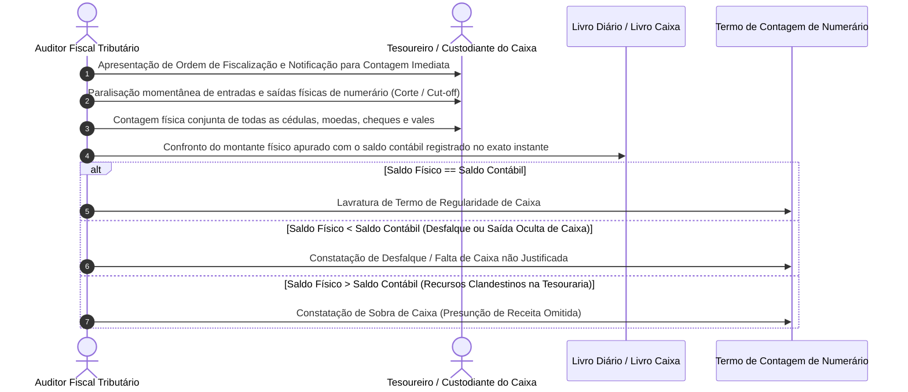
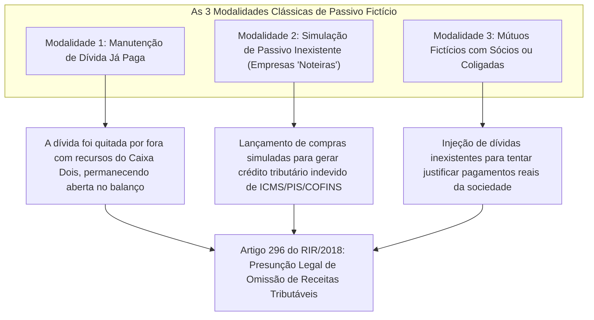
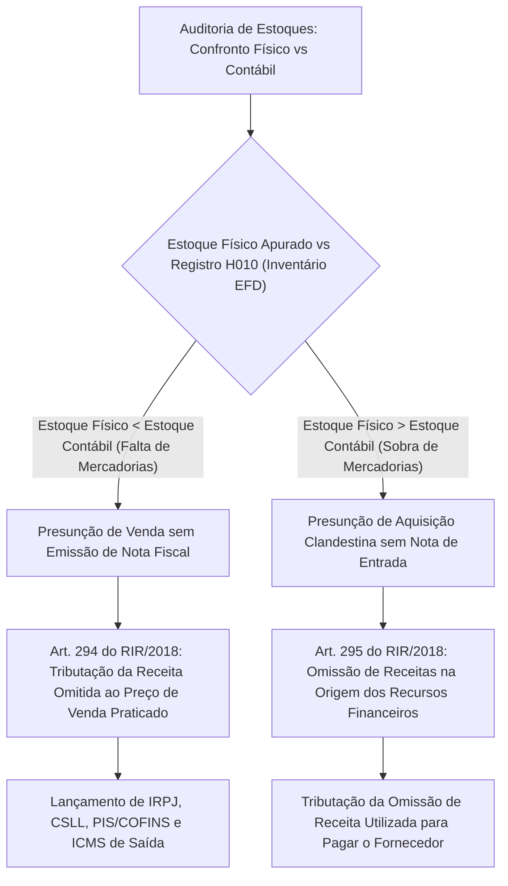
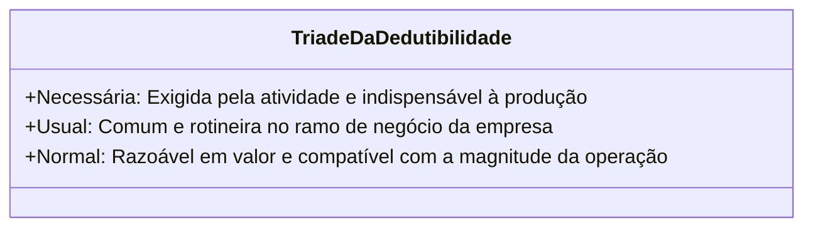
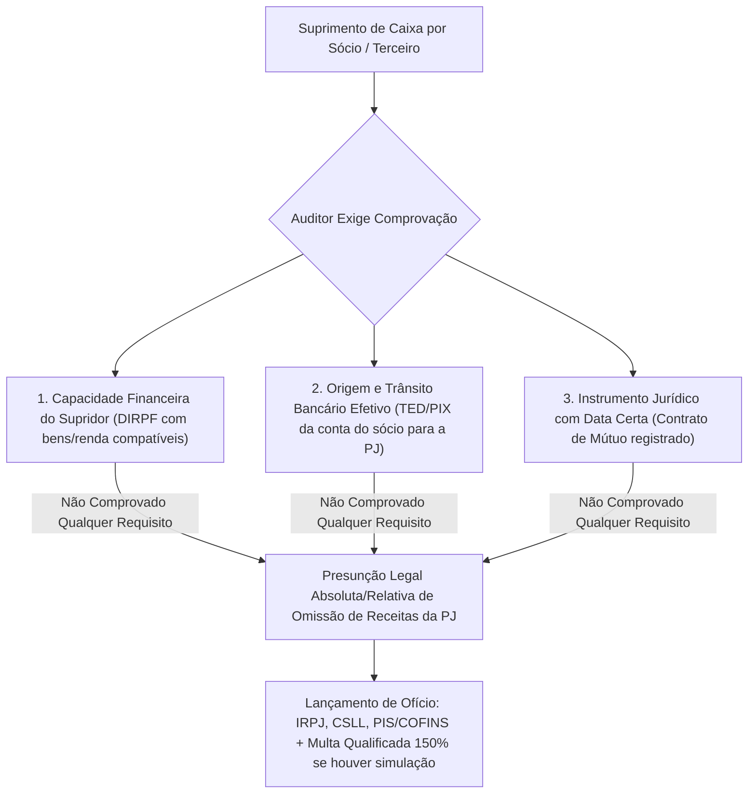

# Auditoria Contábil de Caixa, Passivo Fictício, Estoques Físicos e Despesas Dedutíveis (RIR/2018)

---

## 1. Auditoria Fiscal da Conta Caixa e Disponibilidades

A conta contábil "Caixa Geral" (moeda física mantida na tesouraria) constitui uma das áreas de maior risco em auditoria fiscal tributária. O manuseio de dinheiro em espécie é a via preferencial para a ocultação de faturamento, liquidação de compras clandestinas e manutenção de contabilidade paralela ("Caixa Dois").

### 1.1. O Procedimento de Contagem Física de Caixa (*Cash Count*)

A verificação da autenticidade do saldo da conta Caixa exige a realização de **inspeção física in loco com contagem de numerário**:

> [!IMPORTANT]
> **Requisitos Formais do Termo de Contagem:**
> O Termo de Contagem de Numerário deve ser subscrito conjuntamente pelo auditor fiscal e pelo tesoureiro/responsável pelo caixa da entidade. Caso o custodiante recuse-se a assinar, o auditor convoca duas testemunhas presenciais para atestar a recusa e a veracidade da apuração, sob pena de vício formal de prova.

### 1.2. A Recomposição do Fluxo Diário e a Vedação de Lançamentos Aglutinados

Para mascarar saldos credores de caixa ao longo do mês, contribuintes fraudulentos utilizam frequentemente a técnica de **lançamentos globais ou aglutinados** (ex.: registrar todas as despesas do mês em uma única partida em 31 de dezembro, ou somar as vendas mensais sem individualização diária).

O auditor fiscal desclassifica essa manobra com base no **art. 1.184 do Código Civil** e no **art. 293 do RIR/2018**:
- A fiscalização exige a apresentação do **Razão Analítico Diário** ou procede à **reconstituição cronológica dia a dia** das entradas e saídas;
- Se em qualquer data (ex.: no dia 14 às 15 horas) o saldo for negativo, a presunção legal de omissão de receita está plenamente consumada, sendo irrelevante que no final do mês o saldo tenha se tornado positivo por aportes posteriores.

---

## 2. Auditoria do Passivo Fictício e Suas Três Modalidades Práticas

O passivo fictício é a manutenção dolosa ou culposa, na escrituração contábil da entidade, de dívidas e obrigações que não correspondem à realidade econômico-patrimonial.

A **Súmula CARF nº 26** consagra a regra probatória basilar:

> **Súmula CARF nº 26**: A simples constatação de passivo fictício autoriza a presunção de omissão de receitas, cabendo ao contribuinte o ônus de comprovar a efetiva existência e liquidação da obrigação.

### 2.1. Procedimentos de Auditoria para Identificação de Passivo Fictício:
1. **Confirmação Externa (Circularização de Fornecedores - NBC TA 505):** O auditor envia cartas de circularização positiva aos principais credores que constam no Passivo Circulante e Não Circulante. Se o fornecedor responder declarando que a duplicata já foi quitada ou que jamais realizou operações com a entidade, o passivo fictício resta provado documentalmente;
2. **Exame de Exigibilidade e Prescrição Comercial:** Exame de dívidas antigas mantidas no balanço há anos sem cobrança judicial, sem protesto cartorário e sem pagamento de juros de mora;
3. **Inspeção de Contratos de Mútuo:** Verificação de contratos de empréstimo entre a empresa e seus sócios ou empresas do mesmo grupo econômico, checando a data de reconhecimento de firma, cláusulas de remuneração financeira e capacidade patrimonial do mutuante.

---

## 3. Auditoria de Estoques e a Reconciliação Quantitativa Físico-Financeira

O estoque representa parcela substancial do capital de giro de empresas industriais e comerciais. As distorções de estoque têm impacto direto sobre o Custo das Mercadorias Vendidas (CMV) e sobre a apuração do Lucro Real e do ICMS.

### 3.1. As Fórmulas Matemáticas de Auditoria Fiscal de Estoques:

$$
\text{Estoque Final Físico Teórico} = \text{Estoque Inicial} + \sum \text{Entradas Fiscais} - \sum \text{Saídas Fiscais}
$$

$$
\text{CMV} = \text{Estoque Inicial} + \text{Compras Líquidas do Período} - \text{Estoque Final}
$$

### 3.2. Tratamento das Perdas, Quebras e Perecimento de Mercadorias

Contribuintes frequentemente alegam "perdas naturais", "quebras de transporte" ou "evaporação" para justificar faltas físicas de estoque.

O **RIR/2018 (art. 303)** exige requisitos estritos para que a perda seja fiscalmente dedutível:
1. **Laudo de Autoridade Oficial Competente:** Comprovação da perda mediante certificado emitido pelo Instituto de Pesquisas Tecnológicas (IPT), Instituto Nacional de Tecnologia (INT), Embrapa, autoridade sanitária ou Corpo de Bombeiros;
2. **Boletim de Ocorrência Policial e Laudo Pericial:** Em caso de roubo, furto, desabamento ou sinistro;
3. **Destruição com Acompanhamento Fiscal:** Mercadorias deterioradas ou obsoletas devem ser destruídas na presença física de autoridade da administração tributária previamente intimada, lavrando-se o respectivo termo circunstanciado.

---

## 4. Auditoria de Custos e Despesas Operacionais no Lucro Real (Art. 311 do RIR/2018)

Na sistemática de apuração do Lucro Real, o lucro líquido contábil é ajustado no e-LALUR mediante adições de despesas que não atendam aos requisitos legais de dedutibilidade:

> **Art. 311 do RIR/2018**: São operacionais as despesas não computadas nos custos, **necessárias** à atividade da empresa e à manutenção da respectiva fonte produtora.  
> **§ 1º**: São necessárias as despesas **pagas ou incorridas** para a realização das transações ou operações exigidas pela atividade da empresa.  
> **§ 2º**: As despesas operacionais necessárias são as **usuais ou normais** no tipo de transações, operações ou atividades da empresa.

### Quadro das Principais Despesas Indedutíveis (Adições Compulsórias no e-LALUR):

| Categoria da Despesa | Tratamento Tributário no Lucro Real e na CSLL | Fundamentação Legal |
| :--- | :--- | :--- |
| **Multas Punitivas por Infração Fiscal** | **Totalmente Indedutível**. Adição obrigatória no e-LALUR. | Art. 344 do RIR/2018 c/c Lei nº 8.981/1995. |
| **Multas Moratórias / Compensatórias** | **Dedutíveis** (desde que decorrentes de mora contratual civil ordinária). | Súmula CARF e legislação federal. |
| **Despesas com Alimentação de Sócios e Diretores** | **Indedutíveis**, ressalvada a alimentação fornecida indistintamente a todos os empregados da empresa (PAT). | Art. 369 do RIR/2018. |
| **Brindes e Presentes Corporativos** | **Totalmente Indedutíveis** na apuração do Lucro Real. | Art. 13 da Lei nº 9.249/1995. |
| **Doações em Geral** | **Indedutíveis**, exceto doações a entidades sem fins lucrativos qualificadas (OSCIP) e incentivos de cultura/audiovisual dentro dos limites legais. | Art. 377 do RIR/2018. |
| **Despesas Pessoais dos Sócios** | **Indedutíveis**. Caracterizam distribuição disfarçada de lucros ou pagamentos sem causa (IRRF 35%). | Art. 61 da Lei nº 8.981/1995 e art. 528 do RIR/2018. |

---

---

## 5. Auditoria de Suprimentos Indevidos de Caixa e Ativo Fictício (Arts. 297 e 298 do RIR/2018)

### 5.1. Suprimento de Caixa de Origem Não Comprovada

Quando a empresa enfrenta iminência de saldo credor de caixa ("estouro de caixa"), uma fraude clássica consiste em registrar aportes fictícios de numerário sob a rubrica de "Empréstimos de Sócios", "Mútuos de Terceiros" ou "Aumento de Capital em Moeda Corrente".

O **art. 297 do RIR/2018** estabelece presunção legal expressa:

> **Art. 297 do RIR/2018**: Caracteriza-se como omissão de receita o suprimento de caixa efetuado pelo sócio, titular da empresa individual ou terceiros, quando não for comprovada a efetiva entrega dos recursos e a sua origem fidedigna.

#### Requisitos Cumulativos para Afastar a Presunção de Omissão de Receita no Suprimento de Caixa:
1. **Disponibilidade Financeira do Supridor:** O sócio deve comprovar rendimentos tributáveis ou isentos suficientes na Declaração de Ajuste Anual do IRPF do ano-calendário correspondente;
2. **Efetiva Transferência dos Recursos:** O aporte deve transitar obrigatoriamente pelo sistema bancário oficial (vedado numerário em espécie sem rastreabilidade);
3. **Contrato de Mútuo ou Formalização Societária:** Documento com firmas reconhecidas ou registrado em cartório/Junta Comercial em data contemporânea ao fato, com estipulação de prazo e condições de resgate.

---

### 5.2. Auditoria do Ativo Fictício (Superavaliação Patrimonial)

O ativo fictício consiste na manutenção indevida, no balanço patrimonial, de bens, direitos ou valores que deixaram de existir ou que jamais existiram.

| Modalidade de Ativo Fictício | Mecânica da Fraude | Efeito Tributário / Procedimento Fiscal |
| :--- | :--- | :--- |
| **Clientes / Duplicatas a Receber Já Quitadas** | O cliente pagou a duplicata por fora (em dinheiro ou conta paralela). A receita foi ocultada e o título permanece em aberto no ativo para não evidenciar o desfalque ou desvio. | Presunção de omissão de receita no momento do recebimento clandestino. O auditor confronta o extrato bancário e confirma com o cliente via circularização. |
| **Estoques Inexistentes ou Deteriorados** | Mercadorias furtadas, perecidas ou vendidas sem nota continuam registradas no ativo para inflar o patrimônio e diminuir artificialmente o CMV do período. | Glosa de custos e presunção de vendas não faturadas (art. 294 RIR/2018). |
| **Bens do Ativo Imobilizado Baixados sem Registro** | Máquinas ou veículos alienados sem nota fiscal cujos saldos continuam sendo depreciados mês a mês. | Glosa das quotas de depreciação indevidas (adição no e-LALUR) e tributação do ganho de capital omitido na alienação. |

---

## 6. Estudo de Caso Prático Numérico: Reconstituição Diária de Caixa e Levantamento Quantitativo de Estoques

### 6.1. Caso 1: Recomposição do Caixa da Comercial Ômega Ltda.

Durante procedimento de fiscalização na empresa Comercial Ômega Ltda. (tributada pelo Lucro Real trimestral), o auditor fiscal constatou os seguintes lançamentos na conta Caixa no mês de março:

- **Saldo Inicial em 01/03:** R$ 12.000,00
- **05/03:** Vendas à vista comprovadas em dinheiro: R$ 35.000,00
- **10/03:** Pagamento de fornecedores em espécie: R$ 40.000,00 $
ightarrow$ *Saldo acumulado: R$ 7.000,00*
- **15/03:** Pagamento de folha de salários em espécie: R$ 68.000,00 $
ightarrow$ *Saldo acumulado: **- R$ 61.000,00 (Saldo Credor de Caixa!)***
- **20/03:** Injeção contábil registrada como "Suprimento de Caixa pelo Sócio": R$ 100.000,00 $
ightarrow$ *Saldo acumulado: + R$ 39.000,00*
- **31/03:** Saldo final escriturado: R$ 15.000,00

#### Análise e Conclusão Fiscal:
1. **Em 15/03:** Configura-se saldo credor de caixa no valor de **R$ 61.000,00**. Não existe numerário físico negativo. Houve omissão de receita de R$ 61.000,00 no dia 15/03;
2. **Em 20/03:** Intimado a comprovar a origem do suprimento de R$ 100.000,00, o sócio apresentou DIRPF com rendimento anual de apenas R$ 45.000,00 e ausência de saques bancários compatíveis. O suprimento é considerado inidôneo (art. 297), caracterizando **nova omissão de receitas de R$ 100.000,00**;
3. **Total de Omissão de Receitas no Período:** $	ext{R\$ } 61.000,00 + 	ext{R\$ } 100.000,00 = 	ext{R\$ } 161.000,00$, sujeita a arbitramento ou tributação direta no 1º trimestre com juros SELIC e multa de ofício de 75%.

---

### 6.2. Caso 2: Reconciliação Quantitativa de Estoques da Indústria Delta S.A.

Levantamento físico realizado pela fiscalização em 31/12 para o produto "Bobina de Aço X-40":

- **Estoque Inicial Físico e Contábil em 01/01:** 1.000 unidades a R$ 500,00 cada ($	ext{R\$ } 500.000,00$)
- **Compras Registradas no Exercício (com NF-e de entrada):** 8.000 unidades a R$ 550,00 cada ($	ext{R\$ } 4.400.000,00$)
- **Vendas Faturadas no Exercício (com NF-e de saída):** 6.500 unidades
- **Estoque Final Teórico Escritural:** $1.000 + 8.000 - 6.500 = 2.500 	ext{ unidades}$
- **Contagem Física Efetiva (*In Loco*) em 31/12:** **1.800 unidades**
- **Diferença Apurada (Falta Física de Estoque):** $2.500 - 1.800 = \mathbf{700 	ext{ unidades faltantes}}$

#### Consequência Jurídico-Tributária:
- A falta física de 700 unidades sem laudo de perecimento (art. 303 RIR/2018) presume **venda clandestina sem nota fiscal** (art. 294 RIR/2018);
- Preço médio ponderado de venda no período: R$ 900,00/unidade;
- **Receita Omitida Arbitrada:** $700 	imes 	ext{R\$ } 900,00 = \mathbf{	ext{R\$ } 630.000,00}$;
- Lançamento de ofício de ICMS, IPI (se aplicável), IRPJ (15% + 10%), CSLL (9%), PIS (1,65%) e COFINS (7,6%), acrescido de juros e multas punitivas de 75% a 150%.

---

## 7. Mnemônicos & Âncoras Cognitivas

> [!TIP]
> **Mnemônico dos Estoques: `FALTOU = VENDEU; SOBROU = COMPROU`**
> - Se o estoque físico for **MENOR** que o contábil: faltou produto porque **VENDEU sem nota** (omissão de receita de vendas).
> - Se o estoque físico for **MAIOR** que o contábil: sobrou produto porque **COMPROU clandestinamente** (omissão de receita na origem do dinheiro usado na compra).

> [!TIP]
> **Mnemônico das Despesas do Art. 311: `N-U-N`**
> Para ser dedutível no Lucro Real, a despesa deve ser:
> - **N** $\rightarrow$ **N**ecessária (essencial para a empresa funcionar).
> - **U** $\rightarrow$ **U**sual (comum naquele ramo econômico).
> - **N** $\rightarrow$ **N**ormal (em patamar financeiro razoável).

---

## 8. Bateria de Questões Oficiais Comentadas (QConcursos)

### Questão 01 — [FGV — Receita Federal do Brasil / Auditor-Fiscal da Receita Federal — 2023]
**Identificador QC:** [Q4371095](https://www.qconcursos.com/questoes-de-concursos/questoes/dde2b7ce-c6)  
**Enunciado:** Em procedimento de auditoria fiscal sobre uma sociedade anônima tributada pelo Lucro Real, o Auditor-Fiscal identificou que a empresa contabilizou como despesas operacionais dedutíveis: (1) multas punitivas de 75% aplicadas pela fiscalização tributária no ano anterior; (2) distribuição de cestas de brindes de alto valor distribuídas no Natal a clientes selecionados; e (3) despesas com aluguel de aeronave particular utilizada pela família do diretor-presidente para viagens de férias. À luz do art. 311 do RIR/2018 e da Lei nº 9.249/1995:
* **A)** Todas as despesas mencionadas são plenamente dedutíveis por refletirem atos normais de gestão societária.
* **B)** Apenas as multas punitivas são dedutíveis, sendo as demais despesas indedutíveis.
* **C)** As multas punitivas fiscais, as despesas com brindes e as despesas com viagens pessoais de administradores são totalmente indedutíveis, devendo ser adicionadas ao lucro líquido contábil no e-LALUR.
* **D)** A dedutibilidade dos brindes é autorizada desde que não ultrapasse 20% do capital social.
* **E)** As despesas com aeronave particular devem ser amortizadas em 20 anos como ativo intangível.

#### Gabarito e Dissecação Técnica: **Alternativa C**

* **Alternativa C (CORRETA):** A legislação tributária federal é expressa: (1) multas punitivas decorrentes de lançamento de ofício são expressamente indedutíveis (art. 344 do RIR/2018); (2) despesas com brindes são vedadas pelo art. 13 da Lei nº 9.249/1995; e (3) despesas particulares de lazer de administradores violam o princípio da necessidade e utilidade do art. 311, caracterizando despesas indedutíveis e distribuição disfarçada de lucros. Todas devem ser adicionadas na Parte A do e-LALUR.
- **Alternativas A, B, D e E (INCORRETAS):** Despesas indedutíveis por expressa previsão legal não admitem deduções parciais ou amortizações artificiais.

---
> **🛡️ Regra de Ouro Inviolável:** A legislação tributária federal é expressa: (1) multas punitivas decorrentes de lançamento de ofício são expressamente indedutíveis (art.

### Questão 02 — [FCC — SEFAZ-BA / Auditor Fiscal — 2019]
**Identificador QC:** [Q4368110](https://www.qconcursos.com/questoes-de-concursos/questoes/0b7e61ce-c3)  
**Enunciado:** Durante fiscalização em um grande supermercado, a equipe de auditoria fiscal estadual realizou a contagem física do estoque de mercadorias no dia 31 de janeiro, confrontando as quantidades físicas com o Livro Registro de Inventário (Registro H010 da EFD ICMS/IPI) e com as notas fiscais de entrada e saída emitidas em janeiro. Constatou-se a falta física de 5.000 unidades de azeite importado, sem qualquer registro de perda ou roubo. Diante dessa constatação fática:
* **A)** Presume-se que as 5.000 unidades faltantes foram consumidas pelos funcionários do supermercado, estando isentas do imposto estadual.
* **B)** Presume-se que as mercadorias faltantes no estoque físico foram comercializadas sem a emissão de documento fiscal e sem o devido recolhimento do tributo, autorizando o lançamento de ofício do ICMS e penalidades.
* **C)** O supermercado adquire o direito de anular as compras de janeiro perante os fornecedores estrangeiros.
* **D)** A fiscalização deve conceder prazo de 12 meses para que o supermercado encontre as mercadorias no depósito.
* **E)** O lançamento tributário é nulo se não houver confissão espontânea do gerente de estoque.

#### Gabarito e Dissecação Técnica: **Alternativa B**

* **Alternativa B (CORRETA):** A falta física de mercadorias no estoque em confronto com a escrituração contábil/fiscal gera presunção legal absoluta/relativa de operação de saída sem emissão de documento fiscal (art. 294 do RIR/2018 e regulamentos estaduais do ICMS), autorizando o lançamento de ofício imediato do imposto sobre as vendas presumidas acrescido de multas punitivas qualificadas.
- **Alternativas A, C, D e E (INCORRETAS):** Não há presunção de consumo isento; a relação comercial com fornecedores não afeta a infração tributária; não há prazo dilatado para justificar faltas; e o lançamento tributário de ofício independe de confissão.

---
> **🛡️ Regra de Ouro Inviolável:** A falta física de mercadorias no estoque em confronto com a escrituração contábil/fiscal gera presunção legal absoluta/relativa de operação de saída sem emissão de documento fiscal (art.

### Questão 03 — [CESPE / CEBRASPE — SEFAZ-CE / Auditor Fiscal da Receita Estadual — 2021]
**Identificador QC:** [Q4221420](https://www.qconcursos.com/questoes-de-concursos/questoes/78946ee9-91)  
**Enunciado:** A respeito da auditoria de Passivo Fictício e da jurisprudência do Conselho Administrativo de Recursos Fiscais (CARF), assinale a opção correta:
* **A)** A demonstração de passivo fictício exige que a fiscalização prove o enriquecimento ilícito pessoal de todos os sócios da entidade.
* **B)** Conforme a Súmula CARF nº 26, a simples constatação de passivo fictício autoriza a presunção legal de omissão de receitas, cabendo ao contribuinte o ônus de comprovar a efetiva existência e liquidação da obrigação.
* **C)** O passivo fictício elide-se automaticamente se o contribuinte retificar a escrituração contábil após a intimação fiscalizadora.
* **D)** As dívidas com partes relacionadas estão isentas de auditoria de passivo fictício em razão da soberania das assembleias societárias.
* **E)** A comprovação de passivo fictício gera a extinção do crédito tributário por compensação ficta.

#### Gabarito e Dissecação Técnica: **Alternativa B**

* **Alternativa B (CORRETA):** Reproduz literalmente a Súmula CARF nº 26. Comprovada a irrealidade ou quitação clandestina da obrigação escriturada no passivo, a lei e a jurisprudência presumem a omissão de receitas, cabendo unicamente ao contribuinte o ônus probatório em contrário.
* **Alternativa A (INCORRETA):** A presunção atinge a pessoa jurídica, prescindindo de prova de locupletamento individual de sócios.
* **Alternativa C (INCORRETA):** Retificação contábil após início de fiscalização não afasta infração pretérita (Súmula CARF nº 140).
- **Alternativas D e E (INCORRETAS):** Mútuos com partes relacionadas são as áreas mais visadas em fiscalizações e passivo fictício enseja exigência de tributos, e não extinção.

---
> **🛡️ Regra de Ouro Inviolável:** Reproduz literalmente a Súmula CARF nº 26.

### Questão 04 — [FGV — SEFAZ-AM / Auditor Fiscal de Tributos Estaduais — 2022]
**Identificador QC:** [Q4183715](https://www.qconcursos.com/questoes-de-concursos/questoes/aa16e904-81)  
**Enunciado:** O auditor fiscal, ao proceder à recomposição do fluxo de caixa de uma empresa comercial, identificou que em 15 de abril a empresa efetuou pagamentos no montante de R\$ 180.000,00, dispondo de saldo inicial de apenas R\$ 20.000,00 na conta Caixa e sem qualquer registro de ingressos ou transferências bancárias naquele dia. A constatação de saldo credor diário de R\$ 160.000,00:
* **A)** Constitui mero erro de arredondamento justificado pela inflação do período.
* **B)** Caracteriza presunção legal de omissão de receitas no montante de R\$ 160.000,00 na data de 15 de abril, pois a realização de pagamentos sem disponibilidade física comprova a introdução de recursos financeiros não escriturados.
* **C)** É admitida pela legislação contábil societária como saldo negativo temporário de capital de giro.
* **D)** Transfere a responsabilidade pelo imposto para a instituição bancária em que a empresa mantém conta corrente.
* **E)** Exige que a fiscalização aguarde o encerramento do triênio fiscal para verificar se o saldo se compensou.

#### Gabarito e Dissecação Técnica: **Alternativa B**

* **Alternativa B (CORRETA):** Conforme art. 293 do RIR/2018, a existência de saldo credor na conta Caixa em qualquer data demonstra a entrada de recursos clandestinos para honrar saídas reais. O saldo credor apurado na data (R\$ 160.000,00) constitui omissão de receitas operacionais tributáveis.
* **Alternativa A (INCORRETA):** Não há tolerância para saldo credor de R\$ 160 mil como "arredondamento".
* **Alternativa C (INCORRETA):** Não existe caixa físico negativo na contabilidade nem no mundo material.
- **Alternativas D e E (INCORRETAS):** O banco não responde por desvios na tesouraria da empresa e o lançamento é imediato por período de apuração.

---
> **🛡️ Regra de Ouro Inviolável:** Conforme art.

### Questão 05 — [FCC — SEFAZ-SC / Auditor Fiscal da Receita Estadual — 2018]
**Identificador QC:** [Q4161429](https://www.qconcursos.com/questoes-de-concursos/questoes/6e3270ee-7b)  
**Enunciado:** Em uma auditoria de custos e despesas dedutíveis no Lucro Real, o Auditor Fiscal glosou despesas registradas como "Comissões sobre Vendas", no valor de R\$ 400.000,00, pagas em dinheiro mediante simples recibos assinados por pessoas físicas cujos CPFs eram inexistentes no cadastro da Receita Federal. Diante desse fato:
* **A)** O pagamento classifica-se como despesa sem causa ou a beneficiário não identificado, ensejando a incidência do imposto de renda exclusivamente na fonte à alíquota de 35%, além da sua indedutibilidade na apuração do Lucro Real e da CSLL.
* **B)** A empresa tem o direito de amortizar as comissões em 10 anos como custo diferido de vendas.
* **C)** O Fisco deve convalidar as despesas em homenagem à livre iniciativa econômica privada.
* **D)** A tributação restringe-se à aplicação de multa de trânsito aduaneiro.
* **E)** A responsabilidade tributária extingue-se se a empresa demitir os diretores comerciais.

#### Gabarito e Dissecação Técnica: **Alternativa A**

* **Alternativa A (CORRETA):** Pagamento efetuado a beneficiários com CPFs inexistentes/fictícios caracteriza pagamento a beneficiários não identificados e sem causa idônea. Aplica-se compulsoriamente o art. 61 da Lei nº 8.981/1995: incidência de IRRF exclusivo de 35% e glosa total da dedutibilidade no Lucro Real e na CSLL.
- **Alternativas B, C, D e E (INCORRETAS):** A lei proíbe a dedução de despesas fictícias e a tributação punitiva na fonte é cogente e imediata.

---
> **🛡️ Regra de Ouro Inviolável:** Pagamento efetuado a beneficiários com CPFs inexistentes/fictícios caracteriza pagamento a beneficiários não identificados e sem causa idônea.

### Questão 06 — [CESPE / CEBRASPE — SEFAZ-RR / Auditor Fiscal de Tributos Estaduais — 2023]
**Identificador QC:** [Q4368148](https://www.qconcursos.com/questoes-de-concursos/questoes/1f5b7033-c3)  
**Enunciado:** Em relação à comprovação de perdas de estoques por quebras no processo produtivo industrial para fins de dedutibilidade fiscal no IRPJ (art. 303 do RIR/2018):
* **A)** A empresa pode estimar unilateralmente qualquer percentual de perda em sua ata de diretoria sem necessidade de comprovação técnica.
* **B)** As perdas normais do processo produtivo são dedutíveis desde que devidamente comprovadas por laudos periciais de órgãos oficiais (como IPT ou INT) ou decorrentes de controles técnicos idôneos de engenharia.
* **C)** Toda perda industrial gera presunção absoluta de crime de responsabilidade societária.
* **D)** As quebras de estoque geram crédito presumido de ICMS para compensação futura.
* **E)** As perdas de mercadorias no transporte são consideradas despesas financeiras não operacionais.

#### Gabarito e Dissecação Técnica: **Alternativa B**

* **Alternativa B (CORRETA):** As perdas e quebras normais de estoque inerentes à atividade industrial são integradas aos custos de produção desde que respaldadas por documentação técnica e laudos idôneos emitidos por instituições tecnológicas oficiais ou controles analíticos consolidados de engenharia (art. 303 do RIR/2018).
* **Alternativa A (INCORRETA):** Veda-se estimativa discricionária arbitrária da administração.
- **Alternativas C, D e E (INCORRETAS):** Não há crime em perdas normais; perdas anormais exigem estorno de crédito de ICMS (e não crédito presumido); e constituem custos ou perdas operacionais, não despesas financeiras.

---
> **🛡️ Regra de Ouro Inviolável:** As perdas e quebras normais de estoque inerentes à atividade industrial são integradas aos custos de produção desde que respaldadas por documentação técnica e laudos idôneos emitidos por instituições tecnológicas oficiais ou controles analíticos consolidados de engenharia (art.

### Questão 07 — [ESAF — Receita Federal do Brasil / Auditor-Fiscal da Receita Federal — 2014]
**Identificador QC:** [Q4368143](https://www.qconcursos.com/questoes-de-concursos/questoes/1f4f7fb8-c3)  
**Enunciado:** Em procedimento fiscalizatório, constatou-se que uma empresa manteve no Ativo Circulante a conta "Clientes - Duplicatas a Receber" no valor de R\$ 1.000.000,00, embora os clientes já tivessem liquidado integralmente as faturas via depósitos em contas bancárias não declaradas da diretoria. Essa manobra societária e fiscal:
* **A)** Configura ativo fictício (superavaliação do ativo), cuja ocultação da liquidação mascara a entrada de receitas operacionais não contabilizadas.
* **B)** É permitida como forma de preservar o capital de giro da companhia perante instituições financeiras.
* **C)** Gera direito à apuração de lucros acumulados isentos de qualquer tributo.
* **D)** Extingue a competência fiscalizatória da Receita Federal por se tratar de direito privado.
* **E)** Exige que o auditor fiscal promova a penhora online dos automóveis dos clientes da empresa.

#### Gabarito e Dissecação Técnica: **Alternativa A**

* **Alternativa A (CORRETA):** A manutenção no balanço de títulos já quitados pelos clientes configura **ativo fictício**. A receita das vendas foi realizada, mas o numerário foi desviado para contas particulares dos diretores sem trânsito contábil, mantendo-se o saldo irreal a receber no ativo para não registrar o desfalque ou a omissão financeira.
- **Alternativas B, C, D e E (INCORRETAS):** Ativo fictício é fraude contábil; os rendimentos desviados são tributáveis com penalidades de ofício; a fiscalização tributária é plenamente competente; e os clientes que pagaram regularmente não sofrem constrição judicial.

---
> **🛡️ Regra de Ouro Inviolável:** A manutenção no balanço de títulos já quitados pelos clientes configura **ativo fictício**.

### Questão 08 — [FGV — CFC / Qualificação Técnica Geral (QTG) — 2026]
**Identificador QC:** [Q4368105](https://www.qconcursos.com/questoes-de-concursos/questoes/0b7523a1-c3)  
**Enunciado:** O teste de auditoria fiscal que confronta as notas fiscais de vendas de mercadorias com os lançamentos efetuados no livro Diário e nos extratos bancários, com o objetivo de assegurar que nenhuma venda realizada deixou de ser faturada ou escriturada, classifica-se tecnicamente como:
* **A)** Teste de Superavaliação (*Vouching*).
* **B)** Teste de Subavaliação (*Tracing*).
* **C)** Procedimento de avaliação de intangíveis.
* **D)** Teste de conformidade aduaneira marítima.
* **E)** Procedimento de inventário rotativo cego.

#### Gabarito e Dissecação Técnica: **Alternativa B**

* **Alternativa B (CORRETA):** A verificação que parte da documentação das operações (vendas reais realizadas) para os registros contábeis e fiscais é o teste de **subavaliação (*tracing*)**, que valida a afirmação de completude/integridade (*completeness*) e busca identificar receitas omitidas.
* **Alternativa A (INCORRETA):** Superavaliação parte da contabilidade para os documentos comprobatórios.
- **Alternativas C, D e E (INCORRETAS):** Não se trata de avaliação de intangíveis, normas marítimas ou inventário rotativo.

---
> **🛡️ Regra de Ouro Inviolável:** A verificação que parte da documentação das operações (vendas reais realizadas) para os registros contábeis e fiscais é o teste de **subavaliação (*tracing*)**, que valida a afirmação de completude/integridade (*completeness*) e busca identificar receitas omitidas.

### Questão 09 — [FGV — Receita Federal do Brasil / Auditor-Fiscal da Receita Federal — 2023]
**Identificador QC:** [Q4368146](https://www.qconcursos.com/questoes-de-concursos/questoes/1f56860b-c3)  
**Enunciado:** Em fiscalização sobre a escrituração contábil da empresa Beta Logística S.A., o Auditor-Fiscal identificou que o sócio majoritário aportou R$ 500.000,00 na conta Caixa da companhia a título de "Adiantamento para Futuro Aumento de Capital" (AFAC). Intimado a comprovar a origem dos recursos, o sócio declarou que os valores eram guardados em espécie em sua residência ("embaixo do colchão") e que não possuía conta bancária nem lastro patrimonial em sua DIRPF. Conforme as normas do RIR/2018:
* **A)** O aporte é plenamente regular, tendo em vista o princípio contábil da autonomia patrimonial da pessoa jurídica.
* **B)** O suprimento de caixa por sócio cuja capacidade financeira e origem dos recursos não sejam fidedignamente comprovadas autoriza a presunção legal de omissão de receita tributável da pessoa jurídica (art. 297 do RIR/2018).
* **C)** A fiscalização deve converter o aporte em título da dívida pública federal inegociável.
* **D)** O sócio adquire imunidade fiscal em relação aos rendimentos declarados verbalmente.
* **E)** O lançamento tributário deve ser suspenso por 5 anos até que o sócio comprove a aquisição dos recursos.

#### Gabarito e Dissecação Técnica: **Alternativa B**

* **Alternativa B (CORRETA):** O art. 297 do RIR/2018 e a jurisprudência sumulada do CARF estabelecem que o suprimento de caixa por sócio exige a demonstração cumulativa da origem dos recursos e da efetiva disponibilidade financeira. A alegação de valores em espécie guardados em casa sem lastro na DIRPF não possui idoneidade probatória, presumindo-se omissão de receita da pessoa jurídica.
- **Alternativas A, C, D e E (INCORRETAS):** A autonomia patrimonial não legitima aportes sem lastro; não há conversão em títulos públicos; não há imunidade verbal; e o lançamento tributário de ofício não é suspenso por mera alegação desprovida de prova.

---
> **🛡️ Regra de Ouro Inviolável:** O art.

### Questão 10 — [CESPE / CEBRASPE — SEFAZ-CE / Auditor Fiscal da Receita Estadual — 2021]
**Identificador QC:** [Q4221425](https://www.qconcursos.com/questoes-de-concursos/questoes/78a24aa5-91)  
**Enunciado:** A respeito da desclassificação da escrituração contábil e do arbitramento da base de cálculo dos tributos decorrente de vícios no controle de estoques e disponibilidades (art. 148 do CTN c/c legislação do IRPJ e ICMS):
* **A)** A existência de meros erros formais de digitação sem qualquer impacto quantitativo obriga o Fisco a arbitrar sumariamente o lucro da entidade.
* **B)** A imprestabilidade da escrituração contábil que não reflita a real movimentação financeira, apresentando saldos credores de caixa reiterados e ausência de livros de registro de inventário, autoriza a autoridade fiscal a desclassificar a escrita e arbitrar os tributos devidos.
* **C)** O arbitramento tributário é prerrogativa exclusiva do Poder Judiciário, sendo vedada sua aplicação por auditores fiscais no curso do processo administrativo.
* **D)** A desclassificação contábil extingue definitivamente as obrigações acessórias do contribuinte fiscalizado.
* **E)** O contribuinte cuja contabilidade for desclassificada perde permanentemente o direito ao contraditório e à ampla defesa.

#### Gabarito e Dissecação Técnica: **Alternativa B**

* **Alternativa B (CORRETA):** Conforme art. 148 do CTN e arts. 603 a 612 do RIR/2018, a autoridade administrativa procede à desclassificação da escrituração contábil quando esta contiver vícios graves, fraudes, saldos credores sistemáticos ou omissão de registros de inventário que a tornem imprestável para demonstrar a base de cálculo real, cabendo a apuração por arbitramento.
* **Alternativa A (INCORRETA):** Erros formais escusáveis não autorizam desclassificação sumária.
* **Alternativa C (INCORRETA):** O arbitramento é ato administrativo fiscal típico do lançamento de ofício.
- **Alternativas D e E (INCORRETAS):** Obrigações acessórias permanecem vigentes e as garantias constitucionais do contraditório e da ampla defesa são inafastáveis.

---
> **🛡️ Regra de Ouro Inviolável:** Conforme art.

### Questão 11 — [FCC — SEFAZ-SC / Auditor Fiscal da Receita Estadual — 2018]
**Identificador QC:** [Q4097279](https://www.qconcursos.com/questoes-de-concursos/questoes/f82aa610-8b)  
**Enunciado:** Em uma indústria têxtil submetida a procedimento fiscal, constatou-se que o inventário físico do algodão estocado em 31/12 indicava quantidade significativamente SUPERIOR àquela escriturada no Registro H010 da EFD ICMS/IPI e no livro Diário. Conforme as presunções legais da legislação tributária:
* **A)** A sobra física de mercadorias no estoque presume a realização de aquisições de insumos sem emissão de nota fiscal, evidenciando a omissão de receitas na origem dos recursos financeiros utilizados para o respectivo pagamento (art. 295 do RIR/2018).
* **B)** A sobra física de estoques gera direito ao aproveitamento em dobro dos créditos de ICMS e IPI.
* **C)** A empresa deve receber uma bonificação fiscal da Secretaria da Fazenda por eficiência operacional.
* **D)** As mercadorias excedentes passam compulsoriamente para o patrimônio pessoal do auditor fiscal.
* **E)** A presunção aplicável à sobra de estoque é de que a entidade recebeu doação governamental imune de tributos.

#### Gabarito e Dissecação Técnica: **Alternativa A**

* **Alternativa A (CORRETA):** O excesso de estoque físico em relação ao estoque escriturado (**sobra física**) comprova que a mercadoria ingressou no estabelecimento clandestinamente, sem documento fiscal de compra. Essa operação demonstra a existência de pagamentos não escriturados, cuja origem decorre de receitas pretéritas omitidas pela empresa (art. 295 do RIR/2018 e legislação do ICMS).
- **Alternativas B, C, D e E (INCORRETAS):** Compras clandestinas não geram crédito tributário; não há bonificação por fraude; mercadorias fiscais não se transferem ao agente público; e doações exigem comprovação documental idônea e expressa.

---
> **🛡️ Regra de Ouro Inviolável:** O excesso de estoque físico em relação ao estoque escriturado (**sobra física**) comprova que a mercadoria ingressou no estabelecimento clandestinamente, sem documento fiscal de compra.

### Questão 12 — [FGV — CFC / Qualificação Técnica Geral (QTG) — 2026]
**Identificador QC:** [Q4368144](https://www.qconcursos.com/questoes-de-concursos/questoes/1f524a80-c3)  
**Enunciado:** Ao realizar testes de conformidade na conta "Duplicatas a Receber", a equipe de auditoria independente constatou que diversos títulos já vencidos há mais de três anos permaneciam registrados pelo valor nominal integral no Ativo Circulante sem provisão para perdas e sem cobrança judicial. Em circularização, os clientes informaram que os pagamentos haviam sido liquidados tempestivamente em dinheiro diretamente na sede da empresa. Essa constatação evidencia:
* **A)** Ativo Fictício decorrente de receita auferida e apropriada sem o devido trânsito contábil da liquidação financeira, objetivando mascarar omissão de receitas ou desvios patrimoniais.
* **B)** Regular aplicação do princípio da prudência contábil societária.
* **C)** Excelente gestão de créditos comerciais e liquidez corrente.
* **D)** Impossibilidade de responsabilização dos administradores em virtude da prescrição decenal.
* **E)** Obrigação de os clientes liquidarem novamente as duplicatas perante a auditoria.

#### Gabarito e Dissecação Técnica: **Alternativa A**

* **Alternativa A (CORRETA):** A permanência no ativo de direitos já extintos por quitação efetiva caracteriza **ativo fictício**. Os recursos recebidos dos clientes foram desviados ou ocultados sem trânsito regular pelo caixa escriturado, mantendo-se a duplicata em aberto para evitar a constatação de omissão de receitas ou desfalque de disponibilidades.
- **Alternativas B e C (INCORRETAS):** Manter créditos inexistentes viola a fidedignidade contábil e as NBC TAs.
- **Alternativas D e E (INCORRETAS):** Os administradores respondem por dolo e simulação; e clientes que já quitaram regularmente não podem ser cobrados duas vezes.
> **🛡️ Regra de Ouro Inviolável:** A permanência no ativo de direitos já extintos por quitação efetiva caracteriza **ativo fictício**.
