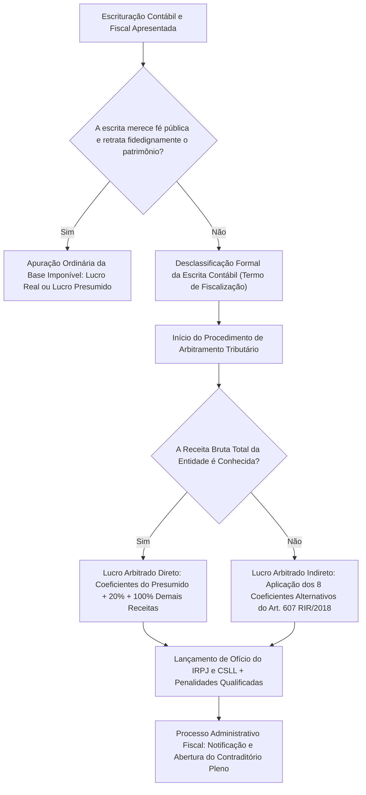
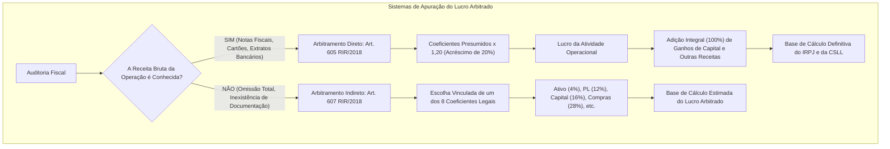
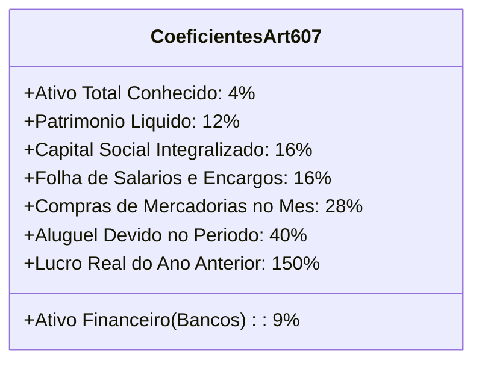
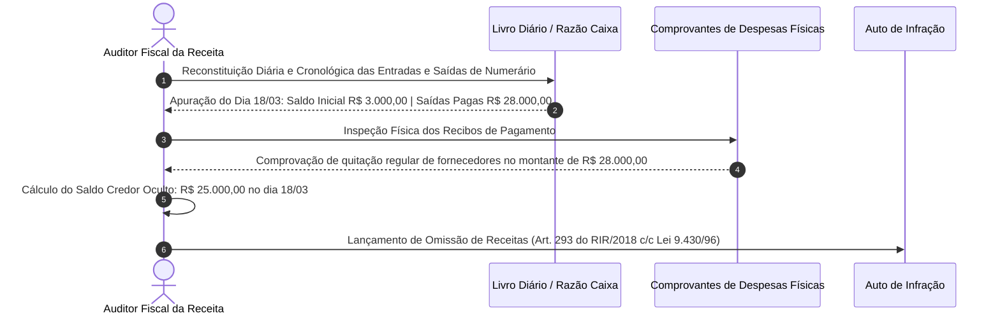
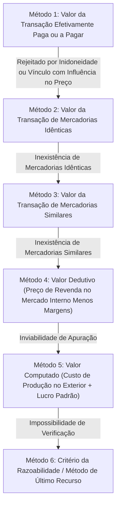
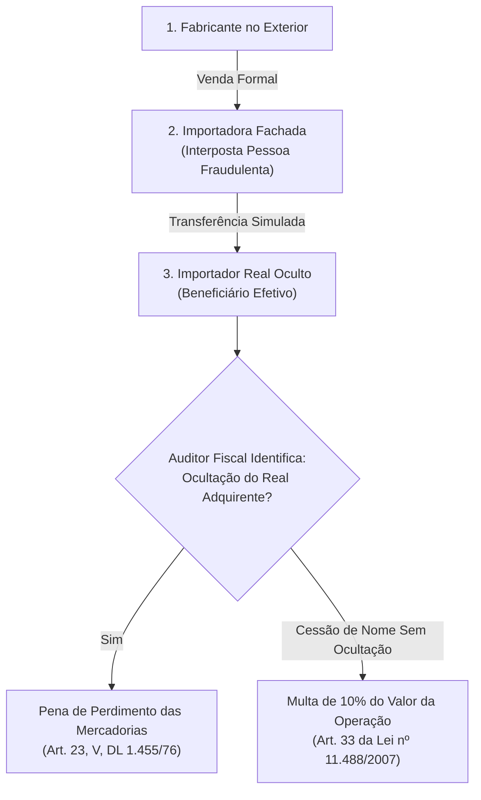
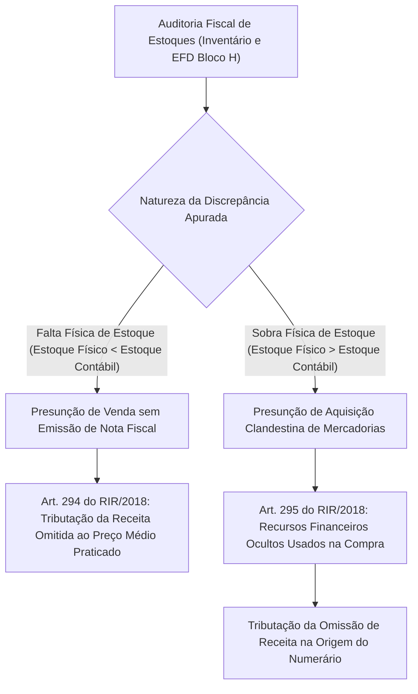
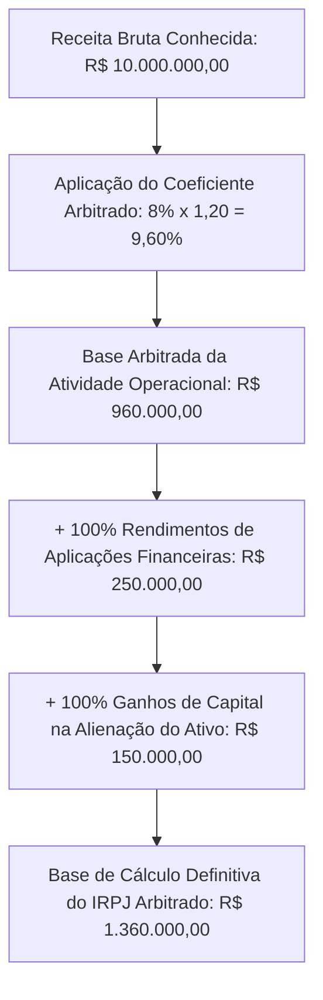

# Arbitramento de Lucro, Recomposição do Fluxo de Caixa e Auditoria de Comércio Exterior

---

## 1. Fundamentos Normativos e Natureza Jurídica do Arbitramento

O arbitramento da base de cálculo tributária é a técnica excepcional de lançamento fiscal de ofício em que a Administração Tributária, diante da impossibilidade fática de apuração direta por recusa, inexistência ou inidoneidade dos elementos documentais e contábeis apresentados pelo sujeito passivo, quantifica indiretamente a obrigação tributária.

No ordenamento jurídico brasileiro, a matriz fundante do arbitramento encontra-se esculpida no **art. 148 do Código Tributário Nacional (CTN)**:

$$
\text{Base Imponível Indireta} = f(\text{Sinais Exteriores de Riqueza, Padrões Setoriais, Dados Estatísticos e Contábeis Fidedignos})
$$

> **Art. 148 do CTN**: Quando o cálculo do tributo tenha por base, ou tome em consideração, o valor ou o preço de bens, direitos, serviços ou atos jurídicos, a autoridade lançadora, mediante regular processo administrativo, arbitrará aquele valor ou preço, sempre que sejam omissos ou não mereçam fé as declarações ou os esclarecimentos prestados, ou os documentos expedidos pelo sujeito passivo ou pelo terceiro legalmente obrigado, ressalvada, em caso de contestação, avaliação contraditória, administrativa ou judicial.



> [!IMPORTANT]
> **Natureza Jurídica: Aferição Indireta vs. Sanção Tributária**
> O arbitramento fiscal **não possui natureza jurídica de penalidade**, sanção política ou castigo ao infrator. Trata-se de modalidade de apuração subsidiária e de determinação da matéria tributável decorrente do princípio da indeclinabilidade da competência tributária e do dever constitucional de tributar conforme a capacidade contributiva real (art. 145, § 1º, da CF/88). Não é franqueado à fiscalização fixar bases punitivas arbitrárias; a autoridade lançadora está adstrita a critérios técnicos legais e motivados sob pena de nulidade absoluta do auto de infração por vício formal e material.

---

## 2. A Desclassificação da Escrita Contábil e a Teoria dos Vícios Relevantes

A desclassificação da escrituração não constitui faculdade discricionária do auditor fiscal, mas sim ato vinculado dependente de fundamentação fática e jurídica exaustiva. 

### 2.1. Princípio da Conservação da Escrita e Impropriedades Formais

A doutrina contábil e a jurisprudência pacificada do Conselho Administrativo de Recursos Fiscais (CARF) e do Superior Tribunal de Justiça (STJ) consagram o **Princípio da Conservação da Escrita Contábil**. 

Meros erros formais, atrasos pontuais de escrituração de livros secundários ou pequenas divergências de conciliação que possam ser elucidadas por perícia ou cotejamento com extratos bancários e notas fiscais **não autorizam** a desclassificação da contabilidade:

| Categoria do Vício | Impacto na Escrita | Efeito Fiscal Consequente | Jurisprudência de Referência |
| :--- | :--- | :--- | :--- |
| **Vício Meramente Formal** | Erros de digitação, inversão de contas secundárias, ausência de autenticação tempestiva na Junta Comercial. | **Manutenção da escrita**. Aplicação de penalidade acessória pecuniária, sem desclassificação do regime do Lucro Real. | Súmula CARF nº 32 e Jurisprudência STJ. |
| **Vício Relevante Insanável** | Suprimentos de caixa sem comprovação de origem, passivo fictício continuado, omissão sistemática de notas fiscais, contas correntes paralelas. | **Desclassificação formal e material**. Abertura de procedimento de arbitramento do lucro e lançamento de ofício. | Acórdão CARF 1402-001.782 e REsp 1.111.189/SP. |

> [!WARNING]
> **Requisito Procedimental Indispensável:** A autoridade fiscalizadora é obrigada a lavrar **Termo de Intimação** especificando detalhadamente as irregularidades encontradas e fixando prazo legal improrrogável (mínimo de 20 a 30 dias) para que o contribuinte preste esclarecimentos, exiba documentos de suporte ou proceda à recomposição dos registros. Somente após a inércia ou a insuficiência dos elementos apresentados é lícito lavrar o **Termo de Desclassificação da Escrita**.

---

## 3. Hipóteses Legais Taxativas de Arbitramento

O Regulamento do Imposto sobre a Renda (**RIR/2018 - Decreto nº 9.580/2018**, arts. 603 a 612), reproduzindo os mandamentos do art. 47 da Lei nº 8.981/1995 e das Leis nº 9.064/1995 e 9.430/1996, cataloga as circunstâncias autorizadoras do arbitramento:

### 3.1. Arbitramento de Ofício pelo Fisco (Art. 603 do RIR/2018)

O lucro da pessoa jurídica será arbitrado pela fiscalização nas seguintes situações taxativas:

1. **Inexistência de Escrituração Contábil Regular:** O contribuinte obrigado ao Lucro Real não mantiver livros fiscais e contábeis de acordo com a legislação comercial e fiscal (Livro Diário e Livro Razão), ou deixar de elaborar as demonstrações financeiras obrigatórias (Balanço Patrimonial, DRE, DMPL e DFC);
2. **Recusa Injustificada de Exibição dos Livros e Arquivos:** O sujeito passivo, notificado pelo Fisco, negar-se a exibir seus livros de escrituração, documentos fiscais ou arquivos digitais integrantes do Sistema Público de Escrituração Digital (SPED ECD e EFD), ou criar embaraço deliberado ao trabalho do auditor;
3. **Escrituração Contábil Imprestável (Vício Material Insanável):** Os registros mantidos apresentarem vícios, fraudes, incorreções ou deficiências estruturais que impeçam a identificação da efetiva movimentação financeira (incluindo depósitos bancários) ou inviabilizem a determinação fidedigna do Lucro Real;
4. **Falta de Manutenção ou Escrituração do LALUR / e-LALUR:** O contribuinte sujeito ao Lucro Real deixar de escriturar o Livro de Apuração do Lucro Real (LALUR físico ou e-LALUR no Bloco M da ECF);
5. **Opção Indevida pelo Lucro Presumido:** Pessoa jurídica impedida de optar pelo regime do Lucro Presumido (por auferir receita anual superior ao teto legal de R\$ 78 milhões, por ter atividade financeira, de factoring, ou por usufruir de incentivos de isenção/redução do imposto) recolher tributos com base no Lucro Presumido;
6. **Ausência de Escrituração no País de Filiais no Exterior:** A pessoa jurídica não mantiver no Brasil escrituração contábil em moeda nacional e língua portuguesa referente às operações praticadas por filial, agência ou sucursal no exterior;
7. **Ausência de Livro Caixa na Opção pelo Lucro Presumido:** Entidade optante pelo Lucro Presumido que decida não manter contabilidade mercantil completa, mas deixe de escriturar o Livro Caixa contendo todas as entradas, saídas e movimentações bancárias.

### 3.2. Arbitramento por Iniciativa do Próprio Contribuinte (Art. 604 do RIR/2018)

O direito tributário brasileiro agasalha a possibilidade de o próprio contribuinte adotar voluntariamente o Lucro Arbitrado:
- Ocorre precipuamente quando os livros contábeis forem destruídos, extraviados ou danificados por motivos de caso fortuito ou força maior (incêndios, inundações, desabamentos, ataques cibernéticos com destruição irrecuperável de servidores sem backup), desde que o evento seja comprovado perante a repartição fiscal e seja inviável a reconstituição da escrita contábil antes da data de vencimento da apuração trimestral.

---

## 4. Metodologia de Quantificação e Cálculo do Lucro Arbitrado

A quantificação do Lucro Arbitrado opera-se mediante dois modelos matemáticos excludentes, desenhados para atender ao grau de informação disponível no momento da ação fiscalizadora:



### 4.1. Método do Arbitramento com Receita Bruta Conhecida (Art. 605 do RIR/2018)

Quando a autoridade fiscal dispõe dos montantes de vendas, prestações de serviços ou receitas financeiras auferidas (apuradas por documentos fiscais autorizados, declarações fazendárias, EFDs, adquirentes de cartão de crédito via DIMP ou declarações de instituições financeiras via e-Financeira), os percentuais de presunção aplicáveis à receita bruta são os mesmos definidos para o **Lucro Presumido, acrescidos de 20% (vinte por cento)**:

$$
\text{Coeficiente Arbitrado} = \text{Coeficiente Lucro Presumido} \times 1,20
$$

| Segmento de Atividade Econômica | Coeficiente no Lucro Presumido | Multiplicador Legal | Coeficiente Efetivo no Lucro Arbitrado |
| :--- | :---: | :---: | :---: |
| Venda de mercadorias no comércio atacadista e varejista | 8,0% | $\times 1,20$ | **9,60%** |
| Atividades industriais em geral | 8,0% | $\times 1,20$ | **9,60%** |
| Revenda a varejo de combustíveis derivados de petróleo e GLP | 1,6% | $\times 1,20$ | **1,92%** |
| Serviços de transporte de cargas | 8,0% | $\times 1,20$ | **9,60%** |
| Serviços hospitalares e laboratoriais (atendidas as regras da Anvisa) | 8,0% | $\times 1,20$ | **9,60%** |
| Serviços de transporte coletivo de passageiros | 16,0% | $\times 1,20$ | **19,20%** |
| Prestação de serviços profissionais em geral (advocacia, engenharia, consultoria) | 32,0% | $\times 1,20$ | **38,40%** |
| Intermediação de negócios e agenciamento imobiliário | 32,0% | $\times 1,20$ | **38,40%** |
| Administração, locação ou cessão de bens imóveis e móveis | 32,0% | $\times 1,20$ | **38,40%** |
| Instituições financeiras, seguradoras e cooperativas de crédito | 45,0% | $\times 1,20$ | **54,00%** |

#### Adições Obrigatórias à Base de Cálculo:
Ao lucro apurado pela aplicação dos percentuais acima devem ser somados, em sua integralidade (**100% do valor auferido**, sem aplicação de qualquer coeficiente redutor):
1. Os ganhos de capital auferidos na alienação de bens do Ativo Não Circulante (Imobilizado e Investimentos);
2. Os rendimentos de aplicações financeiras de renda fixa e ganhos líquidos de renda variável;
3. As receitas de aluguéis e royalties;
4. As recuperações de créditos anteriormente baixados como perda;
5. Os juros sobre o capital próprio (JCP) auferidos.

### 4.2. Método do Arbitramento com Receita Bruta Desconhecida: Os 8 Coeficientes Alternativos (Art. 607 do RIR/2018)

Quando a ocultação de documentos ou o grau de fraude impede a identificação do faturamento do contribuinte, a legislação estabelece uma ordem alternativa e vinculada de coeficientes incidentes sobre variáveis patrimoniais ou operacionais aferíveis:



1. **0,04 (4%)** da soma dos valores do ativo circulante, realizável a longo prazo e permanente (imobilizado, intangível e investimentos) constantes do último balanço patrimonial conhecido;
2. **0,16 (16%)** do valor do capital social integralizado arquivado na Junta Comercial;
3. **0,12 (12%)** do patrimônio líquido do último balanço aprovado;
4. **0,28 (28%)** das compras de matérias-primas e mercadorias realizadas no mês;
5. **0,16 (16%)** do total das folhas de pagamento, retiradas de pró-labore e remuneração de autônomos pagas no mês;
6. **0,40 (40%)** do valor do aluguel devido no mês de apuração;
7. **1,50 (150%)** do lucro real apurado no último período de apuração conhecido, devidamente atualizado;
8. Para instituições financeiras: **0,09 (9%)** da soma do ativo circulante e realizável a longo prazo.

---

## 5. Recomposição Cronológica do Fluxo de Caixa e Auditoria de Disponibilidades

O fluxo financeiro retrata a circulação efetiva de liquidez na entidade. Em auditoria tributária, as distorções no fluxo de caixa constituem indícios materiais de operações não faturadas ou fraudes patrimoniais.

### 5.1. A Impossibilidade Fática do Caixa Negativo e a Presunção do Art. 293 do RIR/2018

A conta contábil "Caixa Geral" (moeda física mantida na tesouraria) rege-se pelo princípio de que **não existe saldo credor em conta de disponibilidade física**:

$$
\text{Saldo em Caixa}_t = \text{Saldo em Caixa}_{t-1} + \sum \text{Entradas Registradas}_t - \sum \text{Saídas Realizadas}_t \ge 0
$$

A ocorrência de saldo credor (descoberto) em qualquer data demonstra que saídas financeiras reais (pagamentos de fornecedores, salários, aluguéis) foram honradas com numerário que ingressou na empresa sem a correspondente emissão de nota fiscal ou registro contábil de receita.



### 5.2. A Manobra do Suprimento de Caixa de Sócios e Seus Requisitos Probatórios

Para ocultar saldos credores e justificar recursos não escriturados, contribuintes fraudulentos lançam com frequência créditos fictícios na conta Caixa sob a rubrica "Suprimento de Sócios" (Mútuo Passivo com Sócios):

```
DÉBITO:  Caixa Geral (Ativo Circulante)
CRÉDITO: Mútuo a Pagar - Sócios (Passivo Circulante)
```

O auditor fiscal desclassifica essa operação caso o sujeito passivo não comprove cumulativamente:
1. **Capacidade Financeira do Sócio:** Rendimentos tributáveis e bens declarados na DIRPF do sócio compatíveis com a magnitude do empréstimo aportado;
2. **Origem Bancária Identificada:** Comprovação documental de transferência bancária eletrônica originada da conta corrente pessoal do sócio diretamente para a conta da pessoa jurídica. A alegação de "entrega de dinheiro vivo" guardado em casa é reiteradamente rechaçada pela jurisprudência do CARF (Súmula CARF nº 107).

---

## 6. Auditoria Fiscal no Comércio Exterior: Subfaturamento, Superfaturamento e Interposição Fraudulenta

O comércio internacional exige rigoroso controle aduaneiro para salvaguardar a indústria nacional, a arrecadação tributária e a higidez do balanço de pagamentos.

### 6.1. Subfaturamento e Superfaturamento em Operações de Importação

| Dimensão de Análise | Subfaturamento | Superfaturamento |
| :--- | :--- | :--- |
| **Conceito Fático** | Declaração de valor aduaneiro inferior ao preço efetivamente pago ou acordado com o exportador estrangeiro. | Declaração de preço aduaneiro inflado, superior ao praticado no mercado internacional para bens idênticos ou similares. |
| **Finalidade Ilegítima** | Evasão tributária dos tributos devidos no desembaraço (Imposto de Importação, IPI-Importação, PIS/COFINS-Importação, ICMS-Importação). | Remessa ilícita de divisas ao exterior (fuga de capitais, lavagem de dinheiro ou superfaturamento em contratos públicos). |
| **Procedimento Fiscal de Apuração** | Rejeição do Método 1 do Acordo de Valoração Aduaneira (AVA-GATT). Aplicação dos métodos substitutivos e arbitramento da base de cálculo aduaneira. | Glosa de custos operacionais na apuração do Lucro Real e representação fiscal ao Banco Central e Ministério Público Federal (crime cambial). |
| **Penalidades Aplicáveis** | Cobrança dos tributos com multa qualificada de 100% a 150% (fraude/conluio) + multa por declaração inexata (art. 703 do Regulamento Aduaneiro). | Pena de perdimento da moeda remetida indevidamente e responsabilização penal (art. 22 da Lei nº 7.492/1986). |

### 6.2. Os 6 Métodos de Valoração Aduaneira (AVA-GATT / Decreto nº 6.759/2009)

O auditor fiscal deve observar a ordem estrita e sucessiva dos métodos do Acordo de Valoração Aduaneira da OMC:



> [!NOTE]
> **Inversão Facultativa:** Mediante requerimento formal do importador aprovado pela autoridade aduaneira, a ordem de aplicação entre o **Método 4 (Valor Dedutivo)** e o **Método 5 (Valor Computado)** pode ser invertida.

### 6.3. Interposição Fraudulenta de Terceiros e Pena de Perdimento

A interposição fraudulenta ocorre quando a importação é realizada por intermédio de pessoa jurídica interposta ("laranja" ou importador de fachada), com o objetivo de ocultar o real encomendante, adquirente ou financiador das operações:



#### Distinção Crítica para Concursos Fiscais:
1. **Interposição Fraudulenta Presumida (Pena de Perdimento):** Ocorre quando não há comprovação da origem, disponibilidade e efetiva transferência dos recursos empregados na operação de comércio exterior (art. 23, § 2º, do Decreto-Lei nº 1.455/1976). Presume-se a interposição fraudulenta por ocultação absoluta do sujeito passivo real, ensejando a **pena de perdimento** das mercadorias.
2. **Interposição Fraudulenta Comprovada sem Prejuízo Cambial (Multa de 10%):** Ocorre quando o sujeito passivo é ocultado, mas há demonstração da lisura financeira ou quando a mercadoria já foi consumida/alienada, aplicando-se a **multa administrativa de 10%** sobre o valor da operação com base no art. 33 da Lei nº 10.637/2002.

---

## 7. Jurisprudência Vinculante e Precedentes Paradigmáticos (STJ e CARF)

A aplicação do arbitramento da base de cálculo e a recomposição do fluxo de caixa encontram limites rígidos e balizas probatórias na jurisprudência do Superior Tribunal de Justiça (STJ) e da Câmara Superior de Recursos Fiscais (CSRF) do CARF:

### 7.1. Súmulas e Enunciados Fundamentais do CARF

| Número do Enunciado | Teor do Enunciado Sumular | Impacto Direto na Prática da Auditoria Fiscal |
| :--- | :--- | :--- |
| **Súmula CARF nº 26** | A simples constatação de passivo fictício autoriza a presunção legal de omissão de receitas, cabendo ao contribuinte o ônus de comprovar a efetiva liquidação da obrigação. | Inverte o ônus da prova em favor do Fisco: detectada a dívida inexistente ou quitada sem trânsito contábil, a omissão de receita resta juridicamente consumada. |
| **Súmula CARF nº 32** | A desclassificação da escrituração com base em meras falhas formais que não impeçam a apuração do Lucro Real é nula. | Veda o arbitramento quando os vícios forem periféricos e a escrita contábil permitir a identificação das receitas e despesas essenciais. |
| **Súmula CARF nº 107** | O suprimento de caixa por recursos de sócios exige a comprovação da efetiva disponibilidade econômico-financeira do titular e a comprovação da transferência bancária originária. | Rejeita peremptoriamente alegações de aportes de "recursos guardados em espécie" desprovidos de lastro bancário prévio na pessoa física. |
| **Súmula CARF nº 140** | A presunção de omissão de receita decorrente de saldo credor de caixa não se elide pela apresentação de livros contábeis retificados posteriormente à lavratura do termo de início de fiscalização. | Inibe a manobra de reabertura contábil post factum para fabricar empréstimos ou receitas artificiais após a intimação fiscalizadora. |
| **Súmula CARF nº 164** | Para fins de arbitramento da base de cálculo do IRPJ com base na receita bruta conhecida, é vedada a dedução de créditos de prejuízos fiscais não controlados na Parte B do LALUR. | O contribuinte submetido ao lucro arbitrado perde o direito à dedução ordinária de prejuízos fiscais de exercícios pretéritos na apuração do imposto. |

### 7.2. O Tema Repetitivo do STJ sobre Arbitramento Tributário

O Superior Tribunal de Justiça, no julgamento do **Tema 1.013/STJ** e em remansosa jurisprudência da Primeira Seção:
- Fixou que o arbitramento com base no art. 148 do CTN é procedimento excepcional e subsidiário;
- Determinou que a Administração Fazendária não pode recorrer ao arbitramento por mera comodidade ou celeridade processual;
- Estabeleceu que, se o contribuinte mantiver documentação fiscal eletrônica que permita a apuração direta da base tributável, o arbitramento padece de vício insanável de legalidade material, acarretando a anulação do auto de infração.

---

## 8. Auditoria de Estoques e Arbitramento do Custo das Mercadorias Vendidas (CMV)

Em entidades comerciais e industriais, a sonegação de receitas costuma manifestar-se por meio de distorções patrimoniais na conta Mercadorias/Estoques.

### 8.1. A Equação Fundamental de Estoques e as Presunções Legais

A auditoria fiscal de estoques utiliza o modelo de reconstituição quantitativa e física de mercadorias:

$$
\text{Estoque Final Físico-Financeiro} = \text{Estoque Inicial} + \text{Entradas no Período} - \text{Saídas do Período}
$$

A constatação de discrepâncias entre o inventário físico apurado pelo auditor e o estoque escriturado no Bloco H da EFD acarreta duas presunções legais complementares:



1. **Falta de Mercadorias no Inventário Físico:** Se o estoque físico apurado in loco for inferior ao saldo contábil escriturado no Livro Registro de Inventário (EFD Bloco H), presume-se que a mercadoria faltante foi alienada e entregue a adquirentes sem emissão de documento fiscal (venda sem nota). A base tributável é calculada multiplicando-se a quantidade faltante pelo maior preço unitário de venda praticado no período.
2. **Sobra de Mercadorias no Inventário Físico:** Se o auditor constatar mercadorias físicas no estabelecimento em quantidade superior à escriturada nos livros fiscais, presume-se que as mercadorias foram adquiridas no mercado clandestino sem nota fiscal de entrada. A saída de numerário necessária para honrar a compra não declarada presume-se oriunda de faturamento prévio omitido da tributação.

---

## 9. Estudo de Caso Prático Numérico de Auditoria Fiscal

### Cenário de Fiscalização: Indústria Metalúrgica Forja Sul S.A.
- **Regime Declarado pelo Contribuinte:** Lucro Real Trimestral.
- **Constatações da Equipe Fiscal durante o 1º Trimestre:**
  1. Omissão de escrituração no e-LALUR (Bloco M da ECF) referente a adições compulsórias de despesas indedutíveis de R\$ 400.000,00;
  2. Apresentação de contas correntes bancárias não registradas na contabilidade ("Caixa Dois");
  3. Desclassificação formal da escrita contábil lavrada mediante Termo Fiscal motivado;
  4. **Receita Bruta Total Aferida via Notas Fiscais Eletrônicas autorizadas (NF-e):** R\$ 10.000.000,00;
  5. Rendimentos de aplicações financeiras de renda fixa comprovados via e-Financeira: R\$ 250.000,00;
  6. Ganho de capital líquido auferido na venda de uma prensa industrial usada: R\$ 150.000,00.

### Resolução e Memória de Cálculo do Lucro Arbitrado:



#### Passo 1: Determinação da Base Operacional Arbitrada
$$
\text{Lucro Arbitrado Operacional} = R\$\ 10.000.000,00 \times (8\% \times 1,20) = R\$\ 10.000.000,00 \times 9,60\% = R\$\ 960.000,00
$$

#### Passo 2: Adição Integral das Demais Receitas e Ganhos de Capital
$$
\text{Base de Cálculo Total do IRPJ} = R\$\ 960.000,00 + R\$\ 250.000,00 + R\$\ 150.000,00 = R\$\ 1.360.000,00
$$

#### Passo 3: Apuração do IRPJ Devido
1. **Alíquota Básica (15%):**
   $$
   \text{IRPJ Básico} = R\$\ 1.360.000,00 \times 15\% = R\$\ 204.000,00
   $$
2. **Adicional do IRPJ (10% sobre o montante que exceder R\$ 60.000,00 no trimestre):**
   $$
   \text{Excedente Trimestral} = R\$\ 1.360.000,00 - R\$\ 60.000,00 = R\$\ 1.300.000,00
   $$
   $$
   \text{Adicional do IRPJ} = R\$\ 1.300.000,00 \times 10\% = R\$\ 130.000,00
   $$
3. **IRPJ Total Lançado de Ofício:**
   $$
   \text{IRPJ Total} = R\$\ 204.000,00 + R\$\ 130.000,00 = R\$\ 334.000,00
   $$

#### Passo 4: Apuração da Contribuição Social sobre o Lucro Líquido (CSLL)
- Coeficiente base para indústria na CSLL: $12\% \times 1,20 = 14,40\%$.
- Base operacional CSLL: $R\$\ 10.000.000,00 \times 14,40\% = R\$\ 1.440.000,00$.
- Base total CSLL: $R\$\ 1.440.000,00 + R\$\ 250.000,00 + R\$\ 150.000,00 = R\$\ 1.840.000,00$.
- CSLL devida (alíquota geral de 9%):
  $$
  \text{CSLL Devida} = R\$\ 1.840.000,00 \times 9\% = R\$\ 165.600,00
  $$

---

## 10. Mnemônicos & Âncoras Cognitivas

> [!TIP]
> **Mnemônico: As 4 Bases Mais Cobradas do Art. 607 RIR/2018 (`AC-PL-CAP-COMP`)**
> - **Ativo Circulante + RLP + Permanente:** `0,04` (4%) $\rightarrow$ *"Ativo Quatro"*
> - **Patrimônio Líquido:** `0,12` (12%) $\rightarrow$ *"PL é Dúzia"*
> - **Capital Social Integralizado:** `0,16` (16%) $\rightarrow$ *"Capital e Folha empatam nos 16"*
> - **Folha de Salários / Autônomos:** `0,16` (16%)
> - **Compras de Mercadorias no Mês:** `0,28` (28%) $\rightarrow$ *"Compras saltam para 28"*

> [!TIP]
> **Mnemônico da Receita Conhecida: `Presumido x 1,2`**
> - Não decore dezenas de tabelas separadas. Pegue o percentual clássico do Lucro Presumido e multiplique por **$1,2$**:
>   - Comércio / Indústria: $8\% \times 1,2 = 9,6\%$
>   - Combustíveis: $1,6\% \times 1,2 = 1,92\%$
>   - Serviços em Geral: $32\% \times 1,2 = 38,4\%$
> - Lembre-se: Ganhos de capital e receitas financeiras entram com **100%**, sem redutor!

---

## 11. Bateria de Questões Oficiais Comentadas (QConcursos)

### Questão 01 — [FGV — SEFAZ-AM / Auditor Fiscal de Tributos Estaduais — 2022]
**Identificador QC:** [Q2288322](https://www.qconcursos.com/questoes-de-concursos/questoes/c5cf679f-77)  
**Enunciado:** O arbitramento do lucro aplica‑se quando:
- (A) a escrituração apresentar indícios de impropriedades formais.
- (B) houver opção pelo lucro presumido, sendo possível a apuração do resultado pelo lucro real.
- (C) o contribuinte adotar escrituração resumida nos livros principais.
- (D) houver opção indevida pelo lucro presumido.
- (E) os lançamentos da escrituração fiscal estiverem destacados em livros auxiliares.

> **Gabarito Comentado: Alternativa D**
> - **Alternativa D (CORRETA):** O art. 603, inciso V, do RIR/2018 e o art. 47 da Lei nº 8.981/95 dispõem taxativamente que a opção indevida pelo lucro presumido por contribuinte legalmente obrigado ao lucro real (ex.: entidade com receita anual superior a R\$ 78 milhões ou pertencente ao setor financeiro) autoriza o arbitramento do lucro de ofício pela fiscalização.
> - **Alternativa A (INCORRETA):** Impropriedades meramente formais que não impeçam a apuração do resultado contábil não ensejam a desclassificação da escrita nem o arbitramento, aplicando-se o princípio da conservação da escrita contábil (Súmula CARF nº 32).
> - **Alternativa B (INCORRETA):** A opção pelo lucro presumido é facultada à pessoa jurídica que preencha os requisitos legais; a mera viabilidade de apuração pelo lucro real não acarreta desclassificação ou arbitramento.
> - **Alternativa C (INCORRETA):** A escrituração resumida do Diário com apoio em livros auxiliares analíticos é expressamente respaldada pelo Código Civil (art. 1.184) e pelas normas do CFC.
> - **Alternativa E (INCORRETA):** O destaque de registros fiscais em livros auxiliares atende à boa técnica contábil e à legislação de regência.

---

### Questão 02 — [FCC — SEFAZ-SP / Agente Fiscal de Rendas — 2013]
**Identificador QC:** [Q154757](https://www.qconcursos.com/questoes-de-concursos/questoes/b2fe79b2-ad)  
**Enunciado:** Ao ocorrer o arbitramento do lucro, qualquer que seja a hipótese dentre as previstas no Regulamento do Imposto de Renda, e sendo conhecida a Receita Bruta da companhia, que opera exclusivamente no comércio atacadista de gêneros alimentícios, o percentual a ser aplicado sobre essa receita bruta para determinação do lucro arbitrado do período é de:
- (A) 1,6%.
- (B) 8,0%.
- (C) 9,6%.
- (D) 12,0%.
- (E) 38,4%.

> **Gabarito Comentado: Alternativa C**
> - **Alternativa C (CORRETA):** Para o comércio atacadista, a alíquota base de presunção é de 8,0%. Conforme o art. 605 do RIR/2018, sendo conhecida a receita bruta da pessoa jurídica, o lucro arbitrado corresponderá à aplicação dos coeficientes do Lucro Presumido acrescidos de vinte por cento:
>   $$\text{Coeficiente Arbitrado} = 8,0\% \times 1,20 = 9,60\%$$
> - **Alternativa A (INCORRETA):** 1,6% é o coeficiente do lucro presumido para revenda de combustíveis.
> - **Alternativa B (INCORRETA):** 8,0% é o percentual do lucro presumido comum, sem a incidência do adicional legal obrigatório de 20%.
> - **Alternativa D (INCORRETA):** 12,0% é o percentual básico da CSLL no lucro presumido para comércio.
> - **Alternativa E (INCORRETA):** 38,4% é a alíquota de lucro arbitrado com receita conhecida aplicável à prestação de serviços ($32\% \times 1,20$).

---

### Questão 03 — [CESPE / CEBRASPE — SEFAZ-CE / Auditor Fiscal da Receita Estadual — 2021]
**Identificador QC:** [Q2238267](https://www.qconcursos.com/questoes-de-concursos/questoes/9b6bb79b-3b)  
**Enunciado:** Tomando por base a legislação do imposto de renda (IR) das pessoas jurídicas, julgue o item seguinte:  
*O arbitramento do lucro da pessoa jurídica é prerrogativa exclusiva da autoridade fiscal lançadora, sendo expressamente vedado ao contribuinte tributar-se pelo lucro arbitrado por iniciativa própria, sob pena de nulidade absoluta da apuração.*
- ( ) Certo
- ( ) Errado

> **Gabarito Comentado: Errado**
> - **Justificativa:** O item está **ERRADO**. O art. 604 do RIR/2018 prevê expressamente que o contribuinte poderá efetuar o pagamento do imposto com base no lucro arbitrado por iniciativa própria quando, estando sujeito à tributação com base no lucro real, não mantiver escrituração na forma das leis fiscais ou comerciais, ou quando ocorrer a perda, extravio ou destruição de seus livros e documentos decorrente de caso fortuito ou força maior que impeça a reconstituição dos registros antes do vencimento do tributo.

---

### Questão 04 — [FCC — SEFAZ-AP / Auditor Fiscal da Receita Estadual — 2022]
**Identificador QC:** [Q91439](https://www.qconcursos.com/questoes-de-concursos/questoes/4ed03665-68)  
**Enunciado:** O arbitramento do lucro para fins de cálculo do imposto de renda pode ser feito pela autoridade fiscal ou pela própria empresa, sendo, nessa última hipótese, cabível quando:
- (A) a empresa tiver faturamento anual superior ao limite do regime de tributação simplificada (Simples Nacional).
- (B) a empresa mantiver escrituração regular no LALUR, mas tiver prejuízos fiscais recorrentes.
- (C) o contribuinte, obrigado à tributação pelo lucro real, deixar de elaborar a escrituração na forma das leis comerciais e fiscais.
- (D) a autoridade fiscal conceder autorização judicial prévia específica para adoção do método.
- (E) a empresa prestar serviços e desejar equiparar seus custos aos da atividade comercial.

> **Gabarito Comentado: Alternativa C**
> - **Alternativa C (CORRETA):** Reproduz com exatidão a literalidade do art. 604 do RIR/2018 (art. 47 da Lei nº 8.981/95), autorizando o arbitramento pelo contribuinte quando este deixar de manter ou elaborar a escrituração na forma da lei.
> - **Alternativa A (INCORRETA):** Ultrapassado o limite do Simples (R\$ 4,8 milhões), a entidade deve migrar para o Lucro Presumido ou Lucro Real.
> - **Alternativa B (INCORRETA):** Prejuízos fiscais recorrentes apurados com escrituração regular no LALUR geram direito à compensação com lucros futuros (trava dos 30%), não ensejando arbitramento.
> - **Alternativa D (INCORRETA):** Não existe exigência de autorização judicial prévia no direito tributário material brasileiro para a apuração por lucro arbitrado.
> - **Alternativa E (INCORRETA):** Equiparação de serviços a comércio depende de requisitos objetivos de natureza da atividade (ex.: serviços hospitalares), não tendo relação com o Lucro Arbitrado.

---

### Questão 05 — [VUNESP — Prefeitura de Marília - SP / Auditor Fiscal Tributário — 2021]
**Identificador QC:** [Q3601816](https://www.qconcursos.com/questoes-de-concursos/questoes/63df061e-92)  
**Enunciado:** Realizada a verificação de determinado Contribuinte inscrito no cadastro fiscal do Município e identificada a omissão contábil e a ausência reiterada de emissão de notas fiscais, a Autoridade Fiscal utilizou o instituto do arbitramento da base de cálculo do ISSQN. Sobre o arbitramento no direito tributário brasileiro, nos termos do art. 148 do CTN:
- (A) decorre do poder discricionário pleno do auditor, sem necessidade de motivação em processo administrativo.
- (B) tem natureza estritamente punitiva, operando como penalidade ao sonegador.
- (C) somente pode ser efetuado mediante autorização prévia deferida pelo Poder Judiciário.
- (D) é modalidade subsidiária de apuração tributária aplicável quando forem omissos ou não mereçam fé os documentos do contribuinte, assegurado o contraditório.
- (E) restringe-se a tributos federais incidentes sobre o patrimônio e a renda.

> **Gabarito Comentado: Alternativa D**
> - **Alternativa D (CORRETA):** O art. 148 do CTN consagra a natureza subsidiária e excepcional do arbitramento, exigindo processo administrativo regular que garanta o contraditório e a ampla defesa, e que comprove a omissão ou a falta de idoneidade dos documentos do contribuinte.
> - **Alternativa A (INCORRETA):** O lançamento por arbitramento é ato vinculado; a ausência de processo administrativo motivado enseja nulidade insanável.
> - **Alternativa B (INCORRETA):** O arbitramento é instrumento de determinação da base tributária segundo a capacidade contributiva, não constituindo sanção ou pena.
> - **Alternativa C (INCORRETA):** Trata-se de procedimento administrativo de competência privativa da autoridade fiscal tributária, sem reserva de jurisdição judicial para sua deflagração.
> - **Alternativa E (INCORRETA):** O art. 148 do CTN é norma geral cogente aplicável a impostos e taxas em todos os níveis federativos (União, Estados, DF e Municípios).

---

### Questão 06 — [CESPE / CEBRASPE — SEFAZ-RR / Auditor Fiscal de Tributos Estaduais — 2023]
**Identificador QC:** [Q635292](https://www.qconcursos.com/questoes-de-concursos/questoes/8c0a375c-15)  
**Enunciado:** Analise as assertivas abaixo relativas à tributação das pessoas jurídicas:  
I. O Imposto de Renda Pessoa Jurídica possui base de cálculo diferente para cada método de tributação (lucro real, lucro presumido ou arbitramento), sendo incidente a mesma alíquota geral básica de 15%.  
II. O contribuinte tem livre escolha do método de tributação do IRPJ entre lucro real, presumido e arbitrado, independentemente do ramo de atividade ou volume de faturamento.  
III. A Autoridade Fiscal possui prerrogativa de proceder ao arbitramento do lucro quando não dispuser de elementos fidedignos nos registros contábeis do contribuinte.  
IV. O IRPJ é tributo originariamente sujeito a lançamento por homologação, cabendo lançamento de ofício na hipótese de omissão ou declaração a menor.  
Estão corretas apenas as assertivas:
- (A) I e III.
- (B) II e IV.
- (C) I, III e IV.
- (D) III e IV.
- (E) II, III e IV.

> **Gabarito Comentado: Alternativa C**
> - **Análise Pormenorizada dos Itens:**
>   - **Item I (CORRETO):** A alíquota geral básica do IRPJ no Brasil é de 15% para todos os regimes tributários (Real, Presumido ou Arbitrado), acrescida de adicional de 10% sobre a parcela do lucro que exceder R\$ 20.000,00 por mês (R\$ 60.000,00 no trimestre).
>   - **Item II (INCORRETO):** Não existe livre escolha absoluta. A Lei nº 9.718/1998 e o RIR/2018 obrigam certas categorias ao regime do Lucro Real (receita anual superior a R\$ 78 milhões, instituições financeiras, factorings, entidades com receitas no exterior).
>   - **Item III (CORRETO):** O art. 148 do CTN e os arts. 603 a 612 do RIR/2018 autorizam a apuração por arbitramento de ofício quando a contabilidade for inidônea ou omissa.
>   - **Item IV (CORRETO):** O IRPJ submete-se ao modelo do art. 150 do CTN (lançamento por homologação), surgindo o lançamento de ofício (art. 149 do CTN) quando há infração à legislação tributária.

---

### Questão 07 — [ESAF — Receita Federal do Brasil / Auditor-Fiscal da Receita Federal — 2014]
**Identificador QC:** [Q380324](https://www.qconcursos.com/questoes-de-concursos/questoes/776548b6-dc)  
**Enunciado:** Em procedimento de auditoria fiscal em comércio exterior, o Auditor-Fiscal constatou que uma empresa importadora realizou operação de importação de maquinários industriais, com saída de mercadorias no exterior faturadas por empresa sediada em paraíso fiscal, apurando-se que o verdadeiro financiador e adquirente dos bens era terceiro não declarado nos registros aduaneiros (Siscomex). Configurada a interposição fraudulenta de terceiros sem a comprovação da origem dos recursos empregados, a penalidade prevista na legislação aduaneira federal (Decreto-Lei nº 1.455/1976) é:
- (A) advertência com prazo de 30 dias para regularização cambial.
- (B) pena de perdimento das mercadorias importadas.
- (C) multa punitiva simples de 2% do valor aduaneiro.
- (D) suspensão da habilitação dos despachantes aduaneiros pelo prazo improrrogável de um ano.
- (E) arbitramento compulsório do lucro presumido para fins de IPI.

> **Gabarito Comentado: Alternativa B**
> - **Alternativa B (CORRETA):** O art. 23, inciso V, do Decreto-Lei nº 1.455/1976 (redação da Lei nº 10.637/2002) tipifica a interposição fraudulenta de terceiros como dano ao erário punível com a **pena de perdimento** das mercadorias, sempre que não for comprovada a origem dos recursos utilizados na transação de importação.
> - **Alternativas A, C, D e E (INCORRETAS):** A proteção do controle aduaneiro federal comina a perda definitiva da propriedade dos bens importados fraudulentamente, sanção incomparavelmente mais severa que advertências ou multas de baixo percentual.

---

### Questão 08 — [FGV — Receita Federal do Brasil / Auditor-Fiscal da Receita Federal — 2023]
**Identificador QC:** [Q1921779](https://www.qconcursos.com/questoes-de-concursos/questoes/01ef4f8b-e6)  
**Enunciado:** No que concerne aos regimes de tributação do imposto sobre a renda das pessoas jurídicas, assinale a opção correta a respeito do Lucro Arbitrado:
- (A) A base de cálculo do lucro arbitrado para empresas comerciais, quando conhecida a receita bruta, é de 8%, idêntica à do lucro presumido.
- (B) Os rendimentos auferidos em aplicações financeiras de renda fixa são tributados à alíquota de presunção de 32% antes de sua integração à base de cálculo.
- (C) Na determinação do lucro arbitrado, quando a receita bruta não for conhecida, a autoridade fiscal poderá utilizar como parâmetro 16% do capital social integralizado.
- (D) As deduções de incentivos fiscais sobre o imposto devido aplicam-se em patamar dobrado no regime de lucro arbitrado para evitar enriquecimento ilícito do Estado.
- (E) O arbitramento do lucro extingue a responsabilidade tributária dos administradores da pessoa jurídica no tocante a crimes tributários.

> **Gabarito Comentado: Alternativa C**
> - **Alternativa C (CORRETA):** O art. 607, inciso II, do RIR/2018 estipula que, sendo desconhecida a receita bruta, o lucro arbitrado poderá ser determinado à razão de 16% (dezesseis centésimos) do valor do capital social integralizado constante do último registro arquivado no órgão competente (Junta Comercial).
> - **Alternativa A (INCORRETA):** Sendo conhecida a receita bruta, aplica-se o percentual do lucro presumido acrescido de 20%, resultando em 9,60% ($8\% \times 1,20$).
> - **Alternativa B (INCORRETA):** Os rendimentos auferidos em aplicações financeiras não sofrem redução por presunção: entram na base de cálculo em sua totalidade (100%).
> - **Alternativas D e E (INCORRETAS):** Não há incentivos fiscais dobrados no lucro arbitrado, nem extinção de punibilidade em crimes contra a ordem tributária (Lei nº 8.137/1990).

---

### Questão 09 — [FCC — SEFAZ-BA / Auditor Fiscal — 2019]
**Identificador QC:** [Q22723](https://www.qconcursos.com/questoes-de-concursos/questoes/25f4ec9e-f6)  
**Enunciado:** A legislação do imposto de renda estabelece que a base de cálculo do imposto é o lucro real, presumido ou arbitrado, correspondente ao período de apuração. Quando a pessoa jurídica tiver sua receita bruta conhecida e apurar o imposto com base no lucro arbitrado, a determinação do lucro arbitrado:
- (A) utilizará as alíquotas do lucro presumido sem qualquer modificação ou acréscimo.
- (B) aplicará sobre a receita bruta os coeficientes de presunção do lucro presumido acrescidos de 20%.
- (C) utilizará coeficientes fixados discricionariamente pelo auditor fiscal entre o mínimo de 10% e o máximo de 50%.
- (D) exigirá a concordância prévia e expressa do Ministério Público Federal.
- (E) impedirá o cômputo de quaisquer adições referentes a ganhos de capital auferidos pela entidade.

> **Gabarito Comentado: Alternativa B**
> - **Alternativa B (CORRETA):** Conforme mandamento expresso do art. 47 da Lei nº 8.981/1995 e art. 605 do RIR/2018, conhecendo-se a receita bruta auferida, o lucro arbitrado é apurado mediante a aplicação dos percentuais de presunção do Lucro Presumido acrescidos de 20% (vinte por cento).
> - **Alternativas A, C, D e E (INCORRETAS):** Sem o adicional de 20% teríamos o Lucro Presumido; não há fixação discricionária do auditor; não há intervenção do MPF no lançamento tributário; os ganhos de capital devem ser adicionados integralmente (100%).

---

### Questão 10 — [VUNESP — SEFAZ-SP / Julgador Tributário — 2014]
**Identificador QC:** [Q3600965](https://www.qconcursos.com/questoes-de-concursos/questoes/40169410-92)  
**Enunciado:** Na legislação tributária brasileira existem duas modalidades de quantificação para o arbitramento do lucro das pessoas jurídicas: com base na receita bruta conhecida ou com base em coeficientes sobre elementos patrimoniais/operacionais quando a receita for desconhecida. Caso a empresa exerça a atividade de prestação de serviços de consultoria contábil e de auditoria, e sua receita bruta tenha sido apurada em R\$ 2.000.000,00 no trimestre, o lucro arbitrado correspondente à receita operacional será de:
- (A) R\$ 160.000,00.
- (B) R\$ 192.000,00.
- (C) R\$ 640.000,00.
- (D) R\$ 768.000,00.
- (E) R\$ 900.000,00.

> **Gabarito Comentado: Alternativa D**
> - **Alternativa D (CORRETA):** A atividade de serviços profissionais (consultoria e auditoria) submete-se ao percentual base de 32% no Lucro Presumido. No Lucro Arbitrado com receita conhecida, o coeficiente é majorado em 20%:
>   $$\text{Coeficiente Arbitrado} = 32\% \times 1,20 = 38,40\%$$
>   $$\text{Lucro Arbitrado Operacional} = R\$\ 2.000.000,00 \times 38,40\% = R\$\ 768.000,00$$
> - **Alternativas A, B, C e E (INCORRETAS):** R\$ 160.000,00 seria 8% (comércio presumido); R\$ 192.000,00 seria 9,6% (comércio arbitrado); R\$ 640.000,00 seria 32% (serviços presumido sem o acréscimo legal).

---

### Questão 11 — [FGV — SEFAZ-MG / Auditor Fiscal da Receita Estadual — 2023]
**Identificador QC:** [Q287277](https://www.qconcursos.com/questoes-de-concursos/questoes/9cd67948-55)  
**Enunciado:** Em relação à tributação sobre o resultado das pessoas jurídicas e ao instituto do arbitramento do lucro, assinale a afirmativa correta:
- (A) À pessoa jurídica sujeita à apuração da CSLL com base no resultado arbitrado em determinado ano-calendário é vedada a utilização do percentual de presunção majorado em 20%.
- (B) O arbitramento do lucro desonera o sujeito passivo da retenção de tributos na fonte sobre pagamentos efetuados a prestadores de serviços.
- (C) Ocorrida a hipótese de arbitramento do lucro por desclassificação da escrita contábil, os lucros e dividendos distribuídos aos sócios que excederem o valor da base arbitrada líquida do imposto submetem-se à tributação com base na tabela progressiva do IRPF.
- (D) A tributação pelo lucro arbitrado dispensa a autoridade fiscal da comprovação da materialidade da ocorrência dos fatos geradores.
- (E) O arbitramento promovido de ofício pelo Fisco afasta em definitivo a incidência de multas de mora e de ofício sobre o crédito lançado.

> **Gabarito Comentado: Alternativa C**
> - **Alternativa C (CORRETA):** Conforme art. 141 da IN RFB nº 1.700/2017 e jurisprudência vinculante, no caso de Lucro Arbitrado, são isentos do IRPF apenas os lucros e dividendos distribuídos até o limite do valor do lucro arbitrado diminuído dos tributos federais devidos (IRPJ, CSLL, PIS e COFINS). Os valores distribuídos em excesso que não puderem ser comprovados por escrituração contábil regular ficam sujeitos à incidência do imposto na fonte conforme a tabela progressiva do IRPF (ou alíquota exclusiva de 35% caso configurados pagamentos sem causa ou a beneficiários não identificados).
> - **Alternativa A (INCORRETA):** A CSLL também adota percentuais majorados na sistemática do lucro arbitrado.
> - **Alternativa B (INCORRETA):** A condição de contribuinte no lucro arbitrado em nada altera o dever instrumental e a responsabilidade de retenção na fonte como fonte pagadora (art. 45 do CTN).
> - **Alternativas D e E (INCORRETAS):** O Fisco é sempre adstrito ao ônus de demonstrar o fato gerador e o lançamento de ofício impõe a aplicação de multa de ofício de 75% a 150%.

---

### Questão 12 — [FCC — SEFAZ-PE / Auditor Fiscal do Tesouro Estadual — 2014]
**Identificador QC:** [Q1659503](https://www.qconcursos.com/questoes-de-concursos/questoes/e7d3a2e5-4c)  
**Enunciado:** Em procedimento fiscalizatório de auditoria tributária estadual, a fiscalização apurou que uma sociedade comercial apresentava saldo credor sistemático em sua conta "Caixa Geral" durante o exercício de 2023, bem como suprimentos de caixa efetuados por sócios sem o trânsito dos recursos em contas bancárias formais. Diante desses fatos, a autoridade fiscal:
- (A) deve desconsiderar tais fatos por se tratarem de meras infrações societárias de competência privativa da Junta Comercial.
- (B) deve presumir a omissão de receitas operacionais tributáveis, efetuando o lançamento de ofício do imposto devido acrescido das penalidades legais cabíveis.
- (C) somente poderá arbitrar o imposto se houver confissão espontânea do administrador da empresa perante o Cartório de Títulos e Documentos.
- (D) fica impedida de cobrar o imposto se o contribuinte apresentar termo de compromisso de ajuste contábil para o exercício financeiro subsequente.
- (E) deve aguardar a decretação de falência ou recuperação judicial da sociedade para habilitar o crédito tributário como quirografário.

> **Gabarito Comentado: Alternativa B**
> - **Alternativa B (CORRETA):** O saldo credor de caixa e os suprimentos fictícios de sócios sem comprovação de origem bancária configuram presunções legais absolutas e relativas de omissão de receita tributável (art. 293 do RIR/2018 e legislações estaduais do ICMS), determinando o lançamento de ofício com aplicação de multas punitivas qualificadas.
> - **Alternativas A, C, D e E (INCORRETAS):** O saldo credor de caixa é ilícito tributário grave que atinge a arrecadação; prescinde de confissão e de autorização judicial, sendo o lançamento de ofício dever vinculado e cogente da autoridade administrativa tributária (art. 142 do CTN).

