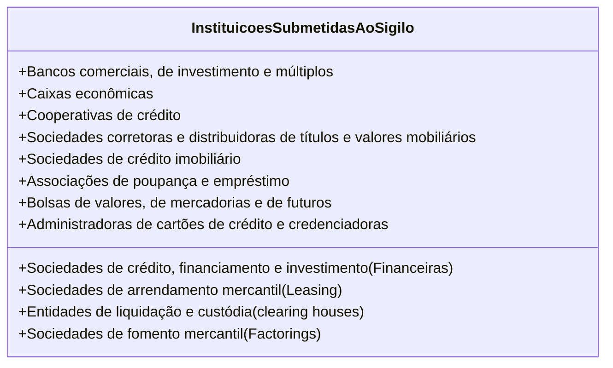
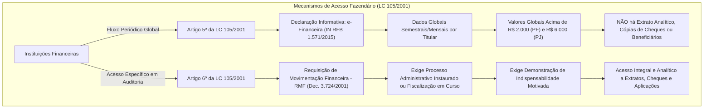
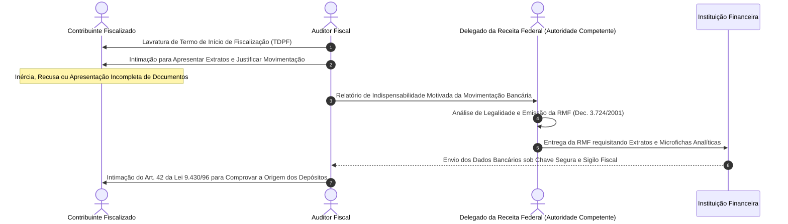
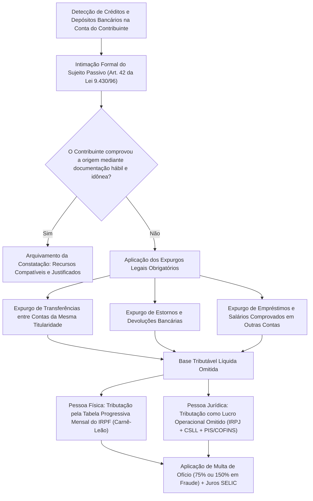
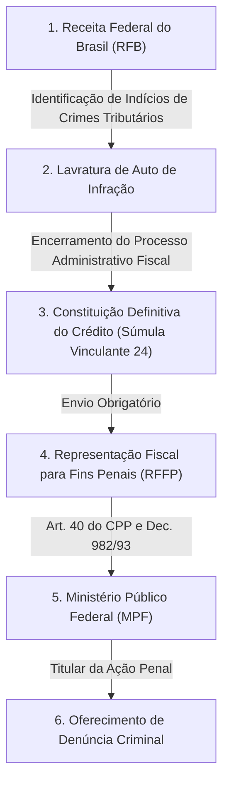
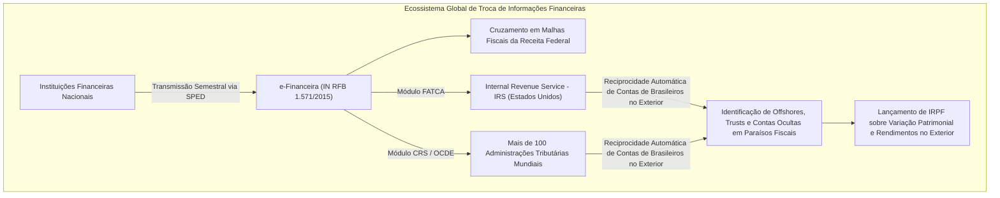
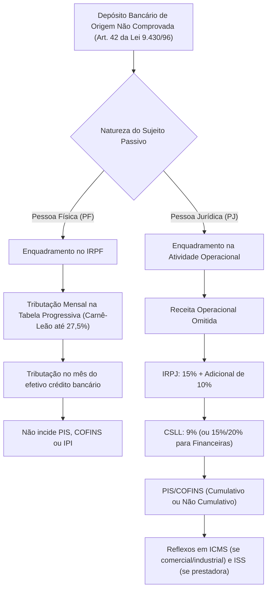

# Sigilo Bancário, Sigilo Fiscal e Presunções Decorrentes de Movimentação Financeira (LC nº 105/2001 e Art. 42 da Lei nº 9.430/1996)

---

## 1. Fundamentos Constitucionais: Intimidade Financeira vs. Dever Fundamental de Pagar Tributos

O acesso da Administração Tributária aos dados de movimentação bancária dos contribuintes representa uma das interseções mais complexas entre os direitos fundamentais de primeira geração e os poderes instrumentais do Estado Fiscal.

De um lado, a Constituição Federal de 1988 resguarda a intimidade, a vida privada e o sigilo de dados:

> **Art. 5º, inciso X, da CF/88**: São invioláveis a intimidade, a vida privada, a honra e a imagem das pessoas, assegurado o direito a indenização pelo dano material ou moral decorrente de sua violação.  
> **Art. 5º, inciso XII, da CF/88**: É inviolável o sigilo da correspondência e das comunicações telegráficas, de dados e das comunicações telefônicas, salvo, no último caso, por ordem judicial, nas hipóteses e na forma que a lei estabelecer para fins de investigação criminal ou instrução processual penal.

De outro lado, a própria Carta Magna impõe como princípio estruturante da ordem tributária a efetivação da capacidade contributiva e a fiscalização patrimonial:

> **Art. 145, § 1º, da CF/88**: Sempre que possível, os impostos terão caráter pessoal e serão graduados segundo a capacidade econômica do contribuinte, facultado à administração tributária, especialmente para conferir efetividade a esses objetivos, identificar, respeitados os direitos individuais e nos termos da lei, o patrimônio, os rendimentos e as atividades econômicas do contribuinte.

```mermaid
flowchart TD
    subgraph "Conflito Aparente de Normas Constitucionais"
        A["Art. 5º, X e XII CF/88: Intimidade e Sigilo de Dados"] vs B["Art. 145, § 1º CF/88: Capacidade Contributiva e Fiscalização"]
    end
    
    A & B --> C["Julgamento Histórico do STF: RE 601.314 / Tema 225 e ADIs 2.390, 2.386, 2.397, 2.859"]
    C --> D["Tese da Transferência de Sigilo: Não há Quebra, mas Transferência de Dever de Sigilo do Banco para o Fisco"]
    D --> E["Art. 6º da LC nº 105/2001 é Plenamente CONSTITUCIONAL"]
    E --> F["Proteção Reforçada: O Fisco responde pelo Sigilo Fiscal do Art. 198 do CTN sob pena de Crime Funcional"]
```

> [!IMPORTANT]
> **Tese Vinculante do STF (Tema 225 - RE 601.314):**
> O Supremo Tribunal Federal pacificou que o art. 6º da Lei Complementar nº 105/2001 **não ofende o direito ao sigilo bancário**, pois realiza a **mera transferência de sigilo** da instituição financeira para a Administração Fazendária, que mantém o dever de custódia e preservação do sigilo fiscal sob rigorosa responsabilidade funcional e administrativa (art. 198 do CTN c/c art. 325 do Código Penal). Não há exigência constitucional de prévia autorização judicial para que a fiscalização tributária tenha acesso aos extratos e documentos bancários, desde que cumpridos os requisitos procedimentais da lei complementar.

---

## 2. A Arquitetura da Lei Complementar nº 105/2001

A **Lei Complementar nº 105/2001** disciplina de forma exaustiva o regime de sigilo das operações de instituições financeiras no território nacional:

### 2.1. Entidades Sujeitas ao Dever de Sigilo (Art. 1º, § 1º)

O dever de sigilo bancário não recai exclusivamente sobre os bancos comerciais tradicionais, alcançando um rol amplo de agentes do Sistema Financeiro Nacional:



### 2.2. Hipóteses que Não Constituem Violação do Dever de Sigilo (Art. 1º, § 3º)

A própria LC nº 105/2001 discrimina as hipóteses em que a transmissão de dados financeiros é juridicamente legítima e **não configura quebra ilícita de sigilo**:

1. **Informações Cadastrais:** O fornecimento de dados cadastrais (nome, CPF/CNPJ, endereço, qualificação dos titulares e representantes legais de contas de depósitos);
2. **Troca de Informações Interbancárias:** A comunicação recíproca entre instituições financeiras de dados sobre cheques sem fundos, inadimplemento de obrigações creditícias e histórico cadastral de risco;
3. **Comunicações ao COAF (UIF):** O envio obrigatório ao Conselho de Controle de Atividades Financeiras de relatórios sobre movimentações atípicas em espécie ou operações suspeitas de crimes de lavagem de capitais (Lei nº 9.613/1998);
4. **Revelação com Autorização Expressa:** A divulgação de dados bancários quando autorizada expressamente pelo próprio titular da conta;
5. **Atuação do Banco Central e da CVM:** O repasse de dados regulatórios e de fiscalização ao BACEN e à Comissão de Valores Mobiliários no exercício de suas competências estritas;
6. **Prestação de Informações Globais à Receita Federal:** A remessa de dados consolidados sem identificação individualizada de lançamentos na forma do art. 5º da LC 105/01.

---

## 3. Os Dois Canais Distintos de Acesso Fazendário: Art. 5º vs. Art. 6º da LC 105/2001

A compreensão da disciplina do sigilo bancário exige a separação nítida dos dois mecanismos operacionais previstos na Lei Complementar nº 105/2001:



### Quadro Comparativo: Artigo 5º vs. Artigo 6º

| Critério de Comparação | Canal Informativo Global (Artigo 5º) | Canal Fiscalizatório Direto (Artigo 6º) |
| :--- | :--- | :--- |
| **Finalidade Operacional** | Alimentação dos sistemas de malha fina e inteligência fiscal. | Instrução probatória de procedimento de auditoria tributária. |
| **Instrumento Regulamentar** | Declaração eletrônica periódica (**e-Financeira**, antiga DIMOF). | **Requisição de Movimentação Financeira (RMF)**. |
| **Natureza dos Dados Acessados** | Montantes globais creditados e debitados no período, sem detalhamento de transações individuais. | Extratos bancários analíticos, microfilmes de cheques, contratos de câmbio e demonstrativos detalhados de investimentos. |
| **Exigência de Fiscalização em Curso?** | **NÃO**. Envio automático e obrigatório por parte das instituições financeiras. | **SIM**. Exige formalmente processo instaurado ou fiscalização em curso (TDPF). |
| **Necessidade de Motivação Especial?** | **NÃO**. Decorre de obrigação tributária acessória legal e geral. | **SIM**. Exige despacho fundamentado de indispensabilidade emitido por autoridade competente. |
| **Gatilhos Regulamentares** | Operações superiores a R\$ 2.000,00/mês para pessoas físicas e R\$ 6.000,00/mês para pessoas jurídicas. | Indícios materiais de omissão de receita, fraude ou incapacidade patrimonial. |

---

## 4. Requisitos Procedimentais Cumulativos do Artigo 6º da LC 105/2001 (A RMF)

Para que a Administração Fazendária requisite e acerte o exame de livros, registros e extratos mantidos por instituições financeiras sem autorização judicial, o **artigo 6º da LC nº 105/2001** e o **Decreto Federal nº 3.724/2001** exigem o atendimento rigoroso de **requisitos cumulativos**:

$$
\text{Validade da RMF} = (\text{Procedimento Fiscal Formal em Curso}) \land (\text{Indispensabilidade Motivada}) \land (\text{Autoridade Competente}) \land (\text{Notificação Prévia})
$$



### 4.1. Análise Pormenorizada dos 4 Requisitos de Validade:

1. **Existência de Procedimento Fiscal em Curso:** Deve haver prévia instauração de procedimento administrativo formal, materializado pelo Termo de Distribuição do Procedimento Fiscal (TDPF) ou ordem de serviço específica notificada ao contribuinte. É vedada a requisição exploratória ou prospectiva sem fiscalização formalmente deflagrada ("fishing expedition").
2. **Indispensabilidade Comprovada:** O auditor fiscal deve comprovar a imprescindibilidade dos extratos bancários, demonstrando que os elementos contábeis apresentados pelo sujeito passivo são omissos, contraditórios ou insuficientes para apurar a base tributável.
3. **Competência da Autoridade Emitente:** A RMF não pode ser expedida diretamente pelo auditor fiscal de campo; sua emissão é ato privativo da autoridade administrativa tributária competente (no âmbito federal: Delegados da Receita Federal do Brasil, Inspetores-Chefes e Coordenadores-Gerais).
4. **Notificação Prévia do Contribuinte:** Conforme pacificado pelo Superior Tribunal de Justiça e consagrado no Decreto nº 3.724/2001, a fiscalização deve previamente intimar o sujeito passivo para que este exiba voluntariamente as informações bancárias. Apenas diante de sua recusa injustificada, inércia ou prestação inverídica expedir-se-á a RMF ao banco.

---

## 5. Aplicação do Artigo 6º aos Fiscos Estaduais e Municipais

No julgamento conjunto das ADIs 2.390, 2.386, 2.397 e 2.859 e do RE 601.314, o Supremo Tribunal Federal assentou expressamente que:

> [!NOTE]
> **Extensão aos Estados, Distrito Federal e Municípios:**
> O acesso direto aos dados bancários previsto no art. 6º da LC nº 105/2001 **é aplicável a todas as esferas federativas**, permitindo que Auditores Fiscais de Fazendas Estaduais (ICMS) e Municipais (ISSQN) requisitem extratos e registros bancários.
> Contudo, para que o ente subnacional possa exercer validamente essa prerrogativa, é **obrigatória a edição prévia de lei ou decreto local regulamentador** que reproduza garantias de sigilo, dever de motivação, reserva de autoridade expedidora e controle correcional equivalentes aos parâmetros do Decreto Federal nº 3.724/2001. A ausência de decreto regulamentador local contamina de nulidade o acesso bancário promovido por Estado ou Município.

---

## 6. Depósitos Bancários de Origem Não Comprovada (Art. 42 da Lei nº 9.430/1996)

O **artigo 42 da Lei nº 9.430/1996** institui uma das presunções legais mais poderosas e recorrentes em auditoria fiscal:

$$
\text{Receita Omitida Presumida} = \sum \text{Créditos Bancários sem Origem Comprovada} - \sum \text{Expurgos Legais Obrigatórios}
$$

> **Art. 42 da Lei nº 9.430/1996**: Caracterizam-se também omissão de receita ou de rendimento os valores creditados em conta de depósito ou de investimento mantida junto a instituição financeira, em relação aos quais o titular, pessoa física ou jurídica, regularmente intimado, não comprove, mediante documentação hábil e idônea, a origem dos recursos utilizados nessas operações.



### 6.1. Regras Operacionais de Expurgo Obrigatório

A autoridade fiscal é legalmente obrigada a realizar o saneamento da conta bancária antes de lavrar o auto de infração, expurgando:
1. **Transferências entre Mesma Titularidade:** Valores transferidos de uma conta corrente para outra conta mantida pelo mesmo titular (inclusive em instituições financeiras distintas);
2. **Estornos Bancários:** Erros operacionais da instituição financeira corrigidos no mesmo período;
3. **Resgates de Aplicações Financeiras:** Ingressos que correspondam à mera liquidação de aplicações de renda fixa ou fundos do próprio contribuinte;
4. **Rendimentos Já Tributados ou Isentos Comprovados:** Salários com retenção na fonte, dividendos recebidos regularmente, indenizações isentas por lei.

### 6.2. Contas Conjuntas e Interpostas Pessoas ("Laranjas")

- **Contas Bancárias Conjuntas (Solidárias):** Havendo dois ou mais titulares na conta bancária, a fiscalização deve intimar todos os cotitulares para justificar a origem. Caso nenhum comprove individualmente o aporte, a base imponível omitida presume-se rateada em **partes iguais** entre os titulares (art. 42, § 6º, da Lei 9.430/96).
- **Contas de Titularidade de Interpostas Pessoas:** Comprovado que o contribuinte é o real titular dos recursos transitados em conta bancária aberta em nome de terceiros ("laranjas"), o titular de fato responderá pela integralidade do tributo e penalidades, respondendo o titular formal como responsável solidário (art. 124, I, do CTN c/c art. 42, § 5º, da Lei 9.430/96).

---

## 7. Sigilo Fiscal (Art. 198 do CTN) e o Compartilhamento de Provas com o Ministério Público (Tema 990 do STF)

O sigilo fiscal impõe à Administração Fazendária o dever imperativo de proteger as informações econômico-patrimoniais do sujeito passivo:

> **Art. 198 do CTN**: Sem prejuízo do disposto na legislação criminal, é vedada a divulgação, por parte da Fazenda Pública ou de seus servidores, de informação obtida em razão do ofício sobre a situação econômica ou financeira do sujeito passivo ou de terceiros e sobre a natureza e o estado de seus negócios ou atividades.

### 7.1. Exceções Legais ao Sigilo Fiscal (Art. 198, §§ 1º e 3º)

O próprio CTN elenca as situações em que a divulgação ou o compartilhamento de dados não ofende a lei:
1. **Requisição de autoridade judiciária** no interesse da justiça;
2. **Solicitações de autoridade administrativa** no interesse da Administração Pública, desde que comprovada a instauração regular de processo administrativo no órgão solicitante com o objetivo de investigar infração disciplinar ou funcional;
3. **Divulgação de inscrições em Dívida Ativa** da Fazenda Pública;
4. **Divulgação de parcelamentos** concedidos ou incentivos/renúncias fiscais usufruídos;
5. **Permuta de informações entre Fiscos** da União, Estados, DF e Municípios (art. 199 do CTN).

### 7.2. A Tese do Tema 990 do STF (Compartilhamento com o Ministério Público)

No paradigmático julgamento do **RE 1.055.941 / Tema 990 de Repercussão Geral**, o plenário do Supremo Tribunal Federal fixou a seguinte tese de eficácia vinculante:



> [!IMPORTANT]
> **Tese do Tema 990 do STF:**
> 1. É **constitucional o compartilhamento** dos relatórios de inteligência financeira da UIF (COAF) e da **íntegra do procedimento fiscalizatório** da Receita Federal do Brasil (que define o lançamento do tributo) com os órgãos de persecução penal (Ministério Público e Polícia Judiciária), **sem a obrigatoriedade de prévia autorização judicial**.
> 2. O repasse das informações deve ocorrer por meio de comunicações formais e canais seguros, permanecendo o Ministério Público submetido ao dever absoluto de sigilo sobre os dados recebidos.

---

## 8. A e-Financeira e o Intercâmbio Internacional de Informações Tributárias (FATCA e CRS/OCDE)

A concretização tecnológica do art. 5º da LC nº 105/2001 materializa-se na **e-Financeira**, instituída pela **Instrução Normativa RFB nº 1.571/2015**, integrada ao ecossistema do SPED.



### 8.1. Parâmetros de Obrigatoriedade e Limites de Envio

As entidades financeiras, seguradoras, entidades de previdência complementar e administradoras de consórcios são legalmente obrigadas a reportar à Receita Federal todas as operações de clientes que atinjam os seguintes gatilhos globais acumulados no mês:

| Categoria do Titular | Limite Global Mensal de Movimentação Financeira | Periodicidade de Transmissão ao SPED |
| :--- | :---: | :---: |
| **Pessoa Física (PF)** | Superior a **R\$ 2.000,00** por mês | Semestral (fevereiro e agosto) |
| **Pessoa Jurídica (PJ)** | Superior a **R\$ 6.000,00** por mês | Semestral (fevereiro e agosto) |
| **Contas Reportáveis no Exterior (FATCA / CRS)** | Qualquer saldo ou movimentação (conforme tratados bilaterais) | Anual / Conforme calendário internacional |

> [!TIP]
> **Natureza dos Dados da e-Financeira:** A e-Financeira informa o saldo no último dia do mês e o somatório dos créditos e débitos ocorridos ao longo do mês. **Não há remessa de extratos diários, nem nomes de favorecidos ou cópias de cheques**. Essa preservação do conteúdo individualizado é o núcleo de fundamentação que levou o STF a declarar a higidez constitucional da sistemática.

---

## 9. Roteiro Metodológico do Auditor Fiscal na Auditoria Bancária

O exame de movimentações financeiras em sede de procedimento fiscal obedece a uma trilha analítica rigorosa:

### 9.1. Passo a Passo da Fiscalização:

1. **Intimação Preliminar para Apresentação Voluntária:** Notifica-se o sujeito passivo para que apresente, no prazo improrrogável de 20 a 30 dias, seus extratos bancários de todas as contas mantidas em território nacional ou no exterior, acompanhados da respectiva conciliação com o Livro Diário/Razão;
2. **Cotejamento com a Escrituração Contábil (ECD/Diário):** Verifica-se se todas as contas bancárias ativas constam do plano de contas e do balanço patrimonial. A existência de contas bancárias ativas no CPF/CNPJ que não tenham sido escrituradas no Ativo Circulante configura indício veemente de caixa paralelo ("Caixa Dois");
3. **Emissão da RMF em Caso de Recusa:** Inerte ou recalcitrante o contribuinte, a fiscalização lavra Despacho Fundamentado de Indispensabilidade, submetendo-o ao Delegado da Receita Federal ou autoridade estadual/municipal competente para expedição da RMF às instituições bancárias;
4. **Depuração e Saneamento dos Extratos Analíticos:** Recebidos os dados em formato eletrônico padronizado, o auditor processa os lançamentos por meio de sistemas automatizados (ex.: sistema ÁGILE ou HARPIA da RFB), aplicando os expurgos legais obrigatórios (transferências de mesma titularidade, estornos e créditos comprovados);
5. **Intimação do Art. 42 da Lei nº 9.430/1996:** O auditor emite notificação discriminando cada um dos depósitos não justificados, concedendo prazo de 30 dias para comprovação documental da origem dos recursos.

---

## 10. Diferenciação Tributária: Aplicação do Art. 42 em Pessoas Físicas vs. Pessoas Jurídicas

A incidência tributária decorrente da presunção de depósitos não justificados desdobra-se em consequências específicas a depender da natureza do sujeito passivo:



---

## 11. Mnemônicos & Âncoras Cognitivas

> [!TIP]
> **Mnemônico da RMF: `P-I-A-N` (Requisitos de Validade do Art. 6º da LC 105/01)**
> Para que o auditor fiscal acerte o acesso direto aos extratos bancários sem ordem judicial, memorize a palavra **PIAN**:
> - **P** $\rightarrow$ **P**rocesso administrativo prévio formalmente instaurado (TDPF em curso);
> - **I** $\rightarrow$ **I**ndispensabilidade formalmente fundamentada em despacho;
> - **A** $\rightarrow$ **A**utoridade administrativa superior competente (Delegado/Secretário);
> - **N** $\rightarrow$ **N**otificação prévia do contribuinte para apresentação voluntária.

> [!TIP]
> **Mnemônico: `Artigo 5º é Geral, Artigo 6º é Pontual`**
> - **Art. 5º:** *Informações Gerais, Periódicas e Globais* (e-Financeira: acima de R\$ 2.000 para PF e R\$ 6.000 para PJ; sem quebra individual).
> - **Art. 6º:** *Procedimento Pontual, Concreto e Analítico* (RMF: extrato na mão, cópia de cheque, durante fiscalização instaurada).

---

## 12. Bateria de Questões Oficiais Comentadas (QConcursos)

### [Questão 01](https://www.qconcursos.com/questoes-de-concursos/questoes/dde2b7ce-c6) — [FEPESE — Prefeitura de Criciúma - SC / Auditor Fiscal da Receita Municipal — 2024]

No cruzamento de informações fiscais com dados financeiros, os agentes fiscais tributários dos Municípios podem acessar registros bancários do contribuinte, mas esse acesso está sujeito a condições legais. Assim, tais agentes somente poderão examinar documentos, livros e registros de instituições financeiras, inclusive os referentes a contas de depósitos e aplicações financeiras, quando houver _______ ou procedimento fiscal em curso e tais exames sejam considerados _______ pela autoridade administrativa competente.  
Assinale a alternativa que preenche CORRETAMENTE as lacunas, na ordem em que aparecem:
* **A)** processo administrativo instaurado — indispensáveis
* **B)** prévia autorização judicial específica — indispensáveis
* **C)** processo administrativo instaurado — pertinentes
* **D)** prévia autorização judicial específica — pertinentes
* **E)** inscrição do débito em dívida ativa — indispensáveis

#### Gabarito e Dissecação Técnica: **Alternativa A**

* **Alternativa A (CORRETA):** O art. 6º da Lei Complementar nº 105/2001 estabelece expressamente: *"As autoridades e os agentes fiscais tributários da União, dos Estados, do Distrito Federal e dos Municípios somente poderão examinar documentos, livros e registros de instituições financeiras, inclusive os referentes a contas de depósitos e aplicações financeiras, quando houver **processo administrativo instaurado** ou procedimento fiscal em curso e tais exames sejam considerados **indispensáveis** pela autoridade administrativa competente."*
- **Alternativas B e D (INCORRETAS):** Conforme fixado pelo STF no Tema 225, o art. 6º não exige autorização judicial prévia, tratando-se de transferência legal de sigilo.
* **Alternativa C (INCORRETA):** A lei exige que os exames sejam "indispensáveis", e não meramente "pertinentes".
* **Alternativa E (INCORRETA):** A inscrição em dívida ativa é fase posterior ao encerramento do processo administrativo de lançamento, e não condição para o exame de dados na fase de fiscalização.

> **Fique Ligado:** O art.

---

### [Questão 02](https://www.qconcursos.com/questoes-de-concursos/questoes/31ddf815-7f) — [CESPE / CEBRASPE — Polícia Federal / Perito Criminal Federal — 2021]

Em relação aos crimes contra a ordem tributária, bem como ao sigilo fiscal, julgue o seguinte item, considerando o entendimento do STF:  
*O compartilhamento com o Ministério Público de relatórios de inteligência financeira elaborados pela Unidade de Inteligência Financeira (UIF) e de procedimentos fiscais da Receita Federal do Brasil que contenham dados bancários obtidos com base na Lei Complementar nº 105/2001 depende de prévia e indispensável autorização judicial, sob pena de ilicitude probatória por quebra inconstitucional de sigilo de dados.*
- ( ) Certo
- ( ) Errado

#### Gabarito e Dissecação Técnica: **Alternativa A**

- **Justificativa:** O item está frontalmente **ERRADO**. O Plenário do STF, ao fixar tese no **Tema 990 de Repercussão Geral (RE 1.055.941)**, assentou que é constitucional e legítimo o compartilhamento de relatórios da UIF (COAF) e da íntegra de procedimentos fiscais instaurados pela Receita Federal com os órgãos de persecução penal (Ministério Público e Polícia Judiciária) **sem necessidade de prévia autorização judicial**. A remessa de tais elementos fundamenta-se no dever de cooperação interinstitucional e no dever de prestar Representação Fiscal para Fins Penais (art. 83 da Lei nº 9.430/1996).

> **Fique Ligado:** A assertiva correta consagra o dispositivo normativo estrito aplicável à matéria avaliada.

---

### [Questão 03](https://www.qconcursos.com/questoes-de-concursos/questoes/4a84b7e6-26) — [FGV — SEFAZ-MG / Auditor Fiscal da Receita Estadual — 2023]

De acordo com a Lei Complementar nº 105/2001, que dispõe sobre o sigilo das operações de instituições financeiras:  
I. Constitui quebra ilegal de sigilo o fornecimento de informações cadastrais dos titulares de contas bancárias por parte dos bancos às autoridades fiscais.  
II. As instituições financeiras prestarão informações periódicas à administração tributária da União sobre as operações financeiras efetuadas pelos usuários de seus serviços, na forma de regulamento.  
III. O acesso a registros bancários pelas autoridades fiscais estaduais exige processo administrativo instaurado e indispensabilidade motivada.  
Estão corretas apenas as assertivas:
* **A)** I e II.
* **B)** II e III.
* **C)** I e III.
* **D)** I, II e III.
* **E)** apenas a III.

#### Gabarito e Dissecação Técnica: **Alternativa B**

- **Análise das Assertivas:**
- **Item I (INCORRETO):** O art. 1º, § 3º, inciso I, da LC 105/2001 preceitua que o fornecimento de dados cadastrais **não constitui violação do dever de sigilo**.
- **Item II (CORRETO):** Expressa a previsão do art. 5º da LC 105/2001 (operacionalizado pela e-Financeira).
- **Item III (CORRETO):** O art. 6º da LC 105/2001 estende expressamente aos agentes tributários estaduais e municipais o poder de exame de contas sob as condições de processo instaurado e indispensabilidade fundamentada.

> **Fique Ligado:** A assertiva correta consagra o dispositivo normativo estrito aplicável à matéria avaliada.

---

### [Questão 04](https://www.qconcursos.com/questoes-de-concursos/questoes/d71082ba-ec) — [FCC — SEFAZ-SC / Auditor Fiscal da Receita Estadual — 2018]

De acordo com a Lei Complementar nº 105/2001, **NÃO** constitui violação do dever de sigilo das instituições financeiras:
* **A)** a divulgação pública irrestrita na imprensa de relatórios de auditoria contábil interna contendo dados patrimoniais de clientes correntistas.
* **B)** o compartilhamento de saldos bancários individuais de correntistas com empresas privadas de publicidade comercial sem autorização contratual.
* **C)** a revelação de informações sigilosas com o consentimento expresso e formal dos respectivos titulares das contas.
* **D)** o envio de extratos bancários de pessoas físicas a diretórios municipais de partidos políticos para fins de conferência eleitoral.
* **E)** a disponibilização de microfilmes de cheques compensados a sindicatos de classe representativos da categoria do titular.

#### Gabarito e Dissecação Técnica: **Alternativa C**

* **Alternativa C (CORRETA):** O art. 1º, § 3º, inciso V, da LC nº 105/2001 ressalva de forma explícita que não constitui violação do dever de sigilo a revelação de informações confidenciais com o **consentimento expresso dos interessados**.
- **Alternativas A, B, D e E (INCORRETAS):** Todas essas hipóteses configuram quebra ilícita e criminosa de sigilo bancário, sujeitando os responsáveis às sanções de reclusão de um a quatro anos e multa (art. 10 da LC 105/2001).

> **Fique Ligado:** O art.

---

### [Questão 05](https://www.qconcursos.com/questoes-de-concursos/questoes/70c8a6d9-8a) — [VUNESP — SEFAZ-SP / Julgador Tributário — 2014]

Sobre o sigilo das operações de instituições financeiras previsto na Lei Complementar nº 105/2001 e a jurisprudência vinculante das Cortes Superiores, é correto afirmar:
* **A)** As comissões parlamentares de inquérito municipais (CPIs das Câmaras de Vereadores) detêm poderes constitucionais plenos para decretar a quebra do sigilo bancário de contribuintes municipais.
* **B)** O sigilo bancário possui natureza absoluta na ordem constitucional, não cedendo espaço nem mesmo mediante mandado judicial em processo criminal.
* **C)** As autoridades fiscais da União, dos Estados, do DF e dos Municípios podem examinar diretamente registros de instituições financeiras mediante prévia instauração de procedimento fiscal e declaração motivada de indispensabilidade da medida.
* **D)** As cooperativas de crédito e as administradoras de cartão de crédito estão dispensadas de observar o sigilo disciplinado pela LC nº 105/2001 por não possuírem natureza de bancos universais.
* **E)** O fornecimento de dados consolidados sem identificação dos titulares na forma do art. 5º da lei complementar exige aprovação colegiada do Congresso Nacional.

#### Gabarito e Dissecação Técnica: **Alternativa C**

* **Alternativa C (CORRETA):** Literalidade do art. 6º da LC nº 105/2001, cuja validade para todos os entes federados foi confirmada pelo STF no Tema 225.
* **Alternativa A (INCORRETA):** A jurisprudência pacificada do STF estabelece que CPIs municipais **não possuem** poderes instrutórios próprios de autoridades judiciais para quebrar sigilo bancário (art. 58, § 3º, da CF/88 aplica-se apenas a CPIs federais e estaduais).
* **Alternativa B (INCORRETA):** No ordenamento pátrio inexistem direitos fundamentais de caráter absoluto.
* **Alternativa D (INCORRETA):** O art. 1º, § 1º, inclui expressamente as cooperativas de crédito e administradoras de cartão no dever de sigilo.
* **Alternativa E (INCORRETA):** O envio de dados do art. 5º decorre de decreto regulamentador do Poder Executivo, prescindindo de autorização legislativa casuística.

> **Fique Ligado:** Literalidade do art.

---

### [Questão 06](https://www.qconcursos.com/questoes-de-concursos/questoes/4f20483f-91) — [CESPE / CEBRASPE — SEFAZ-AL / Auditor Fiscal da Receita Estadual — 2020]

A respeito do sigilo bancário e fiscal na ordem jurídica brasileira, assinale a opção correta:
* **A)** O auditor fiscal que divulga em rede social documentos bancários sigilosos apreendidos durante fiscalização comete mera infração administrativa leve.
* **B)** A remessa regular de informações de movimentações bancárias globais pelas instituições financeiras à Receita Federal, sem identificação de credores ou pagadores específicos, viola a garantia fundamental da intimidade.
* **C)** A quebra do sigilo das operações de instituições financeiras poderá ser decretada judicialmente em qualquer fase do inquérito policial ou do processo judicial, quando necessária para a apuração de ocorrência de qualquer ilícito penal.
* **D)** A prestação de dados sobre cheques sem fundos para serviços de proteção ao crédito configura quebra ilícita de sigilo financeiro.
* **E)** A responsabilidade pelo sigilo fiscal afasta-se integralmente quando os dados financeiros são compartilhados entre auditores fiscais do mesmo órgão fazendário.

#### Gabarito e Dissecação Técnica: **Alternativa C**

* **Alternativa C (CORRETA):** O art. 3º da LC nº 105/2001 dispõe que a quebra de sigilo poderá ser decretada pelo Poder Judiciário em qualquer fase do inquérito ou processo penal quando necessária para apuração de ilícitos penais tipificados em lei.
* **Alternativa A (INCORRETA):** Trata-se de crime tipificado no art. 10 da LC nº 105/2001 e art. 325 do Código Penal (violação de sigilo funcional), punível com reclusão e perda do cargo público.
* **Alternativa B (INCORRETA):** O STF no julgamento do art. 5º da LC 105/2001 reconheceu a plena constitucionalidade da sistemática da e-Financeira.
* **Alternativa D (INCORRETA):** Exceção expressa do art. 1º, § 3º, II, da LC 105/2001.
* **Alternativa E (INCORRETA):** O dever de sigilo permanece hígido e vincula todos os servidores que tenham acesso funcional aos dados.

> **Fique Ligado:** O art.

---

### [Questão 07](https://www.qconcursos.com/questoes-de-concursos/questoes/53c7a66f-91) — [ESAF — Receita Federal do Brasil / Auditor-Fiscal da Receita Federal — 2014]

Em relação à presunção legal de omissão de receitas decorrente de créditos bancários prevista no art. 42 da Lei nº 9.430/1996, é correto afirmar:
* **A)** Para a caracterização da omissão de receita com base em depósitos bancários, é desnecessária a intimação prévia do contribuinte, podendo o lançamento ser efetuado de plano.
* **B)** O contribuinte regularmente intimado deve comprovar a origem dos recursos creditados mediante documentação hábil e idônea, sob pena de incidência da presunção legal.
* **C)** Os valores transferidos entre contas correntes mantidas no mesmo banco ou em bancos distintos pelo mesmo titular integram compulsoriamente a base tributável como receita nova omitida.
* **D)** Em se tratando de conta conjunta com mais de um titular, a fiscalização deve cobrar o tributo integralmente do primeiro titular nominado na abertura da conta.
* **E)** A presunção do art. 42 da Lei nº 9.430/1996 aplica-se exclusivamente a pessoas jurídicas submetidas à apuração do imposto pelo regime do Lucro Real.

#### Gabarito e Dissecação Técnica: **Alternativa B**

* **Alternativa B (CORRETA):** Conforme art. 42 da Lei nº 9.430/1996, o cerne da presunção legal repousa no fato de o titular, **regularmente intimado**, não comprovar mediante documentação hábil e idônea a origem dos recursos creditados em suas contas de depósito ou investimento.
* **Alternativa A (INCORRETA):** A intimação formal prévia é elemento constitutivo indispensável da infração; sua ausência enseja nulidade absoluta do lançamento.
* **Alternativa C (INCORRETA):** Transferências entre contas da mesma titularidade devem ser expurgadas da base de cálculo.
* **Alternativa D (INCORRETA):** Em contas conjuntas sem comprovação individualizada de titularidade dos recursos, a apuração divide-se em partes iguais entre os correntistas (art. 42, § 6º).
* **Alternativa E (INCORRETA):** A norma aplica-se indistintamente a pessoas físicas (IRPF) e a pessoas jurídicas (qualquer que seja o regime de tributação: Real, Presumido ou Simples Nacional).

> **Fique Ligado:** Conforme art.

---

### [Questão 08](https://www.qconcursos.com/questoes-de-concursos/questoes/4b77518f-16) — [FGV — Receita Federal do Brasil / Auditor-Fiscal da Receita Federal — 2023]

Durante fiscalização tributária federal sobre uma sociedade empresária, a equipe de auditoria constatou a realização de depósitos bancários em dinheiro em valores vultosos que não constavam da contabilidade mercantil da pessoa jurídica. Intimado na forma do art. 42 da Lei nº 9.430/1996, o sujeito passivo alegou que os depósitos decorriam de "mútuos verbais" concedidos por sócios e terceiros, sem apresentar contratos com firmas reconhecidas em data contemporânea, nem comprovação de transferência bancária a partir das contas dos supostos mutuantes. Diante desse quadro probatório:
* **A)** a autoridade fiscalizadora deve aceitar a justificativa em razão da presunção de boa-fé que rege as relações mercantis privadas.
* **B)** a presunção legal de omissão de receitas resta plenamente caracterizada, devendo o montante líquido não comprovado ser lançado de ofício com tributação sobre o resultado e multa de ofício.
* **C)** a fiscalização fica impedida de cobrar tributos até a conclusão de perícia judicial requerida pelo contribuinte perante a Justiça Federal.
* **D)** os valores depositados devem ser classificados compulsoriamente como doação sujeita ao ITCMD estadual, cessando a competência fiscalizatória federal.
* **E)** a autuação fiscal depende de autorização do Banco Central do Brasil para homologação do descumprimento contábil.

#### Gabarito e Dissecação Técnica: **Alternativa B**

* **Alternativa B (CORRETA):** A jurisprudência consolidada do CARF (Súmula CARF nº 107) e do STJ é pacífica no sentido de que a alegação genérica de mútuo ou entrega de dinheiro em espécie sem comprovação da origem e sem trânsito bancário prévio não constitui prova idônea para afastar a presunção legal do art. 42 da Lei nº 9.430/1996, consolidando-se a autuação por omissão de receita.
- **Alternativas A, C, D e E (INCORRETAS):** A boa-fé não ilide a presunção legal objetiva estabelecida em lei; o processo administrativo fiscal é autônomo e não depende de crivo judicial prévio nem de anuência do BACEN; e recursos sem comprovação auferidos por pessoa jurídica caracterizam receita operacional omitida da tributação federal.

> **Fique Ligado:** A jurisprudência consolidada do CARF (Súmula CARF nº 107) e do STJ é pacífica no sentido de que a alegação genérica de mútuo ou entrega de dinheiro em espécie sem comprovação da origem e sem trânsito bancário prévio não constitui prova idônea para afastar a presunção legal do art.

---

### [Questão 09](https://www.qconcursos.com/questoes-de-concursos/questoes/7e4dd3c5-cf) — [FCC — SEFAZ-BA / Auditor Fiscal — 2019]

Para os efeitos da Lei Complementar nº 105/2001, que dispõe sobre o sigilo das operações de instituições financeiras, são consideradas instituições financeiras:
* **A)** exclusivamente os bancos comerciais federais e estaduais constituídos sob a forma de empresa pública.
* **B)** as pessoas jurídicas de direito público interno que exerçam atividade de fiscalização ambiental e urbanística.
* **C)** as sociedades corretoras e distribuidoras de títulos e valores mobiliários, as sociedades de arrendamento mercantil e as cooperativas de crédito.
* **D)** qualquer sociedade comercial anônima de capital aberto que possua mais de mil acionistas minoritários.
* **E)** apenas as entidades financeiras que possuam capital social subscrito e integralizado superior a cem milhões de reais.

#### Gabarito e Dissecação Técnica: **Alternativa C**

* **Alternativa C (CORRETA):** O art. 1º, § 1º, da LC nº 105/2001 cataloga expressamente entre as instituições submetidas ao regime de sigilo as distribuidoras e corretoras de títulos e valores mobiliários, as companhias de leasing (arrendamento mercantil) e as cooperativas de crédito.
- **Alternativas A, B, D e E (INCORRETAS):** O rol não se limita a bancos públicos; órgãos ambientais não são instituições financeiras; o porte do capital ou número de acionistas não é critério para a caracterização legal.

> **Fique Ligado:** O art.

---

### [Questão 10](https://www.qconcursos.com/questoes-de-concursos/questoes/adcedae5-fb) — [CESPE / CEBRASPE — TCE-RO / Auditor de Controle Externo — 2019]

O sigilo das informações contábeis e fiscais é tema nuclear na atuação das administrações tributárias e órgãos de controle. Conforme as normas do Código Tributário Nacional (art. 198) e da jurisprudência consolidada do Supremo Tribunal Federal sobre o sigilo fiscal:
* **A)** o servidor público fazendário que divulga extratos bancários de investigados responde exclusivamente na esfera civil, sendo atípica a conduta na esfera penal.
* **B)** a inscrição de devedores na Dívida Ativa da Fazenda Pública e a divulgação de incentivos e renúncias fiscais usufruídos por pessoas jurídicas não configuram violação do sigilo fiscal.
* **C)** é vedada a permuta de informações cadastrais e fiscais entre o Fisco Federal e os Fiscos Estaduais, ainda que prevista em convênio administrativo.
* **D)** as informações econômico-fiscais protegidas por sigilo podem ser requisitadas diretamente por autoridades policiais sem a existência de inquérito formalmente instaurado.
* **E)** o sigilo fiscal extingue-se automaticamente com a decadência ou prescrição do crédito tributário.

#### Gabarito e Dissecação Técnica: **Alternativa B**

* **Alternativa B (CORRETA):** O art. 198, § 3º, do CTN (com redação dada pela LC nº 104/2001) ressalva expressamente que **não é vedada** a divulgação de informações relativas a inscrições em Dívida Ativa da Fazenda Pública, nem a dados sobre incentivos fiscais concedidos a pessoas jurídicas.
* **Alternativa A (INCORRETA):** A quebra indevida constitui crime funcional (art. 325 do Código Penal e art. 10 da LC 105/2001).
* **Alternativa C (INCORRETA):** O art. 199 do CTN autoriza plenamente a assistência mútua e a permuta de informações fiscais entre entes federados.
* **Alternativa D (INCORRETA):** Autoridades policiais dependem de autorização judicial ou de inquérito instaurado com observância dos requisitos de cooperação institucional.
* **Alternativa E (INCORRETA):** O dever funcional de confidencialidade e sigilo é perpétuo, não cessando com a extinção do crédito pelo decurso do tempo.

> **Fique Ligado:** O art.

---

### [Questão 11](https://www.qconcursos.com/questoes-de-concursos/questoes/67f204ac-e2) — [FCC — SEFAZ-PE / Auditor Fiscal do Tesouro Estadual — 2014]

Um Auditor Fiscal estadual teve acesso, em razão de procedimento de fiscalização tributária formalmente instaurado, a relatórios e extratos bancários de uma sociedade empresária obtidos diretamente de instituição bancária após expedição de Requisição de Movimentação Financeira (RMF). Concluída a ação fiscal com a lavratura do auto de infração, o auditor repassou cópias integrais dos extratos bancários a um amigo pessoal que pretendia adquirir cotas societárias da empresa fiscalizada, com o intuito de alertá-lo sobre a fragilidade financeira do negócio. Diante dessa conduta:
* **A)** o auditor atuou no estrito cumprimento do dever legal de transparência e cidadania.
* **B)** a conduta é atípica se o amigo pessoal se comprometer a não divulgar publicamente os documentos recebidos.
* **C)** o auditor cometeu o crime de quebra indevida de sigilo financeiro previsto no art. 10 da Lei Complementar nº 105/2001 e crime funcional de violação de sigilo (art. 325 do Código Penal), sujeitando-se à pena de reclusão e perda do cargo público.
* **D)** a responsabilidade recai exclusivamente sobre a instituição financeira que transmitiu os extratos ao Fisco sem ordem judicial prévia.
* **E)** a penalidade restringe-se à advertência escrita se não for demonstrado prejuízo material imediato à sociedade empresária.

#### Gabarito e Dissecação Técnica: **Alternativa C**

* **Alternativa C (CORRETA):** A transferência de sigilo autorizada pela LC nº 105/2001 e chancelada pelo STF impõe ao auditor fiscal o dever indeclinável de custódia e sigilo absoluto. A revelação ou entrega indevida de dados fiscais/bancários a terceiros constitui crime tipificado no art. 10 da própria LC 105/2001 (reclusão de 1 a 4 anos e multa) e no art. 325 do Código Penal, acarretando responsabilidade penal, civil e disciplinar gravíssima (demissão do serviço público).
- **Alternativas A, B, D e E (INCORRETAS):** Não há amparo em dever legal; o sigilo bancário-fiscal é bem indisponível tutelado pela ordem jurídica; o banco cumpriu ordem legal da RMF; e a sanção legal comina pena privativa de liberdade e demissão.

> **Fique Ligado:** A transferência de sigilo autorizada pela LC nº 105/2001 e chancelada pelo STF impõe ao auditor fiscal o dever indeclinável de custódia e sigilo absoluto.

---

### [Questão 12](https://www.qconcursos.com/questoes-de-concursos/questoes/29ffa344-25) — [FGV — OAB / Exame de Ordem Unificado — 2022]

Em relação à disciplina legal e jurisprudencial do sigilo fiscal e da quebra de sigilo bancário pelas autoridades administrativas tributárias, assinale a afirmativa correta:
* **A)** A declaração de inconstitucionalidade do art. 6º da LC nº 105/2001 pelo Plenário do STF impede em caráter absoluto o acesso direto do Fisco aos extratos bancários sem chancela judicial.
* **B)** O STF fixou a tese de que o acesso direto da administração tributária a dados bancários não consubstancia quebra de sigilo, mas sim transferência legal do dever de sigilo, desde que garantida a confidencialidade e motivada a indispensabilidade em processo administrativo regular.
* **C)** Os agentes de fiscalização tributária de Municípios de pequeno porte não podem exercer os poderes do art. 6º da LC 105/2001, prerrogativa restrita à União e aos Estados.
* **D)** A exigência de ordem judicial para a quebra de sigilo bancário aplica-se indistintamente tanto à apuração administrativa fiscal de tributos quanto à investigação criminal.
* **E)** Os dados obtidos licitamente pela Receita Federal não podem, em nenhuma hipótese, subsidiar investigações penais instauradas pelo Ministério Público.

#### Gabarito e Dissecação Técnica: **Alternativa B**

* **Alternativa B (CORRETA):** Síntese impecável da tese fixada pelo Supremo Tribunal Federal no RE 601.314 (Tema 225) e nas ADIs 2.390, 2.386, 2.397 e 2.859, que reconheceu a plena validade constitucional do art. 6º da LC nº 105/2001 como legítima transferência do dever de sigilo protegida pelo art. 198 do CTN.
* **Alternativa A (INCORRETA):** O STF julgou o dispositivo CONSTITUCIONAL, e não inconstitucional.
* **Alternativa C (INCORRETA):** O art. 6º aplica-se a todos os Municípios, desde que haja regulamentação local contendo garantias correlatas às do Decreto Federal nº 3.724/2001.
* **Alternativa D (INCORRETA):** O Fisco acessa via procedimento administrativo direto, sem autorização judicial prévia.
* **Alternativa E (INCORRETA):** O Tema 990 do STF reconhece a constitucionalidade do compartilhamento direto da íntegra dos autos de fiscalização com o MP para apuração de ilícitos penais.
> **Fique Ligado:** Síntese impecável da tese fixada pelo Supremo Tribunal Federal no RE 601.
