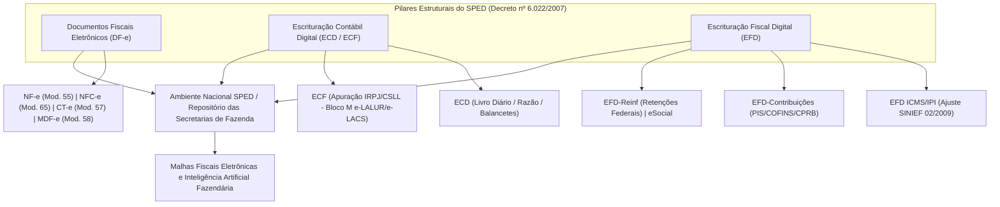
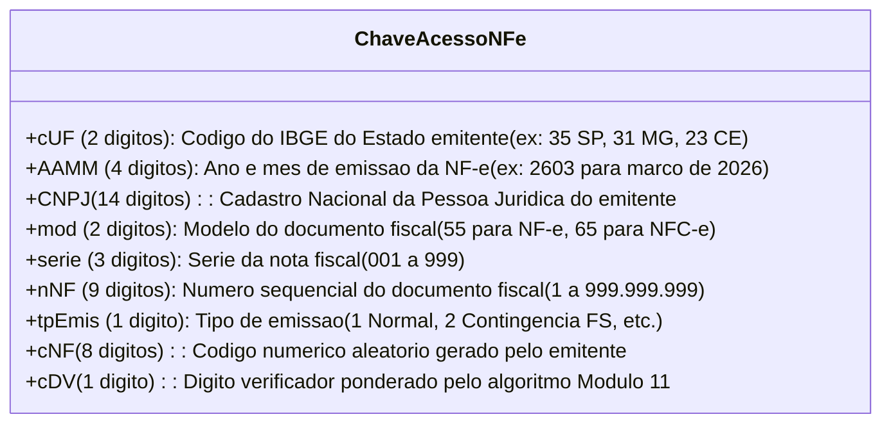
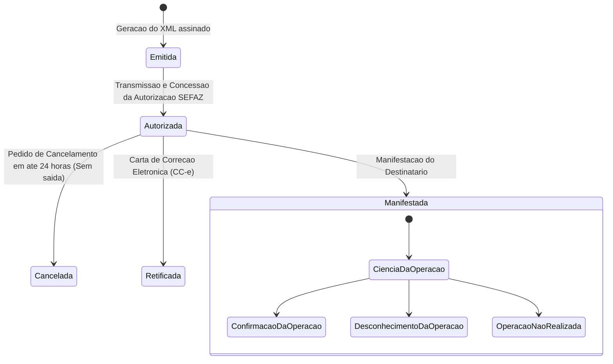
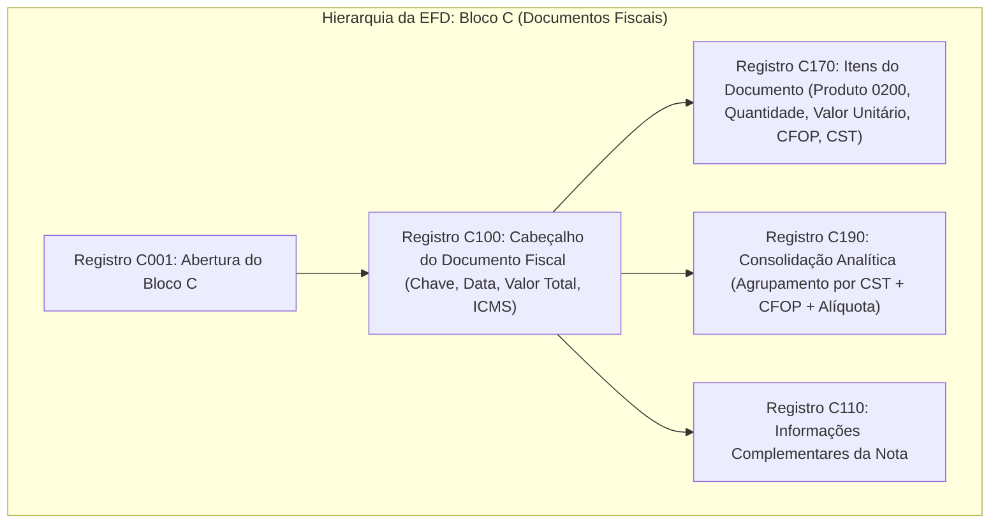
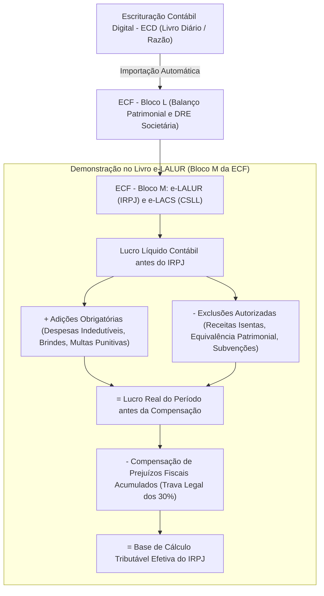
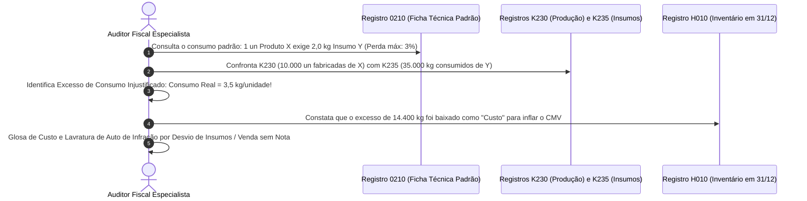

# Auditoria Digital, SPED, EFD ICMS/IPI e Nota Fiscal Eletrônica (NF-e)

---

## 1. O Sistema Público de Escrituração Digital (SPED)

O Sistema Público de Escrituração Digital (SPED), instituído pelo **Decreto nº 6.022/2007**, consubstancia a modernização da relação entre o Fisco e os contribuintes no Brasil. Trata-se do instrumento que unifica a recepção, validação, armazenamento e autenticação de livros e documentos que integram a escrituração contábil e fiscal das pessoas jurídicas.

Constitucionalmente, o SPED assenta-se no **art. 37, inciso XXII, da Constituição Federal de 1988**, que determina que as administrações tributárias da União, dos Estados, do Distrito Federal e dos Municípios atuarão de forma integrada, inclusive com o compartilhamento de cadastros e informações fiscais.



> [!IMPORTANT]
> **Validade Jurídica dos Documentos Digitais (ICP-Brasil):**
> A validade jurídica, autenticidade, integridade e o não repúdio de todos os documentos e livros eletrônicos transmitidos no âmbito do SPED decorrem da utilização de **certificados digitais emitidos no padrão da Infraestrutura de Chaves Públicas Brasileira (ICP-Brasil)**, conforme estabelecido pelo art. 10 da Medida Provisória nº 2.200-2/2001 e legislação tributária de regência.

---

## 2. A Nota Fiscal Eletrônica (NF-e) - Modelo 55 (Ajuste SINIEF 07/2005)

A **Nota Fiscal Eletrônica (NF-e)**, modelo 55, disciplinada pelo **Ajuste SINIEF nº 07/2005**, substituiu os antigos modelos em papel (modelos 1 e 1-A) nas operações mercantis sujeitas ao ICMS e ao IPI.

### 2.1. Conceito e Condição Resolutiva de Existência Jurídica

A NF-e é documento de **existência exclusivamente digital**, emitido e armazenado eletronicamente em formato **XML** (*Extensible Markup Language*).

> [!CAUTION]
> **A Autorização de Uso é Requisito Essencial de Validade:**
> A emissão material do arquivo XML pelo contribuinte **não confere validade jurídica** ao documento fiscal. A NF-e somente existe juridicamente e produz efeitos tributários após a concessão da **Autorização de Uso** pela administração tributária da unidade federada do emitente (SEFAZ). A circulação de mercadorias acompanhada de documento sem autorização ou com autorização denegada configura crime contra a ordem tributária e transporte irregular de mercadorias.

### 2.2. O Documento Auxiliar da Nota Fiscal Eletrônica (DANFE)

O DANFE é a representação gráfica simplificada da NF-e impressa em papel comum (geralmente formato A4):
- **Finalidade Exclusiva:** Acompanhar o trânsito físico das mercadorias, fornecendo aos transportadores e fiscais de postos fiscais as informações essenciais da operação e permitindo a consulta online do arquivo XML original;
- **Não Substitui a NF-e:** O DANFE **não é a nota fiscal** e não possui validade jurídica própria isolada; sua força probatória depende da existência e higidez do arquivo XML autorizado na base da SEFAZ;
- **Chave de Acesso:** Contém obrigatoriamente a representação numérica e em código de barras da **Chave de Acesso de 44 dígitos**.

### 2.3. Anatomia Estrutural da Chave de Acesso (44 Dígitos Numéricos)

A Chave de Acesso da NF-e é composta por 44 caracteres numéricos organizados em campos estritos:

$$
\text{Chave NF-e (44)} = \text{cUF}_{(2)} + \text{AAMM}_{(4)} + \text{CNPJ}_{(14)} + \text{mod}_{(2)} + \text{série}_{(3)} + \text{nNF}_{(9)} + \text{tpEmis}_{(1)} + \text{cNF}_{(8)} + \text{cDV}_{(1)}
$$



### 2.4. Ciclo de Eventos da NF-e: Cancelamento, CC-e e Manifestação do Destinatário



#### Regras Operacionais dos Eventos:

1. **Cancelamento da NF-e:** Permitido em regra no prazo máximo regulamentar de **24 horas** contado da autorização de uso, **desde que não tenha ocorrido a saída das mercadorias** do estabelecimento emitente.
2. **Carta de Correção Eletrônica (CC-e):** Destina-se a sanar erros formais simples da NF-e. O art. 58-B do Convênio SINIEF s/nº de 1970 veda taxativamente o uso da CC-e para corrigir:
   - Variáveis que determinem o valor do imposto (base de cálculo, alíquota, diferença de preço, quantidade, valor da operação ou da prestação);
   - A correção de dados cadastrais que implique mudança completa do remetente ou do destinatário;
   - A data de emissão ou a data de efetiva saída da mercadoria.
3. **Manifestação do Destinatário:** Permite que a empresa receptora informe formalmente ao Fisco se a operação descrita na NF-e é legítima, evitando fraudes de empresas que utilizam seu CNPJ ("notas fiscais espelhadas"):
   - *Ciência da Emissão:* O destinatário declara ter ciência da nota, liberando o download do XML completo;
   - *Confirmação da Operação:* O destinatário confirma que a mercadoria foi efetivamente recebida e conferida;
   - *Operação não Realizada:* A operação foi contratada mas frustrada por extravio, roubo ou desacordo comercial;
   - *Desconhecimento da Operação:* O titular do CNPJ afirma peremptoriamente que jamais solicitou ou adquiriu as mercadorias, blindando-se contra a presunção de omissão de entradas.

---

## 3. Escrituração Fiscal Digital (EFD ICMS/IPI) - Ajuste SINIEF 02/2009

A **EFD ICMS/IPI** constitui um arquivo digital único de transmissão mensal obrigatória, contendo todos os registros de documentos fiscais, apurações tributárias, controle de créditos do ativo imobilizado e estoques.

### 3.1. Anatomia Completa dos Blocos da EFD ICMS/IPI

O arquivo da EFD é organizado hierarquicamente em **Blocos lógicos**:

| Bloco | Denominação Oficial do Bloco | Conteúdo Central e Registros de Relevância para a Auditoria |
| :---: | :--- | :--- |
| **0** | Abertura, Identificação e Referências | Identificação da entidade (0000), Cadastro de Participantes/Clientes/Fornecedores (0150), Unidades de Medida (0190) e Cadastro de Itens/Mercadorias (0200). |
| **C** | Documentos Fiscais I - Mercadorias | Escrituração de notas fiscais de entrada e saída. Registros-chave: **C100** (cabeçalho da NF-e), **C170** (itens da NF-e: produto, NCM, quantidade, valor, CST e alíquotas) e **C190** (consolidação analítica por CST e CFOP). |
| **D** | Documentos Fiscais II - Serviços | Documentos de transporte (CT-e modelos 57 e 67) e comunicação. Registros **D100** (dados da prestação) e **D190** (analítico). |
| **E** | Apuração do ICMS e do IPI | Demonstração do saldo devedor ou credor. **E110** (apuração do ICMS próprio), **E111** (ajustes de crédito/débito decorrentes de incentivos ou estornos) e **E210** (apuração do ICMS Substituição Tributária). |
| **G** | Controle do Crédito do Ativo Permanente (CIAP) | Controle da apropriação dos créditos de ICMS na compra de bens do Imobilizado em **1/48 avos** por mês (art. 20, § 5º da LC 87/96), considerando o fator de saídas tributadas (Registro **G125**). |
| **H** | Inventário Físico | Apresentado anualmente (referente ao estoque de 31 de dezembro na EFD de fevereiro) ou em datas especiais. Registros **H005** (totais do inventário) e **H010** (detalhamento físico-financeiro item a item: código, quantidade, valor unitário e total). |
| **K** | Controle da Produção e do Estoque | O "Livro Registro de Controle da Produção e do Estoque" digital. Registros **K200** (estoque escriturado em poder próprio e de terceiros), **K230** (itens produzidos), **K235** (insumos consumidos na fabricação) e **K280** (correção de apontamento de estoque). |
| **1** | Outras Informações Fiscais | Registros complementares. Destaca-se o **Registro 1601** (operações com instrumentos de pagamento eletrônico: cartões de crédito/débito, PIX, carteiras digitais). |
| **9** | Controle e Encerramento | Registros de conferência de quantidade de linhas por bloco e fechamento do arquivo digital (**9900** e **9999**). |



---

## 4. Técnicas e Malhas Fiscais de Cruzamento Digital

Com a digitalização integral dos documentos fiscais, as equipes de auditoria tributária utilizam bancos de dados relacionais e sistemas de *Big Data* para efetuar cruzamentos em larga escala:

```mermaid
flowchart TD
    subgraph "Principais Malhas de Auditoria Digital Tributária"
        M1["Malha 1: Omissão de Entradas"] -->|Fornecedor emite NF-e autorizada vs Destinatário NÃO lança no Registro C100| R1["Presunção de Saída de Mercadoria sem Nota (Art. 293 RIR / Legislações do ICMS)"]
        
        M2["Malha 2: Auditoria de Meios de Pagamento (DIMP / DECRED vs Bloco 1601 / PGDAS-D)"] -->|Vendas Cartão/PIX informadas por Adquirentes > Vendas Faturadas em NF-e/NFC-e| R2["Lançamento de ICMS/ISS/Simples sobre Receita Omitida"]
        
        M3["Malha 3: Reconciliação Quantitativa de Estoques (Bloco H + Bloco C + Bloco K)"] -->|Estoque Inicial + Entradas - Saídas - Perdas != Estoque Final| R3["Identificação de Sobra (Compra Clandestina) ou Falta (Venda sem Nota)"]
        
        M4["Malha 4: Auditoria do CIAP (Bloco G vs Bloco E)"] -->|Crédito apropriado sem observar o fator 1/48 x (Saídas Tributadas / Saídas Totais)| R4["Glosa de Créditos Indevidos de ICMS do Ativo Imobilizado"]
    end
```

### 4.1. Cruzamento 1: Omissão de Entradas de Mercadorias

- **Mecânica Fiscal:** A Secretaria da Fazenda cruza as notas fiscais emitidas por fornecedores no Ambiente Nacional da NF-e contra o **Registro C100 de Entrada** escriturado pelo adquirente em sua EFD ICMS/IPI;
- **Presunção Legal Consequente:** Se o adquirente deixou de escriturar a NF-e de compra e não manifestou desconhecimento da operação, presume-se que a mercadoria ingressou clandestinamente no estabelecimento e foi subsequentemente comercializada sem nota fiscal, autorizando a cobrança do ICMS sobre as vendas presumidas acrescido de multa de 50% a 100%.

### 4.2. Cruzamento 2: Operações com Cartão de Crédito, Débito e PIX (DIMP vs. EFD)

- As instituições de pagamento, bancos e credenciadoras de cartão transmitem mensalmente ao Fisco a **Declaração de Informações de Meios de Pagamentos (DIMP)**, contendo o montante exato liquidado por estabelecimento (CNPJ);
- O auditor fiscal confronta:
  $$
  \text{Vendas Financeiras Líquidas via DIMP} > \sum \text{NF-e} + \sum \text{NFC-e} + \text{Registro 1601 EFD}
  $$
- A diferença positiva configura presunção legal imediata de faturamento omitido da tributação estadual (ICMS), municipal (ISS) ou federal (Simples Nacional / IRPJ).

---

## 5. Auditoria da ECF (Escrituração Contábil Fiscal) e do e-LALUR / e-LACS (Bloco M)

A **ECF (Escrituração Contábil Fiscal)**, que substituiu a antiga DIPJ desde o ano-calendário 2014, constitui a obrigação acessória onde se processa a conciliação entre o resultado societário (apurado nas normas IFRS/CPC constantes da ECD) e o resultado tributável pelo IRPJ e pela CSLL.



### 5.1. Os Dois Módulos do e-LALUR (Parte A e Parte B)

A auditoria fiscal na ECF investiga a integridade do e-LALUR e do e-LACS, estruturados em duas seções interconectadas:

1. **Parte A do e-LALUR/e-LACS (Registros M300 e M350):** Onde se lançam os ajustes pontuais do período de apuração (trimestral ou anual com estimativas mensais), discriminando individualmente cada adição ou exclusão que altera o lucro líquido contábil.
2. **Parte B do e-LALUR/e-LACS (Registros M010 e M410):** Onde se controlam os valores que não constam da escrituração comercial convencional, mas cujos efeitos fiscais repercutirão em períodos futuros:
   - Saldos de prejuízos fiscais acumulados do IRPJ e bases negativas da CSLL disponíveis para compensação futura;
   - Despesas cuja dedutibilidade foi diferida temporariamente (ex.: provisões não dedutíveis temporárias, amortização do ágio por rentabilidade futura / *goodwill* conforme art. 20 do Decreto-Lei nº 1.598/1977).

---

## 6. Auditoria Avançada do Bloco K (Produção e Estoque) e Ficha Técnica (Registro 0210)

O **Bloco K** da EFD ICMS/IPI é o pesadelo dos fraudadores de custos e estoques industriais, pois digitalizou a movimentação física diária fabril:

### 6.1. O Registro 0210 e o Coeficiente Técnico de Consumo

O **Registro 0210 (Consumo Específico Padronizado)** informa a "receita do bolo" (ficha técnica de engenharia) de cada produto acabado ou semiacabado:
- Quantidade exata de cada insumo (matéria-prima, material de embalagem) necessária para produzir uma unidade do produto resultante;
- Percentual de perda técnica admitida no processo produtivo normal.



---

## 7. Consultas em SQL e Malhas Digitais Aplicadas à Fiscalização Tributária

Na moderna auditoria fazendária, o auditor opera diretamente em bancos de dados relacionais executando instruções SQL para detecção massiva de fraudes:

### 7.1. Query SQL 1: Detecção de Omissão de Entradas (Fornecedor Autorizou vs Comprador Omitiu)

```sql
-- Identifica Notas Fiscais Eletrônicas autorizadas na SEFAZ pelo fornecedor
-- que não foram escrituradas no Registro C100 de entrada pelo destinatário
SELECT 
    nfe.chave_acesso,
    nfe.cnpj_emitente,
    nfe.data_emissao,
    nfe.valor_total,
    nfe.valor_icms
FROM db_sefaz.tb_nfe_autorizadas AS nfe
LEFT JOIN db_sped.tb_efd_registro_c100 AS c100
    ON nfe.chave_acesso = c100.num_chave_acesso
    AND nfe.cnpj_destinatario = c100.cnpj_declarante
WHERE nfe.cnpj_destinatario = '12345678000199' -- CNPJ do contribuinte fiscalizado
  AND nfe.data_emissao BETWEEN '2025-01-01' AND '2025-12-31'
  AND nfe.status_sefaz = 'AUTORIZADA'
  AND c100.num_chave_acesso IS NULL -- NF-e NÃO localizada na EFD de entrada!
  AND nfe.evento_manifestacao != 'DESCONHECIMENTO_DA_OPERACAO';
```

### 7.2. Query SQL 2: Auditoria de Vendas com Cartão / PIX vs. Faturamento Escriturado (DIMP vs EFD)

```sql
-- Compara vendas totais declaradas por adquirentes de cartão (DIMP)
-- contra as notas fiscais emitidas (NF-e/NFC-e) e o Registro 1601 da EFD
SELECT 
    dimp.mes_ano,
    dimp.valor_total_cartao_pix,
    COALESCE(efd.valor_faturado_efd, 0) AS valor_faturado_efd,
    (dimp.valor_total_cartao_pix - COALESCE(efd.valor_faturado_efd, 0)) AS diferenca_omitida
FROM (
    SELECT 
        TO_CHAR(data_liquidacao, 'YYYY-MM') AS mes_ano,
        SUM(valor_operacao_liquida) AS valor_total_cartao_pix
    FROM db_dimp.tb_operacoes_meios_pagamento
    WHERE cnpj_estabelecimento = '12345678000199'
    GROUP BY TO_CHAR(data_liquidacao, 'YYYY-MM')
) AS dimp
LEFT JOIN (
    SELECT 
        TO_CHAR(data_emissao, 'YYYY-MM') AS mes_ano,
        SUM(valor_total_documento) AS valor_faturado_efd
    FROM db_sped.tb_efd_registro_c100
    WHERE cnpj_declarante = '12345678000199' AND ind_operacao = '1' -- Saídas
    GROUP BY TO_CHAR(data_emissao, 'YYYY-MM')
) AS efd ON dimp.mes_ano = efd.mes_ano
WHERE dimp.valor_total_cartao_pix > COALESCE(efd.valor_faturado_efd, 0);
```

---

## 8. Mnemônicos & Âncoras Cognitivas

> [!TIP]
> **Mnemônico da Chave de Acesso: `UF-DATA-CNPJ-MOD-SER-NUM-EMI-ALE-DV`**
> Memorize o número mágico **44 dígitos** e a sequência:
> - **UF (2)** $\rightarrow$ Código do IBGE
> - **AAMM (4)** $\rightarrow$ Ano e Mês de emissão
> - **CNPJ (14)** $\rightarrow$ Emitente
> - **Modelo (2)** $\rightarrow$ `55` (NF-e) ou `65` (NFC-e)
> - **Série (3)** $\rightarrow$ `001`
> - **Número (9)** $\rightarrow$ Numeração da nota
> - **Tipo de Emissão (1)** $\rightarrow$ `1` Normal
> - **Código Numérico (8)** $\rightarrow$ Aleatório
> - **Dígito Verificador (1)** $\rightarrow$ Módulo 11

> [!TIP]
> **Mnemônico dos Blocos Críticos da EFD: `C-E-G-H-K-1`**
> - **C** $\rightarrow$ **C**omércio de Mercadorias (NF-e C100/C170)
> - **E** $\rightarrow$ **E**xação e Apuração do ICMS/IPI
> - **G** $\rightarrow$ **G**estão do Ativo Permanente (CIAP 1/48)
> - **H** $\rightarrow$ **H**olding de Estoques (Inventário de Fim de Ano)
> - **K** $\rightarrow$ **K**ombinação Industrial (Produção e Estoque Diário)
> - **1** $\rightarrow$ **1**nstrumentos Eletrônicos / Cartões (1601)

---

## 9. Bateria de Questões Oficiais Comentadas (QConcursos)

### Questão 01 — [CESPE / CEBRASPE — SEFAZ-RR / Auditor Fiscal de Tributos Estaduais — 2023]
**Identificador QC:** [Q4221420](https://www.qconcursos.com/questoes-de-concursos/questoes/78946ee9-91)  
**Enunciado:** Uma indústria do setor químico foi submetida simultaneamente a diferentes procedimentos de verificação:  
I. Um profissional contratado pela administração avaliou controles internos e políticas operacionais corporativas.  
II. Profissionais de uma firma com registro na CVM e no CNAI examinaram demonstrações contábeis para emitir opinião técnica independente.  
III. Auditores vinculados à Secretaria da Fazenda de um Estado iniciaram procedimento de fiscalização para verificar a correta apuração e recolhimento do ICMS, mediante análise de NF-e, EFD ICMS/IPI e cruzamentos eletrônicos.  
IV. Um perito contador nomeado pelo juiz elaborou laudo técnico para apurar haveres societários.  
As situações I, II, III e IV correspondem, respectivamente, a:
- (A) auditoria independente, auditoria interna, perícia contábil e fiscalização financeira.
- (B) auditoria fiscal, auditoria operacional, auditoria independente e perícia administrativa.
- (C) auditoria governamental, auditoria fiscal, auditoria externa e consultoria contábil.
- (D) auditoria interna, auditoria independente, auditoria fiscal e perícia contábil.
- (E) perícia contábil, auditoria interna, auditoria governamental e auditoria operacional.

> **Gabarito Comentado: Alternativa D**
> - **Alternativa D (CORRETA):** A classificação funcional é inequívoca:
>   - I. Avaliação de controles operacionais corporativos para a administração = **Auditoria Interna** (NBC TI 01).
>   - II. Emissão de parecer sobre demonstrações contábeis com registro CVM = **Auditoria Independente** (NBC TA 200).
>   - III. Fiscalização de ICMS mediante NF-e e EFD por agentes do Estado = **Auditoria Fiscal**.
>   - IV. Elaboração de laudo contábil sob nomeação de magistrado = **Perícia Contábil** (NBC TP 01).
> - **Alternativas A, B, C e E (INCORRETAS):** Confundem as atribuições privativas de cada ramo e seus respectivos instrumentos normativos.

---

### Questão 02 — [FGV — Receita Federal do Brasil / Auditor-Fiscal da Receita Federal — 2023]
**Identificador QC:** [Q4222680](https://www.qconcursos.com/questoes-de-concursos/questoes/6129f236-91)  
**Enunciado:** De acordo com o Decreto nº 6.022/2007, o Sistema Público de Escrituração Digital (SPED) é o instrumento que unifica as atividades de recepção, validação, armazenamento e autenticação de livros e documentos que integram a escrituração contábil e fiscal das pessoas jurídicas. A respeito do SPED e dos documentos fiscais eletrônicos:
- (A) A Nota Fiscal Eletrônica (NF-e) adquire existência jurídica plena a partir do momento em que o contribuinte assina digitalmente o arquivo XML, sendo prescindível a autorização da SEFAZ.
- (B) O DANFE é documento com eficácia legal autônoma, substituindo em definitivo a NF-e para todos os efeitos fiscais e contábeis.
- (C) A validade jurídica dos livros e documentos do SPED fundamenta-se nos certificados digitais emitidos sob a Infraestrutura de Chaves Públicas Brasileira (ICP-Brasil).
- (D) Os Municípios estão constitucionalmente impedidos de integrar o ambiente SPED por se tratar de plataforma restrita aos tributos de competência da União e dos Estados.
- (E) As retificações de livros contábeis no ambiente da ECD podem ser realizadas livremente pelo contribuinte a qualquer tempo, mesmo após a lavratura de termo de encerramento de fiscalização.

> **Gabarito Comentado: Alternativa C**
> - **Alternativa C (CORRETA):** O art. 10 da MP nº 2.200-2/2001 e o Decreto nº 6.022/2007 prescrevem expressamente que os documentos e livros digitais integrantes do SPED dependem de certificação digital padrão ICP-Brasil para garantir sua autenticidade, integridade e validade jurídica plena perante terceiros e o Fisco.
> - **Alternativa A (INCORRETA):** A autorização de uso prévia da SEFAZ é condição resolutiva indispensável de existência da NF-e.
> - **Alternativa B (INCORRETA):** O DANFE é apenas representação gráfica e não substitui a NF-e.
> - **Alternativa D (INCORRETA):** O art. 37, XXII, da CF/88 e o SPED contemplam a integração com os Municípios (ex.: NFS-e padrão nacional).
> - **Alternativa E (INCORRETA):** A retificação contábil após o início do procedimento fiscal é ineficaz para elidir infrações tributárias apuradas (art. 138 do CTN e Súmula CARF nº 140).

---

### Questão 03 — [FCC — SEFAZ-SC / Auditor Fiscal da Receita Estadual — 2018]
**Identificador QC:** [Q4163960](https://www.qconcursos.com/questoes-de-concursos/questoes/6e3270ee-7b)  
**Enunciado:** A digitalização dos documentos fiscais no Brasil transformou profundamente os mecanismos de controle na administração tributária. No âmbito da Nota Fiscal Eletrônica (NF-e) e do Ajuste SINIEF nº 07/2005:
- (A) A Carta de Correção Eletrônica (CC-e) pode ser utilizada para retificar erros na base de cálculo do ICMS, desde que a alíquota aplicável permaneça inalterada.
- (B) O cancelamento da NF-e pode ser efetuado mesmo após o início da circulação da mercadoria, desde que o destinatário recuse formalmente o transporte.
- (C) A Chave de Acesso da NF-e é estruturada em 44 algarismos, contendo, entre outros elementos, o código do IBGE da unidade da Federação emitente, o ano e mês de emissão e o número sequencial do documento fiscal.
- (D) O emitente de NF-e fica dispensado de manter a guarda do arquivo digital XML caso tenha impresso o DANFE em duas vias arquivadas fisicamente.
- (E) A consulta pública da NF-e no portal da SEFAZ pode ser realizada por qualquer cidadão independentemente de certificação digital ou chave de acesso.

> **Gabarito Comentado: Alternativa C**
> - **Alternativa C (CORRETA):** Descrição perfeita da estrutura técnica da Chave de Acesso (44 dígitos), contemplando cUF (2), AAMM (4), CNPJ (14), mod (2), série (3), nNF (9), tpEmis (1), cNF (8) e cDV (1).
> - **Alternativa A (INCORRETA):** O Convênio SINIEF s/nº de 1970 e o Ajuste SINIEF 07/05 proíbem expressamente o uso de CC-e para retificar valores, alíquotas ou bases de cálculo.
> - **Alternativa B (INCORRETA):** Iniciada a circulação, o cancelamento é vedado; a regularização exige nota fiscal de entrada ou de devolução.
> - **Alternativa D (INCORRETA):** O emitente e o destinatário são legalmente obrigados a manter o arquivo XML pelo prazo decadencial (5 anos).
> - **Alternativa E (INCORRETA):** A consulta exige a Chave de Acesso e a visualização completa do XML restringe-se a partes legítimas com certificado digital.

---

### Questão 04 — [FGV — SEFAZ-AM / Auditor Fiscal de Tributos Estaduais — 2022]
**Identificador QC:** [Q4183380](https://www.qconcursos.com/questoes-de-concursos/questoes/aa16e904-81)  
**Enunciado:** Durante procedimento de fiscalização digital sobre uma empresa comercial e prestadora de serviços, a equipe de auditoria fiscal cruzou as informações prestadas por instituições e operadoras de meios eletrônicos de pagamento (cartão de crédito, débito e PIX) com as receitas declaradas na Escrituração Fiscal Digital (EFD). Constatou-se que o volume financeiro liquidado pelas administradoras de cartão era 80% superior ao total faturado nas notas fiscais emitidas no período. Diante dessa discrepância comprovada em malha eletrônica:
- (A) a divergência não autoriza a lavratura de auto de infração por se tratar de presunção desprovida de previsão legislativa.
- (B) o Fisco deve instaurar mediação preliminar perante a Câmara de Conciliação Financeira do BACEN antes de exigir o tributo.
- (C) a autoridade fiscalizadora está respaldada na legislação para lavrar auto de infração com cobrança do imposto sobre a receita omitida, cabendo ao contribuinte o ônus probatório de afastar a presunção legal.
- (D) as informações financeiras de operadoras de cartão de crédito não possuem eficácia probatória em face do princípio do sigilo bancário.
- (E) o auto de infração dependerá de homologação judicial prévia pela Vara da Fazenda Pública Estadual.

> **Gabarito Comentado: Alternativa C**
> - **Alternativa C (CORRETA):** O cruzamento entre dados da DIMP (meios de pagamento) e a escrituração fiscal é instrumento legal consagrado de apuração tributária. O excedente financeiro liquidado e não acobertado por notas fiscais gera presunção legal de omissão de receitas tributáveis, invertendo-se o ônus probatório em desfavor do contribuinte.
> - **Alternativas A, B, D e E (INCORRETAS):** Há expressa previsão nas leis estaduais do ICMS e leis federais; não há mediação bancária; os dados de adquirentes decorrem de obrigação acessória (LC 105/01 art. 5º); e o lançamento de ofício independe de chancela judicial.

---

### Questão 05 — [CESPE / CEBRASPE — SEFAZ-CE / Auditor Fiscal da Receita Estadual — 2021]
**Identificador QC:** [Q4132340](https://www.qconcursos.com/questoes-de-concursos/questoes/f365a438-6f)  
**Enunciado:** A respeito da Escrituração Fiscal Digital (EFD ICMS/IPI) e de suas regras de organização por blocos, assinale a opção correta:
- (A) O Bloco H destina-se exclusivamente ao controle diário das ordens de produção industrial e ao consumo de matérias-primas na fábrica.
- (B) O Registro C100 abriga os dados de consolidação analítica do imposto por alíquota e CFOP, não identificando o número individual da nota fiscal.
- (C) O Bloco K é o livro Registro de Controle da Produção e do Estoque em formato digital, contendo os saldos de estoque escriturados e as quantidades de insumos consumidos.
- (D) O Bloco G é voltado exclusivamente ao registro de notas fiscais de serviços de transporte interestadual e comunicação.
- (E) O Bloco E da EFD é dispensável para empresas que possuam saldo credor acumulado de ICMS ao final do mês.

> **Gabarito Comentado: Alternativa C**
> - **Alternativa C (CORRETA):** O Bloco K representa a versão digital do Livro de Controle da Produção e do Estoque, detalhando a produção (K230), o consumo de matérias-primas (K235) e a posição física dos estoques em poder próprio e de terceiros (K200).
> - **Alternativa A (INCORRETA):** O Bloco H é o Livro Registro de Inventário (apresentado anualmente).
> - **Alternativa B (INCORRETA):** O Registro C100 traz o cabeçalho individualizado de cada NF-e (número, série, data, chave de acesso); quem faz a consolidação analítica por CST/CFOP é o Registro C190.
> - **Alternativa D (INCORRETA):** O Bloco G destina-se ao CIAP (Controle do Crédito de ICMS do Ativo Permanente); os serviços de transporte e comunicação estão no Bloco D.
> - **Alternativa E (INCORRETA):** O Bloco E (Apuração do ICMS) é obrigatório em todos os períodos de apuração.

---

### Questão 06 — [FCC — SEFAZ-PE / Auditor Fiscal do Tesouro Estadual — 2014]
**Identificador QC:** [Q4221425](https://www.qconcursos.com/questoes-de-concursos/questoes/78a24aa5-91)  
**Enunciado:** Durante a auditoria das demonstrações contábeis e fiscais de uma empresa atacadista, o auditor fiscal detectou a ocorrência de notas fiscais eletrônicas de saída com status "Autorizada", emitidas regularmente no sistema do contribuinte, cujos valores de débito do ICMS não foram transportados para o Bloco E (Registro E110) da EFD ICMS/IPI transmitida à Fazenda. Tal inconsistência:
- (A) constitui erro de baixa materialidade que deve ser relevado pelo Fisco sem aplicação de penalidades.
- (B) caracteriza omissão de débitos tributários escriturados, permitindo o lançamento de ofício da diferença do ICMS não recolhido com multa e juros de mora.
- (C) impõe a nulidade de pleno direito de todas as notas fiscais emitidas no respectivo mês pelo contribuinte.
- (D) autoriza a autoridade fiscal a expropriar imediatamente os veículos de transporte de carga da empresa sem instauração de processo administrativo.
- (E) decorre obrigatoriamente de falha de transmissão do ambiente nacional do SPED, cabendo à SEFAZ arcar com os custos tributários.

> **Gabarito Comentado: Alternativa B**
> - **Alternativa B (CORRETA):** A emissão regular da NF-e gera o dever material de escrituração e recolhimento do débito no Registro E110 da EFD. A omissão dolosa ou culposa do transporte desses valores para a apuração enseja lançamento de ofício do crédito tributário omitido com acréscimo de multas punitivas de ofício e juros legais.
> - **Alternativas A, C, D e E (INCORRETAS):** A sonegação de débito escriturado é infração gravíssima; as notas fiscais emitidas permanecem válidas e geram a obrigação tributária; não há expropriação sumária sem devido processo legal; e a responsabilidade pela integridade da EFD é integral do sujeito passivo.

---

### Questão 07 — [CESPE / CEBRASPE — Auditor Federal de Finanças e Controle / CGU — 2022]
**Identificador QC:** [Q4251181](https://www.qconcursos.com/questoes-de-concursos/questoes/f297cb75-9d)  
**Enunciado:** A Escrituração Fiscal Digital de Retenções e Outras Informações Fiscais (EFD-Reinf) possui estrutura organizada por eventos transmitidos ao repositório do SPED. A respeito da EFD-Reinf e de sua interação com as obrigações acessórias do SPED, assinale a opção correta:
- (A) A EFD-Reinf destina-se exclusivamente à apuração e ao recolhimento do ICMS e do ISS devidos por substituição tributária.
- (B) A EFD-Reinf abrange informações sobre retenções na fonte de tributos federais (IRRF, CSLL, PIS, COFINS) incidentes sobre pagamentos efetuados a pessoas jurídicas por serviços prestados, bem como sobre a contribuição previdenciária sobre a receita bruta (CPRB).
- (C) A transmissão da EFD-Reinf dispensa o contribuinte da emissão de notas fiscais eletrônicas de serviços perante as municipalidades.
- (D) Os eventos da EFD-Reinf são submetidos à autenticação física mediante carimbo e rubrica na Junta Comercial estadual.
- (E) A EFD-Reinf substitui integralmente a ECD e a ECF na apuração do lucro real das pessoas jurídicas.

> **Gabarito Comentado: Alternativa B**
> - **Alternativa B (CORRETA):** A EFD-Reinf integra o módulo tributário do SPED dedicado às retenções na fonte federais (IRRF, PIS, COFINS, CSLL) sobre prestação de serviços tomados de pessoas jurídicas, à apuração da CPRB (desoneração da folha) e aos recursos repassados a associações desportivas.
> - **Alternativa A (INCORRETA):** Não trata de ICMS ou ISS (tributos de competência estadual e municipal).
> - **Alternativa C (INCORRETA):** A obrigação acessória municipal da NFS-e permanece autônoma.
> - **Alternativa D (INCORRETA):** Toda a transmissão é digital com certificação ICP-Brasil no ambiente SPED, sem trâmite em Junta Comercial.
> - **Alternativa E (INCORRETA):** ECD e ECF continuam plenamente vigentes para escrituração contábil e apuração anual do IRPJ/CSLL.

---

### Questão 08 — [VUNESP — Prefeitura de Guarulhos - SP / Auditor Fiscal Tributário — 2019]
**Identificador QC:** [Q4163961](https://www.qconcursos.com/questoes-de-concursos/questoes/6e356970-7b)  
**Enunciado:** As obrigações tributárias acessórias desempenham papel nuclear no fornecimento de dados para a fiscalização digital. Sobre as infrações decorrentes do descumprimento de obrigações acessórias relativas à emissão e armazenamento de Documentos Fiscais Eletrônicos (DF-e):
- (A) O descumprimento de obrigação acessória não pode gerar penalidade pecuniária por ausência de previsão constitucional.
- (B) A obrigação acessória, pelo simples fato da sua inobservância, converte-se em obrigação principal relativamente à penalidade pecuniária.
- (C) A pessoa jurídica optante pelo Simples Nacional é imune à aplicação de penalidades decorrentes da falta de entrega de arquivos da EFD.
- (D) A guarda do arquivo digital XML da NF-e é obrigatória exclusivamente para o emitente, ficando o destinatário dispensado de qualquer dever de custódia.
- (E) A declaração de inidoneidade de um documento fiscal eletrônico exige decisão condenatória transitada em julgado na esfera criminal.

> **Gabarito Comentado: Alternativa B**
> - **Alternativa B (CORRETA):** Expressa a regra basilar do art. 113, § 3º, do Código Tributário Nacional: *"A obrigação acessória, pelo simples fato da sua inobservância, converte-se em obrigação principal relativamente à penalidade pecuniária"*. A multa acessória não recolhida ostenta natureza de obrigação principal (crédito tributário exigível).
> - **Alternativa A (INCORRETA):** O art. 113 do CTN e a CF/88 autorizam a imposição de multas pelo descumprimento de deveres instrumentais.
> - **Alternativa C (INCORRETA):** As empresas do Simples sujeitam-se ao cumprimento de deveres instrumentais e a multas por descumprimento de prazos.
> - **Alternativa D (INCORRETA):** O art. 13 do Ajuste SINIEF 07/05 impõe o dever de guarda do XML pelo prazo decadencial a ambos (emitente e adquirente).
> - **Alternativa E (INCORRETA):** A inidoneidade fiscal é declarada no âmbito administrativo fiscal pela autoridade fazendária competente.

---

### Questão 09 — [FGV — Auditor Fiscal da Receita Estadual / SEFAZ-ES — 2022]
**Identificador QC:** [Q4146449](https://www.qconcursos.com/questoes-de-concursos/questoes/75093c5f-74)  
**Enunciado:** Um auditor fiscal estadual está realizando auditoria nos créditos de ICMS apropriados por uma indústria metalúrgica decorrentes da aquisição de máquinas e equipamentos destinados ao seu ativo imobilizado operacional. Para auditar a regularidade dos créditos escriturados pelo contribuinte, o auditor deve verificar:
- (A) se os créditos foram apropriados integralmente e de uma só vez (100%) no próprio mês de entrada do maquinário no estabelecimento, conforme regra geral do regime não cumulativo.
- (B) se o contribuinte escriturou corretamente o Bloco G (CIAP) da EFD ICMS/IPI, observando a apropriação mensal na proporção de 1/48 avos multiplicada pela razão entre as operações de saídas tributadas e as saídas totais do período.
- (C) se o contribuinte obteve autorização judicial prévia para creditamento de ICMS de bens de capital.
- (D) se o maquinário foi adquirido com isenção total de IPI para que o ICMS possa ser aproveitado sem qualquer estorno.
- (E) se o valor do crédito foi convertido em Obrigações do Tesouro Nacional para atualização pelo índice inflacionário da FGV.

> **Gabarito Comentado: Alternativa B**
> - **Alternativa B (CORRETA):** A Lei Complementar nº 87/1996 (Lei Kandir), art. 20, § 5º, disciplina que o creditamento de ICMS sobre bens destinados ao ativo permanente é efetuado à razão de **1/48 por mês**, sendo a parcela mensal proporcionalmente reduzida pelo quociente entre as saídas tributadas (mais exportações) e as saídas totais da empresa. Esse cálculo é controlado e auditado eletronicamente no **Bloco G (CIAP)** da EFD ICMS/IPI.
> - **Alternativa A (INCORRETA):** A apropriação imediata e integral (100%) não se aplica a bens do imobilizado, mas sim a matérias-primas e mercadorias para revenda.
> - **Alternativas C, D e E (INCORRETAS):** O direito ao crédito do ativo decorre de lei complementar, prescindindo de ação judicial, não tem relação com isenção de IPI e não adota indexadores extintos.

---

### Questão 10 — [FCC — SEFAZ-BA / Auditor Fiscal — 2019]
**Identificador QC:** [Q4014898](https://www.qconcursos.com/questoes-de-concursos/questoes/bf3a10b9-40)  
**Enunciado:** Em relação à auditoria fiscal do inventário físico e ao controle quantitativo de estoques na EFD ICMS/IPI, o auditor fiscal confrontou os dados do Registro H010 (detalhamento do inventário físico em 31/12) com os saldos apurados através das entradas registradas no Registro C170 e saídas do período. Constatada a falta física de mercadorias no inventário do estabelecimento:
- (A) presume-se que a mercadoria faltante evaporou por perda natural de estoque, não havendo repercussão tributária se for inferior a 10% do faturamento.
- (B) presume-se que as mercadorias faltantes foram alienadas e entregues a adquirentes sem a emissão do competente documento fiscal, configurando omissão de receitas de vendas e autorizando a exigência do tributo e penalidades.
- (C) a empresa adquire o direito automático a estornar os débitos de saídas anteriores para compensar o prejuízo patrimonial sofrido.
- (D) o auditor é obrigado a instaurar processo de inquérito policial antes de qualquer lançamento fiscal de ofício.
- (E) a infração extingue-se se a empresa repuser as mercadorias faltantes no estoque no exercício financeiro seguinte.

> **Gabarito Comentado: Alternativa B**
> - **Alternativa B (CORRETA):** Trata-se de presunção legal expressa constante do art. 294 do RIR/2018 e das legislações estaduais do ICMS: a constatação de falta de mercadorias no estoque físico (estoque físico apurado inferior ao estoque contábil escriturado) enseja a presunção legal absoluta/relativa de que o saldo faltante foi comercializado sem emissão de documento fiscal (saída sem nota), gerando o dever de recolhimento do tributo com base no preço de venda praticado acrescido das penalidades cabíveis.
> - **Alternativas A, C, D e E (INCORRETAS):** Perdas anormais ou naturais de estoque exigem laudo técnico tempestivo do IPT, Corpo de Bombeiros ou órgão metrológico oficial; não há estorno de débito por descuido; o lançamento fiscal independe de inquérito penal; e reposição posterior de estoque não apaga o fato gerador pretérito consumado.

---

### Questão 11 — [CESPE / CEBRASPE — SEFAZ-CE / Auditor Fiscal da Receita Estadual — 2021]
**Identificador QC:** [Q4059569](https://www.qconcursos.com/questoes-de-concursos/questoes/fe1660af-52)  
**Enunciado:** Com base na legislação tributária e nas normas de fiscalização digital do SPED, julgue o item a seguir:  
*A escrituração e a entrega da EFD ICMS/IPI suprem em definitivo todas as exigências de apresentação de documentos fiscais físicos perante a administração tributária, de forma que o Fisco estadual fica impedido de exigir a exibição física de estoques ou a verificação in loco de estabelecimentos comerciais que já tenham transmitido os Blocos C e H do arquivo eletrônico.*
- ( ) Certo
- ( ) Errado

> **Gabarito Comentado: Errado**
> - **Justificativa:** O item está **ERRADO**. A transmissão da EFD ICMS/IPI é dever instrumental que não restringe nem limita o poder de polícia tributária e o livre acesso dos auditores fiscais aos estabelecimentos, mercadorias, depósitos e instalações da empresa (arts. 195 e 200 do CTN). A fiscalização pode e deve realizar a contagem física presencial de inventário para confrontar a existência física das mercadorias com os registros eletrônicos dos Blocos C, H e K, apurando eventuais desvios, sobras ou faltas de mercadorias.

---

### Questão 12 — [FGV — SEFAZ-MG / Auditor Fiscal da Receita Estadual — 2023]
**Identificador QC:** [Q4059579](https://www.qconcursos.com/questoes-de-concursos/questoes/fe314206-52)  
**Enunciado:** Em relação à apuração de fraudes na escrituração digital e à auditoria fiscal eletrônica dos livros do SPED, assinale a opção correta:
- (A) A utilização de créditos de ICMS destacados em notas fiscais eletrônicas com status "Cancelada" na base nacional da SEFAZ constitui crédito legítimo se o contribuinte comprovar que pagou a duplicata mercantil ao fornecedor.
- (B) O aproveitamento de créditos fiscais de ICMS destacados em NF-e cuja autorização de uso tenha sido denegada ou cancelada pelo Fisco configura apropriação indébita e crédito inidôneo, autorizando a glosa integral do valor, estorno do crédito e lavratura de auto de infração com multa qualificada.
- (C) A reconciliação do Bloco K da EFD dispensa a fiscalização da análise de laudos periciais de quebras e perdas produtivas em processos químicos e petroquímicos.
- (D) O cancelamento intempestivo de NF-e após 30 dias da autorização exime o contribuinte de prestar declarações retificadoras na EFD ICMS/IPI.
- (E) As secretarias de fazenda estaduais não possuem competência legal para celebrar convênios de cooperação técnica para intercâmbio de arquivos XML da NF-e entre si.

> **Gabarito Comentado: Alternativa B**
> - **Alternativa B (CORRETA):** A existência jurídica e a eficácia de crédito do documento fiscal eletrônico decorrem de sua regular autorização. A apropriação de crédito de ICMS proveniente de NF-e cancelada, denegada ou inidônea afronta o art. 23 da Lei Complementar nº 87/1996, caracterizando crédito espúrio/inidôneo que enseja glosa sumária e autuação fiscal com multa punitiva.
> - **Alternativa A (INCORRETA):** O pagamento financeiro de duplicata não convalida documento fiscal juridicamente inexistente ou cancelado para fins de crédito tributário.
> - **Alternativa C (INCORRETA):** O Bloco K não substitui laudos técnicos quando há divergência relevante nos índices de perda.
> - **Alternativas D e E (INCORRETAS):** O cancelamento intempestivo é infração autônoma e exige retificação da EFD; e os Fiscos possuem ampla competência constitucional e legal de compartilhamento mútuo (art. 37, XXII, da CF/88 e art. 199 do CTN).

