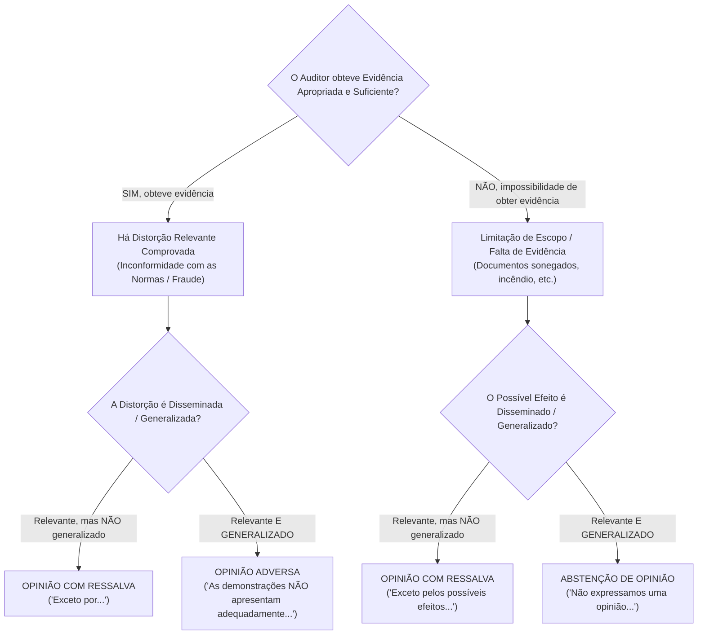
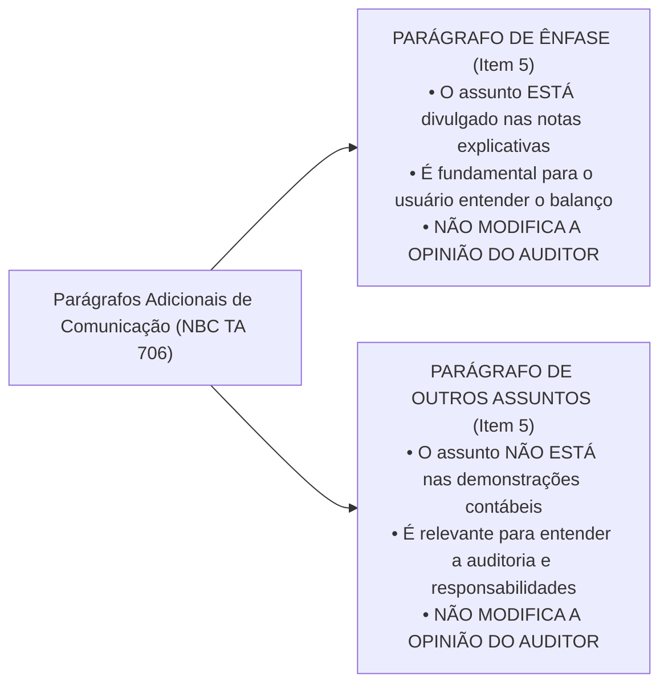

# Módulo 06: Relatório do Auditor e Tipos de Opinião (NBC TA 700, 705 e 706)

> **BLUF (Bottom Line Up Front):**  
> O **Relatório do Auditor Independente** é o produto final de todo o processo de auditoria. Conforme a **NBC TA 700**, a seção de **Opinião deve vir no início do relatório** (primeira seção substantiva), seguida imediatamente pela **Base para Opinião**. A opinião classifica-se em **Não Modificada (Limpa)** ou **Modificada (NBC TA 705)**, desdobrando-se em: **Com Ressalva** (efeitos relevantes, mas **NÃO generalizados/disseminados**), **Adversa** (distorção comprovada relevante **E generalizada**, o balanço não reflete a realidade) e **Abstenção de Opinião** (limitação grave de escopo, impossibilidade de obter evidência que seja relevante **E generalizada**). O **Parágrafo de Ênfase (NBC TA 706)** destaca assunto devidamente divulgado em nota explicativa e **NÃO modifica a opinião** do auditor; já o **Parágrafo de Outros Assuntos** trata de tema não divulgado na contabilidade mas relevante para o entendimento da auditoria.

---

## 1. A Estrutura Canônica do Relatório de Auditoria (NBC TA 700)

A partir da reforma das normas internacionais convergentes do CFC, a ordem dos parágrafos do relatório foi revolucionada para colocar as informações mais importantes diretamente no topo da leitura:

```mermaid
flowchart TD
    REL["ESTRUTURA CANÔNICA DO RELATÓRIO DO AUDITOR (NBC TA 700)"]
    
    REL --> SEC1["1. TÍTULO<br/>(Deve indicar explicitamente: 'Relatório do Auditor Independente')"]
    REL --> SEC2["2. DESTINATÁRIO<br/>(Normalmente acionistas, cotistas e conselho de administração)"]
    REL --> SEC3["3. OPINIÃO DO AUDITOR (Primeira Seção Substantiva)<br/>• Identifica a entidade, as DCs auditadas e as datas<br/>• Expressa a opinião formal clara e inequívoca"]
    REL --> SEC4["4. BASE PARA OPINIÃO (Vem imediatamente após a Opinião)<br/>• Afirma conformidade com as NBC TAs<br/>• Declara a independência e cumprimento ético (CFC)"]
    REL --> SEC5["5. INCERTEZA RELEVANTE SOBRE CONTINUIDADE (Se aplicável - NBC TA 570)"]
    REL --> SEC6["6. PRINCIPAIS ASSUNTOS DE AUDITORIA - PAA / KAM (NBC TA 701)<br/>(Obrigatório para companhias abertas listadas)"]
    REL --> SEC7["7. OUTRAS INFORMAÇÕES (Relatório da Administração - NBC TA 720)"]
    REL --> SEC8["8. RESPONSABILIDADES DA ADMINISTRAÇÃO E GOVERNANÇA PELAS DC"]
    REL --> SEC9["9. RESPONSABILIDADES DO AUDITOR PELA AUDITORIA"]
    REL --> SEC10["10. NOME DO SÓCIO DO TRABALHO (Obrigatório para companhias abertas)"]
    REL --> SEC11["11. ASSINATURA DO AUDITOR, LOCAL (CIDADE) E DATA"]
```

> [!IMPORTANT]
> **Data do Relatório de Auditoria (Item 49):**  
> O relatório de auditoria **não deve ter data anterior** à data em que o auditor obteve evidência de auditoria apropriada e suficiente para fundamentar a sua opinião. Isso inclui a confirmação de que **todas as demonstrações foram preparadas e que a administração assumiu a responsabilidade formal por elas** (aprovação pela diretoria).

---

## 2. A Matriz Bidimensional de Decisão das Opiniões (NBC TA 705)

Esta é a matriz mais importante de toda a disciplina de Auditoria para concursos públicos. Para determinar o tipo de opinião modificada, o auditor cruza duas variáveis:
1. **A Natureza do Assunto:** Se a distorção foi comprovada ou se o auditor foi impedido de obter evidência (limitação de escopo);
2. **A Disseminação dos Efeitos (Generalidade):** Se o efeito fica restrito a contas isoladas (*não generalizado*) ou se contamina todo o balanço (*generalizado/disseminado*).

### A Matriz Definitiva da NBC TA 705:

| Natureza do Assunto que Originou a Modificação | Relevante, mas **NÃO Generalizado** | Relevante **E Generalizado (Disseminado)** |
| :--- | :---: | :---: |
| **As demonstrações contábeis contêm distorção relevante comprovada** (Erro contábil material, omissão de provisão, critério errado) | **OPINIÃO COM RESSALVA** *(NBC TA 705, item 7-a)* | **OPINIÃO ADVERSA** *(NBC TA 705, item 8)* |
| **Impossibilidade de obter evidência de auditoria apropriada e suficiente** (Limitação de escopo imposta pela empresa ou por circunstâncias) | **OPINIÃO COM RESSALVA** *(NBC TA 705, item 7-b)* | **ABSTENÇÃO DE OPINIÃO** *(NBC TA 705, item 9)* |

---

## 3. O Conceito Técnico de "Generalizado" (*Pervasive* / Disseminado)

Muitos candidatos erram questões por não compreenderem a definição estrita da norma. Conforme a NBC TA 705 (item 5), os efeitos de distorções ou de possíveis distorções não detectadas são considerados **generalizados (disseminados)** quando atendem a **pelo menos um** dos seguintes critérios:

1. **Não estão restritos a elementos, contas ou itens específicos** das demonstrações contábeis (estão espalhados por todo o balanço);
2. Se estiverem restritos a elementos ou contas específicas, **representam ou poderiam representar uma parcela substancial das demonstrações contábeis** (ex: o Ativo Imobilizado que representa 85% do patrimônio da empresa não pôde ser auditado); ou
3. Em relação a divulgações em notas explicativas, são **fundamentais para o entendimento das demonstrações contábeis pelos usuários** (ex: omissão total da nota de continuidade operacional).

---

## 4. Detalhamento dos 4 Tipos de Opinião

### 4.1. Opinião Não Modificada (Limpa / Sem Ressalvas)
* **Quando é emitida:** O auditor conclui que as demonstrações contábeis foram elaboradas, em todos os aspectos relevantes, de acordo com a estrutura de relatório financeiro aplicável.
* **Redação Típica:** *"Em nossa opinião, as demonstrações contábeis acima referidas apresentam adequadamente, em todos os aspectos relevantes, a posição patrimonial e financeira da Cia ABC em 31 de dezembro de 20X1..."*

### 4.2. Opinião com Ressalva (*Qualified Opinion*)
* **Quando é emitida:**
  - Havendo distorção relevante comprovada restrita a certas contas; **OU**
  - Havendo impossibilidade de auditar certos itens, cujos possíveis efeitos não contaminam o restante do balanço.
* **Redação Típica:** O auditor utiliza o bordão obrigatório **"exceto por"** (*except for*):
  - *"Em nossa opinião, **exceto pelos efeitos do assunto descrito na seção Base para Opinião com Ressalva**, as demonstrações contábeis apresentam adequadamente..."*

### 4.3. Opinião Adversa (*Adverse Opinion*)
* **Quando é emitida:** O auditor tem evidência concreta e robusta de que as distorções são **relevantes e generalizadas**. As demonstrações estão eivadas de vícios que desvirtuam completamente a realidade econômico-financeira da entidade.
* **Redação Típica:** *"Em nossa opinião, devido à relevância e à disseminação dos assuntos descritos na seção Base para Opinião Adversa, as demonstrações contábeis **NÃO apresentam adequadamente** a posição patrimonial e financeira da Cia ABC..."*

### 4.4. Abstenção de Opinião (Negativa de Opinião / *Disclaimer of Opinion*)
* **Quando é emitida:** O auditor sofreu limitação de escopo tão profunda, generalizada e paralisante que ele **não conseguiu obter evidência suficiente para fundamentar uma opinião**.
* **Efeito no Relatório:**
  - O auditor **NÃO emite opinião**. A seção chama-se *"Abstenção de Opinião"*;
  - A redação declara: *"Devido à relevância e à disseminação dos assuntos descritos na seção Base para Abstenção de Opinião, **não nos foi possível obter evidência suficiente e apropriada para fundamentar nossa opinião; portanto, NÃO expressamos uma opinião sobre as demonstrações contábeis**"*;
  - A descrição das responsabilidades do auditor é substancialmente reduzida, e a seção de Principais Assuntos de Auditoria (PAA) é suprimida ou adaptada.

---

## 5. Parágrafo de Ênfase vs. Parágrafo de Outros Assuntos (NBC TA 706)

Frequentemente as bancas tentam confundir os candidatos afirmando que incluir um Parágrafo de Ênfase equivale a emitir uma Opinião com Ressalva. Isso é um erro crasso!

### Matriz Comparativa Definitiva: Ênfase vs. Outros Assuntos

| Critério de Comparação | Parágrafo de Ênfase | Parágrafo de Outros Assuntos |
| :--- | :--- | :--- |
| **Onde está a matéria na Contabilidade?** | **Obrigatoriamente já apresentada ou divulgada** nas notas explicativas das Demonstrações Contábeis. | **NÃO apresentada nem divulgada** nas Demonstrações Contábeis da entidade. |
| **Finalidade Técnica** | Chamar a atenção do usuário para um ponto de extrema relevância devidamente contabilizado pela administração. | Esclarecer ao usuário assuntos relativos aos trabalhos de auditoria, responsabilidades do auditor ou do relatório. |
| **Efeito sobre a Opinião** | **NÃO MODIFICA A OPINIÃO.** O auditor deve declarar explicitamente: *"Nossa opinião não está modificada em relação a esse assunto"*. | **NÃO MODIFICA A OPINIÃO.** O relatório continua expressando a opinião que foi formada. |
| **Exemplos Clássicos em Provas** | • Incerteza relevante sobre o desfecho de litígio excepcional ou ação regulatória divulgado em nota; • Catástrofe natural grave ocorrida entre a data do balanço e o relatório; • Adoção antecipada voluntária de uma nova norma contábil complexa. | • Demonstrações contábeis do exercício anterior foram auditadas por outro auditor independente; • Demonstrações elaboradas para fins especiais em formato pré-estabelecido por órgão regulador. |

---

## 6. Principais Assuntos de Auditoria - PAA / KAM (NBC TA 701)

Introduzida para aumentar o valor comunicativo do relatório para investidores de mercado:
* **Conceito:** São os assuntos que, no julgamento profissional do auditor, foram os **mais significativos na auditoria das demonstrações contábeis do período corrente**.
* **Critério de Seleção:** Selecionados a partir dos assuntos comunicados aos responsáveis pela governança (áreas de maior risco avaliado de distorção relevante, estimativas com alto grau de incerteza e efeito de transações complexas).
* **Obrigatoriedade:** Obrigatório para a auditoria de demonstrações contábeis de **companhias abertas (listadas em bolsa de valores)**.
* **Atenção:** Os PAA **não substituem** a opinião modificada (ressalva ou adversa) nem substituem divulgações requeridas pela administração em notas explicativas.

---

## 7. Matriz Anti-Pegadinha de Bancas (FGV, Cebraspe, FCC)

| Afirmação Típica de Concurso | Julgamento | Fundamentação Técnica e Pegadinha Desmontada |
| :--- | :---: | :--- |
| *"A inclusão de um Parágrafo de Ênfase no relatório de auditoria configura uma Opinião Modificada com Ressalva."* | **ERRADO** | O Parágrafo de Ênfase **NÃO modifica a opinião do auditor**. Ele apenas chama atenção para uma nota explicativa perfeitamente divulgada. |
| *"Se o auditor identificar que a empresa cometeu um erro contábil relevante e generalizado, ele deve emitir Abstenção de Opinião."* | **ERRADO** | Se o erro foi comprovado pelo auditor (ele obteve evidência), a opinião é **ADVERSA**. Abstenção de opinião só ocorre quando **não foi possível obter evidência**. |
| *"Na estrutura moderna do relatório, a Opinião do auditor deve ser inserida ao final do documento, após todas as justificativas."* | **ERRADO** | Conforme a NBC TA 700, a **Opinião do Auditor deve vir no início**, sendo a primeira seção substantiva do relatório. |
| *"A existência de litígio trabalhista relevante devidamente provisionado e divulgado em nota exige emissão de parecer adverso."* | **ERRADO** | Se a provisão foi corretamente feita e divulgada conforme as normas (CPC 25), o balanço está correto. Cabe **Opinião Não Modificada**, podendo incluir Parágrafo de Ênfase. |
| *"Um incêndio destruiu os livros contábeis do almoxarifado (3% do ativo), impedindo a auditoria. O auditor deve emitir Abstenção de Opinião."* | **ERRADO** | Como representa apenas 3% do ativo, o efeito é relevante mas **NÃO generalizado/disseminado**. O relatório correto é **Opinião com Ressalva**. |

---

## 8. Mnemônicos & Âncoras de Memória

> [!TIP]
> **Mnemônico: A Bússola da Opinião Modificada**  
> - **Achou o erro + Não Generalizado:** **RESSALVA** (*Exceto por...*)  
> - **Achou o erro + Generalizado:** **ADVERSA** (*O balanço está podre!*)  
> - **Não conseguiu achar nada + Não Generalizado:** **RESSALVA** (*Faltou um pedaço*)  
> - **Não conseguiu achar nada + Generalizado:** **ABSTENÇÃO** (*Tirou o chão do auditor!*)

> [!TIP]
> **Mnemônico: Ênfase vs. Outros Assuntos**  
> - **Ênfase = ESPELHO** (Reflete o que já está escrito DENTRO do balanço).  
> - **Outros Assuntos = JANELA** (Mostra o que está FORA do balanço, mas interessa à auditoria).

---

## 9. Questões Paradigmáticas de Prova Comentadas

### Questão 01 (FGV - SEFAZ-MG - Auditor Fiscal da Receita Estadual)
**Enunciado:**  
O auditor independente da Cia. Delta constatou que a entidade não contabilizou uma provisão para contingências tributárias no valor de R$ 50 milhões, cuja perda em ação judicial é considerada provável pelos advogados externos. Esse montante representa 40% do Patrimônio Líquido e 35% do Lucro Líquido da companhia. A administração recusou-se terminantemente a efetuar o ajuste contábil exigido pelas normas.  
Com base na NBC TA 705, diante da recusa e da magnitude e disseminação da distorção sobre o conjunto das demonstrações contábeis, o auditor deve emitir relatório com:
- (A) Opinião com Ressalva.
- (B) Opinião Adversa.
- (C) Abstenção de Opinião.
- (D) Opinião Não Modificada com Parágrafo de Ênfase.
- (E) Opinião Não Modificada com Parágrafo de Outros Assuntos.

**Gabarito Oficial:** **B**  
**Comentário Analítico:**  
Análise do caso prático:
1. Houve distorção contábil comprovada (não reconhecimento de provisão provável exigida pelo CPC 25 / NBC TG 25);
2. O auditor obteve evidência conclusiva (parecer dos advogados e cálculos);
3. A distorção afeta 40% do PL e 35% do Lucro Líquido, sendo considerada **relevante E generalizada (disseminada)** sobre o patrimônio e resultado da empresa.  
Conforme a NBC TA 705 (item 8), quando o auditor obtém evidência apropriada e suficiente e conclui que as distorções são relevantes e generalizadas, deve emitir **Opinião Adversa**. Gabarito: alternativa B.

---

### Questão 02 (Cebraspe - Auditor Federal de Controle Externo - TCU)
**Enunciado:**  
A respeito do relatório do auditor independente e da inclusão de parágrafos adicionais de comunicação, julgue o item subsequente:  
*Caso o auditor independente decida incluir em seu relatório um parágrafo de ênfase para destacar uma incerteza relevante relativa a litígio judicial de grande porte que já se encontra adequadamente divulgada nas notas explicativas das demonstrações contábeis, essa inclusão implicará a modificação da opinião do auditor, convertendo-a em opinião com ressalva.*

**Gabarito Oficial:** **ERRADO**  
**Comentário Analítico:**  
A assertiva contraria a regra basilar da **NBC TA 706 (item 6)**: o parágrafo de ênfase **NÃO modifica a opinião do auditor**. Ele é utilizado exatamente para chamar a atenção para uma divulgação que já está adequada nas demonstrações contábeis, devendo o auditor consignar expressamente no relatório que sua opinião não foi modificada a respeito daquele assunto. O item está incorreto.

---

### Questão 03 (FCC - SEFAZ-PE - Auditor Fiscal do Tesouro Estadual)
**Enunciado:**  
A diretoria da Empresa Beta impediu expressamente que a equipe de auditoria independente tivesse acesso aos registros de contas bancárias no exterior e recusou autorização para circularização bancária dessas contas, que representavam parcela substancial das disponibilidades e do ativo total da entidade. Os auditores não conseguiram aplicar procedimentos alternativos satisfatórios.  
Nessa situação, de acordo com a NBC TA 705, o auditor deve emitir:
- (A) Opinião Não Modificada com Parágrafo de Outros Assuntos.
- (B) Opinião com Ressalva.
- (C) Opinião Adversa.
- (D) Abstenção de Opinião.
- (E) Relatório sem opinião, cancelando compulsoriamente o CNPJ da entidade.

**Gabarito Oficial:** **D**  
**Comentário Analítico:**  
A empresa impôs uma limitação de escopo (impossibilidade de obter evidência) que afeta uma parcela substancial (generalizada/disseminada) dos ativos da entidade. O auditor não obteve evidência apropriada e suficiente e os possíveis efeitos são relevantes e generalizados. Conforme a NBC TA 705 (item 9), o auditor deve emitir **Abstenção de Opinião (Negativa de Opinião)**. Gabarito: alternativa D.

---

## 10. Links e Conexões Temáticas

- 🔗 [Módulo 00: Teoria Geral e NBC TA 200](00-conceitos-iniciais-nbc-ta-200.md)
- 🔗 [Módulo 05: Materialidade e Fraude (NBC TA 320 e 240)](05-materialidade-risco-fraude-nbc-ta-320-240.md)
- 🔗 [Módulo 07: Controle Interno e Principais Assuntos de Auditoria (NBC TA 315 e 701)](07-controle-interno-paa-kam-nbc-ta-315-265-701.md)
- 🔗 [Módulo 08: Eventos Subsequentes e Continuidade (NBC TA 560 e 570)](08-eventos-subsequentes-continuidade-estimativas-nbc-ta-560-570-540-550.md)
