# 🧐 Disciplina 19: Auditoria (Independente, Interna, Governamental e Fiscal)

> **Manual de Referência Teórico e Prático para Concursos de Alto Rendimento**  
> **Carreiras Alvo:** Auditor-Fiscal da Receita Federal do Brasil (RFB), Auditor Fiscal Tributário Estadual (SEFAZ), Auditor Fiscal Municipal (ISS), Auditor Federal de Controle Externo (TCU) e Auditor Federal de Finanças e Controle (CGU).  
> **Fundamentação Normativa:** Normas Brasileiras de Contabilidade Técnicas de Auditoria (NBC TA / IFAC), Normas de Auditoria Interna (NBC TI 01 e NBC PI 01 / IIA), Normas Brasileiras de Auditoria do Setor Público (NBASP / ISSAI / INTOSAI) e Legislação Tributária Federal/Estadual/Municipal.

---

## 🗺️ Mapa Integrado das 6 Vertentes da Disciplina

```mermaid
flowchart TD
    ROOT["<b>TRILHA INTEGRADA DE AUDITORIA</b><br/><i>Matriz Estruturante dos 20 Tratados</i>"]

    ROOT --> P1["<b>01. Fundamentos & Normas Profissionais</b><br/>• Estrutura Conceitual & NBC TA 200 (Teoria da Agência e Risco)<br/>• Controle de Qualidade (NBC PA 01, NBC QM 01/02 & TA 220)<br/>• Código de Ética & Independência (NBC PG 100 & PA 400)"]

    P1 --> P2["<b>02. Auditoria Interna & Governança</b><br/>• Auditoria Interna (NBC TI 01 & Modelo das 3 Linhas IIA)<br/>• Normas do Auditor Interno & Relação com Auditor Externo (NBC PI 01 & TA 610)"]

    P2 --> P3["<b>03. Ciclo Operacional da Auditoria Independente</b><br/>• Planejamento (TA 300/210/510) & Documentação/Custódia (TA 230)<br/>• Avaliação de Riscos & Controles Internos (TA 315 & 265)<br/>• Materialidade & Fraude (TA 320/450 & TA 240)<br/>• Procedimentos, Evidências & Circularização (TA 500, 501, 505 & 520)<br/>• Amostragem Estatística & MUS (TA 530)<br/>• Estimativas Contábeis & Partes Relacionadas (TA 540 & 550)<br/>• Eventos Subsequentes & Continuidade Operacional (TA 560 & 570)"]

    P3 --> P4["<b>04. Comunicação & Relatórios</b><br/>• Formação da Opinião e Relatório Padrão (NBC TA 700/710/720)<br/>• Opiniões Modificadas: Ressalva, Adversa & Abstenção (NBC TA 705)<br/>• Parágrafos de Ênfase, Outros Assuntos & PAA/KAM (NBC TA 706 & 701)"]

    P4 --> P5["<b>05. Auditoria Governamental & Setor Público</b><br/>• Normas NBASP / ISSAI & Tribunais de Contas (Financeira, Operacional & Conformidade)<br/>• Matrizes Técnicas do TCU: Planejamento, Achados (CCCE) & Responsabilização (LINDB)"]

    P5 --> P6["<b>06. Auditoria Fiscal Tributária</b><br/>• Presunções Legais & Omissão de Receita (DL 1.598/77 & Lei 9.430/96)<br/>• Auditoria Contábil de Caixa, Passivo Fictício & Estoques (RIR/2018)<br/>• Arbitramento de Lucro, Fluxo de Caixa & Preços de Transferência<br/>• Sigilo Bancário & Fiscal (LC nº 105/2001 - Temas 225 e 990 STF)<br/>• Auditoria Digital: SPED, EFD ICMS/IPI & Malhas Fiscais da NF-e"]
```

---

## 📑 Índice Canônico dos 20 Tratados da Disciplina

### Pasta 01: Fundamentos e Normas Profissionais
| Arquivo | Título do Tratado / Conteúdo Normativo | Páginas / Profundidade | Bancas | Status |
| :--- | :--- | :---: | :---: | :---: |
| [`01-estrutura-conceitual-nbc-ta-200.md`](01-fundamentos-e-normas-profissionais/01-estrutura-conceitual-nbc-ta-200.md) | Estrutura Conceitual de Asseguração e Objetivos Gerais do Auditor Independente (NBC TA 200 R1, Teoria da Agência, 5 Elementos, Risco $RA = RI \times RC \times RD$). | Tratado Completo (450+ linhas) | FGV, Cebraspe, FCC | 🟢 Concluído |
| [`02-controle-de-qualidade-nbc-pa-01-ta-220.md`](01-fundamentos-e-normas-profissionais/02-controle-de-qualidade-nbc-pa-01-ta-220.md) | Gestão e Controle de Qualidade na Auditoria (NBC PA 01, NBC QM 01/02, NBC TA 220, Revisão EQCR e Prazos de Custódia). | Tratado Completo (350+ linhas) | FGV, FCC | 🟢 Concluído |
| [`03-codigo-de-etica-e-postura-profissional.md`](01-fundamentos-e-normas-profissionais/03-codigo-de-etica-e-postura-profissional.md) | Ética e Independência do Auditor (NBC PG 100, NBC PA 400, Rodízio CVM/BACEN/PREVIC, Ameaças e Salvaguardas). | Tratado Completo (330+ linhas) | FGV, Cebraspe | 🟢 Concluído |

---

### Pasta 02: Auditoria Interna e Governança
| Arquivo | Título do Tratado / Conteúdo Normativo | Páginas / Profundidade | Bancas | Status |
| :--- | :--- | :---: | :---: | :---: |
| [`01-auditoria-interna-nbc-ti-01.md`](02-auditoria-interna-e-governanca/01-auditoria-interna-nbc-ti-01.md) | Auditoria Interna e Modelo de Governança (NBC TI 01, Modelo das 3 Linhas do IIA, Testes de Observância/Substantivos, SUFACO e Relatório). | Tratado Completo (600+ linhas) | FGV, FCC, Cebraspe | 🟢 Concluído |
| [`02-normas-profissionais-auditor-interno-nbc-pi-01.md`](02-auditoria-interna-e-governanca/02-normas-profissionais-auditor-interno-nbc-pi-01.md) | Normas Profissionais do Auditor Interno (NBC PI 01, Autonomia Técnica vs Subordinação, Sigilo, Quarentena e NBC TA 610). | Tratado Completo (510+ linhas) | FGV, FCC | 🟢 Concluído |

---

### Pasta 03: Ciclo Operacional da Auditoria Independente
| Arquivo | Título do Tratado / Conteúdo Normativo | Páginas / Profundidade | Bancas | Status |
| :--- | :--- | :---: | :---: | :---: |
| [`01-planejamento-e-documentacao-nbc-ta-300-230.md`](03-ciclo-operacional-auditoria-independente/01-planejamento-e-documentacao-nbc-ta-300-230.md) | Planejamento, Termos do Trabalho e Papéis de Trabalho (NBC TA 300, 210, 510, 230, Montagem em 60 dias e Custódia de 5 anos). | Tratado Completo (580+ linhas) | FGV, Cebraspe, FCC | 🟢 Concluído |
| [`02-avaliacao-de-riscos-e-controle-interno-nbc-ta-315-265.md`](03-ciclo-operacional-auditoria-independente/02-avaliacao-de-riscos-e-controle-interno-nbc-ta-315-265.md) | Identificação e Avaliação de Riscos e Controles Internos (NBC TA 315 R2, Afirmações, COSO I CRIME, ITGCs e NBC TA 265). | Tratado Completo (480+ linhas) | FGV, Cebraspe | 🟢 Concluído |
| [`03-materialidade-e-tratamento-de-fraudes-nbc-ta-320-240.md`](03-ciclo-operacional-auditoria-independente/03-materialidade-e-tratamento-de-fraudes-nbc-ta-320-240.md) | Materialidade, Avaliação de Distorções e Fraudes (NBC TA 320, 450, 240, Triângulo da Fraude e Sobrescrita de Controles). | Tratado Completo (430+ linhas) | Todas | 🟢 Concluído |
| [`04-procedimentos-evidencias-e-circularizacao-nbc-ta-500-505-520.md`](03-ciclo-operacional-auditoria-independente/04-procedimentos-evidencias-e-circularizacao-nbc-ta-500-505-520.md) | Procedimentos, Evidências, Confirmação Externa e Revisão Analítica (NBC TA 500, 501, 505, 520, Vouching vs Tracing). | Tratado Completo (520+ linhas) | FGV, Cebraspe, FCC | 🟢 Concluído |
| [`05-amostragem-estatistica-e-nao-estatistica-nbc-ta-530.md`](03-ciclo-operacional-auditoria-independente/05-amostragem-estatistica-e-nao-estatistica-nbc-ta-530.md) | Amostragem em Auditoria (NBC TA 530, Amostragem por Unidade Monetária - MUS, Riscos Alfa e Beta e Projeção de Distorções). | Tratado Completo (480+ linhas) | FGV, Cebraspe | 🟢 Concluído |
| [`06-estimativas-contabeis-e-partes-relacionadas-nbc-ta-540-550.md`](03-ciclo-operacional-auditoria-independente/06-estimativas-contabeis-e-partes-relacionadas-nbc-ta-540-550.md) | Auditoria de Estimativas Contábeis e Partes Relacionadas (NBC TA 540 R1, Incerteza de Mensuração, Viés da Gestão e NBC TA 550). | Tratado Completo (430+ linhas) | FGV, FCC | 🟢 Concluído |
| [`07-eventos-subsequentes-e-continuidade-nbc-ta-560-570.md`](03-ciclo-operacional-auditoria-independente/07-eventos-subsequentes-e-continuidade-nbc-ta-560-570.md) | Eventos Subsequentes, Continuidade Operacional e Representações Formais (NBC TA 560, Tipo 1 vs Tipo 2, Dupla Datação, NBC TA 570 e 580). | Tratado Completo (400+ linhas) | FGV, Cebraspe | 🟢 Concluído |

---

### Pasta 04: Comunicação e Relatórios
| Arquivo | Título do Tratado / Conteúdo Normativo | Páginas / Profundidade | Bancas | Status |
| :--- | :--- | :---: | :---: | :---: |
| [`01-formacao-da-opiniao-e-relatorio-nbc-ta-700.md`](04-comunicacao-e-relatorios/01-formacao-da-opiniao-e-relatorio-nbc-ta-700.md) | Formação da Opinião e Estrutura do Relatório do Auditor (NBC TA 700 pós-2016, Apresentação Adequada vs Conformidade, NBC TA 710 e 720). | Tratado Completo (600+ linhas) | Todas | 🟢 Concluído |
| [`02-modificacoes-de-opiniao-ressalva-adversa-abstencao-nbc-ta-705.md`](04-comunicacao-e-relatorios/02-modificacoes-de-opiniao-ressalva-adversa-abstencao-nbc-ta-705.md) | Opiniões Modificadas (NBC TA 705, Matriz 2D Relevante vs Disseminado, Limitação de Escopo pela Gestão e Impactos Estruturais). | Tratado Completo (600+ linhas) | Todas | 🟢 Concluído |
| [`03-enfase-outros-assuntos-e-paa-kam-nbc-ta-706-701.md`](04-comunicacao-e-relatorios/03-enfase-outros-assuntos-e-paa-kam-nbc-ta-706-701.md) | Parágrafos de Ênfase, Outros Assuntos e Principais Assuntos de Auditoria (NBC TA 706, NBC TA 701, Funil dos PAAs e Vedações). | Tratado Completo (600+ linhas) | FGV, Cebraspe, FCC | 🟢 Concluído |

---

### Pasta 05: Auditoria Governamental e Setor Público
| Arquivo | Título do Tratado / Conteúdo Normativo | Páginas / Profundidade | Bancas | Status |
| :--- | :--- | :---: | :---: | :---: |
| [`01-normas-nbasp-issai-tribunais-de-contas.md`](05-auditoria-governamental-e-setor-publico/01-normas-nbasp-issai-tribunais-de-contas.md) | Normas NBASP / ISSAI e Controle Externo (CF/88 arts. 70-75, Níveis NBASP 1 a 4, Auditoria Financeira, Conformidade e Operacional dos 5 E's). | Tratado Completo (600+ linhas) | Cebraspe, FGV | 🟢 Concluído |
| [`02-matriz-de-planejamento-achados-e-responsabilizacao.md`](05-auditoria-governamental-e-setor-publico/02-matriz-de-planejamento-achados-e-responsabilizacao.md) | Instrumentos Práticos do TCU: Matriz de Planejamento, Achados de Auditoria (CCCE) e Matriz de Responsabilização sob a LINDB. | Tratado Completo (600+ linhas) | Cebraspe, FGV | 🟢 Concluído |

---

### Pasta 06: Auditoria Fiscal Tributária
| Arquivo | Título do Tratado / Conteúdo Normativo | Páginas / Profundidade | Bancas | Status |
| :--- | :--- | :---: | :---: | :---: |
| [`01-presuncoes-legais-e-omissao-de-receita.md`](06-auditoria-fiscal-tributaria/01-presuncoes-legais-e-omissao-de-receita.md) | Presunções Legais e Omissão de Receita (DL 1.598/77, Lei 9.430/96, RIR/2018 arts. 293-301, Vouching/Tracing e Suprimentos de Sócios). | Tratado Completo (600+ linhas) | FGV, Cebraspe | 🟢 Concluído |
| [`02-auditoria-contabil-passivo-ficticio-e-saldo-credor-de-caixa.md`](06-auditoria-fiscal-tributaria/02-auditoria-contabil-passivo-ficticio-e-saldo-credor-de-caixa.md) | Auditoria Contábil de Caixa, Passivo Fictício, Estoques Físicos e Despesas Indedutíveis (Recomposição do CMV e Reconciliação Quantitativa). | Tratado Completo (600+ linhas) | FGV, Cebraspe | 🟢 Concluído |
| [`03-arbitramento-de-lucro-e-fluxo-de-caixa.md`](06-auditoria-fiscal-tributaria/03-arbitramento-de-lucro-e-fluxo-de-caixa.md) | Arbitramento da Base de Cálculo, Recomposição do Fluxo de Caixa e Auditoria de Comércio Exterior (CTN art. 148, RIR/2018 arts. 603-612, Subfaturamento e Interposição Fraudulenta). | Tratado Completo (460+ linhas) | FGV, FCC, Cebraspe | 🟢 Concluído |
| [`04-sigilo-bancario-fiscal-lc-105.md`](06-auditoria-fiscal-tributaria/04-sigilo-bancario-fiscal-lc-105.md) | Sigilo Bancário, Sigilo Fiscal e Presunções de Depósitos Bancários (LC 105/2001 arts. 5º e 6º, STF Tema 225 e 990, RMF e Lei 9.430/96 art. 42). | Tratado Completo (410+ linhas) | FGV, Cebraspe | 🟢 Concluído |
| [`05-auditoria-digital-sped-efd-nfe.md`](06-auditoria-fiscal-tributaria/05-auditoria-digital-sped-efd-nfe.md) | Auditoria Digital: SPED, EFD ICMS/IPI, Bloco K, e-LALUR na ECF e Nota Fiscal Eletrônica (NF-e mod. 55, Chave de 44 dígitos e Malhas SQL). | Tratado Completo (420+ linhas) | FGV, Cebraspe | 🟢 Concluído |

---

## 🎯 Padrão de Engenharia Didática Adotado nos 20 Tratados
Cada um dos 20 arquivos deste repositório foi construído seguindo rigorosamente os seguintes pilares de alta performance:
1. **Exaustividade Conceitual:** Dissecação item a item das normas contábeis (NBC TA, NBC TI, NBC PI), diretrizes do setor público (NBASP/ISSAI) e diplomas tributários (CTN, RIR/2018, Leis 8.981/95, 9.430/96 e LC 105/01), sem atalhos ou resumos superficiais;
2. **Diagramas Lógicos em Mermaid:** Fluxogramas de tomada de decisão, diagramas de sequência procedimental e mapeamentos de classes para visualização instantânea de estruturas complexas;
3. **Casos Práticos e Memória de Cálculo:** Demonstração numérica com lançamentos contábeis a débito e crédito, apuração de tributos e conciliações matemáticas;
4. **Mnemônicos & Âncoras Cognitivas:** Fórmulas mnemônicas e gatilhos mentais testados para retenção de listas taxativas, coeficientes e prazos em prova;
5. **Baterias de Questões Oficiais Comentadas:** Questões reais recentes de certames de excelência (Receita Federal, SEFAZ, ISS, TCU, CGU), com identificador QC e links diretos do QConcursos, comentadas alternativa por alternativa com fundamentação normativa.

---

[⬅️ Voltar para o Portal Principal](../../README.md)
