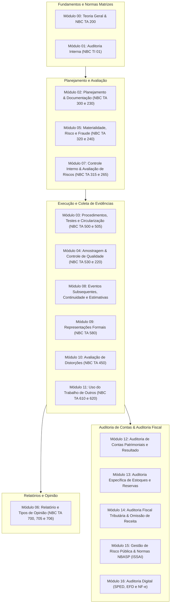

# 🧐 Auditoria (Governamental, Privada e Fiscal)

> **Escopo Temático:** Normas NBC TA (IFAC), NBC TI / PI (Auditoria Interna), NBASP (ISSAI/Tribunais de Contas), Planejamento, Testes, Amostragem, Fraude e Auditoria Fiscal Tributária (Receita Federal / SEFAZ).

---

## 🗺️ Mapa Conceitual Integrado da Disciplina

---

## 📑 Índice Canônico dos Módulos do Curso

| Código | Módulo / Tema | Relevância em Prova | Bancas Típicas | Status |
| :---: | :--- | :---: | :---: | :---: |
| **AUD-000** | [**Módulo 00: Teoria Geral da Auditoria, Classificações e NBC TA 200 (R1)**](00-conceitos-iniciais-nbc-ta-200.md) | **Crítica (Top 1)** | **FGV, Cebraspe, FCC** | 🟢 **Concluído** |
| **AUD-001** | [**Módulo 01: Auditoria Interna (NBC TI 01 e NBC PI 01)**](01-auditoria-interna-nbc-ti-01.md) | **Alta** | **FGV, FCC** | 🟢 **Concluído** |
| **AUD-002** | [**Módulo 02: Planejamento (NBC TA 300) e Documentação (NBC TA 230)**](02-planejamento-documentacao-nbc-ta-300-230.md) | **Crítica** | **FGV, Cebraspe, FCC** | 🟢 **Concluído** |
| **AUD-003** | [**Módulo 03: Evidências, Procedimentos e Circularização (NBC TA 500, 505 e 520)**](03-procedimentos-testes-evidencias-nbc-ta-500-505-520.md) | **Crítica** | **FGV, Cebraspe, FCC** | 🟢 **Concluído** |
| **AUD-004** | [**Módulo 04: Amostragem em Auditoria e Controle de Qualidade (NBC TA 530 e 220)**](04-amostragem-controle-qualidade-nbc-ta-530-220.md) | **Alta** | **FGV, Cebraspe** | 🟢 **Concluído** |
| **AUD-005** | [**Módulo 05: Materialidade, Risco de Auditoria e Fraude (NBC TA 320 e 240)**](05-materialidade-risco-fraude-nbc-ta-320-240.md) | **Altíssima** | **Todas** | 🟢 **Concluído** |
| **AUD-006** | [**Módulo 06: Relatório do Auditor e Tipos de Opinião (NBC TA 700, 705 e 706)**](06-relatorio-opiniao-auditor-nbc-ta-700-705-706.md) | **Crítica** | **Todas** | 🟢 **Concluído** |
| **AUD-007** | [Módulo 07: Controle Interno, Comunicação de Deficiências e PAA/KAM (NBC TA 315, 265 e 701)](07-controle-interno-paa-kam-nbc-ta-315-265-701.md) | Altíssima | Todas | 🟡 Em elaboração |
| **AUD-008** | [Módulo 08: Eventos Subsequentes, Continuidade, Estimativas e Partes Relacionadas (NBC TA 540, 550, 560 e 570)](08-eventos-subsequentes-continuidade-estimativas-nbc-ta-560-570-540-550.md) | Alta | FGV, FCC | 🟡 Em elaboração |
| **AUD-009** | [Módulo 09: Representações Formais da Administração (NBC TA 580)](09-representacoes-formais-nbc-ta-580.md) | Média | FGV, Cebraspe | 🟡 Em elaboração |
| **AUD-010** | [Módulo 10: Avaliação das Distorções Identificadas e Resposta aos Riscos (NBC TA 450 e 330)](10-distorcoes-respostas-aos-riscos-nbc-ta-450-330.md) | Média-Alta | FCC, Cebraspe | 🟡 Em elaboração |
| **AUD-011** | [Módulo 11: Uso do Trabalho de Outros Profissionais (Auditor Interno e Especialistas - NBC TA 610 e 620)](11-trabalho-outros-profissionais-nbc-ta-610-620.md) | Alta | FGV, FCC | 🟡 Em elaboração |
| **AUD-012** | [Módulo 12: Auditoria de Contas Patrimoniais e de Resultado (Superavaliação e Subavaliação)](12-auditoria-contas-patrimoniais-resultado.md) | Crítica (Fiscal) | FGV, Cebraspe | 🟡 Em elaboração |
| **AUD-013** | [Módulo 13: Aspectos Específicos: Estoques, Reservas e Subvenções Governamentais](13-auditoria-especifica-estoques-reservas-subvencoes.md) | Alta | FGV | 🟡 Em elaboração |
| **AUD-014** | [Módulo 14: Auditoria Fiscal Tributária: Recomposição de Caixa, Omissão de Receitas e LC 105/2001](14-auditoria-fiscal-omissao-receita-presuncoes.md) | Crítica (Receita) | FGV, Cebraspe | 🟡 Em elaboração |
| **AUD-015** | [Módulo 15: Gestão de Riscos na Administração Pública e Normas NBASP (ISSAI)](15-gestao-risco-administracao-publica-nbasp.md) | Altíssima (Controle) | Cebraspe, FGV | 🟡 Em elaboração |
| **AUD-016** | [Módulo 16: Auditoria Digital: SPED, Escrituração Fiscal Digital (EFD) e NF-e](16-auditoria-digital-sped-efd-nfe.md) | Altíssima (Fiscal/TI) | FGV, Cebraspe | 🟡 Em elaboração |

---

[⬅️ Voltar para o Portal Principal](../../README.md)
