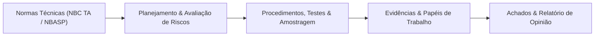

# 🧐 Auditoria

> **Escopo Temático:** Normas NBC TA e NBASP (ISSAI), Planejamento de Auditoria, Testes, Amostragem, Matriz de Achados e Relatórios.

---

## 🗺️ Visão Panorâmica da Matéria

---

## 📑 Índice de Verbetes

| Código | Verbete / Tema | Relevância em Prova | Bancas Típicas | Status |
| :---: | :--- | :---: | :---: | :---: |
| **AUD-001** | [**NBC TA 200: Objetivos Gerais do Auditor e Conceitos Iniciais**](nbc-ta-200-objetivos-gerais-e-conceitos-iniciais.md) | **Crítica (Top 1)** | **FGV, Cebraspe, FCC** | 🟢 **Concluído** |
| **AUD-002** | [Auditoria Interna: NBC TI 01 e NBC PI 01](auditoria-interna-nbc-ti-01.md) | Alta | FGV, FCC | 🟡 Planejado (Aula 01) |
| **AUD-003** | [Planejamento de Auditoria (NBC TA 300) e Documentação (NBC TA 230)](planejamento-e-documentacao.md) | Altíssima | Todas | 🟡 Planejado (Aula 02) |
| **AUD-004** | [Evidências e Procedimentos de Auditoria (NBC TA 500)](evidencias-e-procedimentos.md) | Crítica | Todas | 🟡 Planejado (Aula 03) |
| **AUD-005** | [Amostragem em Auditoria (NBC TA 530)](amostragem-em-auditoria.md) | Alta | FGV, Cebraspe | 🟡 Planejado (Aula 04) |
| **AUD-006** | [Fraude e Erro em Auditoria (NBC TA 240) e Risco](fraude-e-erro-auditoria.md) | Altíssima | Todas | 🟡 Planejado (Aula 05) |
| **AUD-007** | [Relatório e Opinião de Auditoria (NBC TA 700, 705, 706)](relatorio-opiniao-auditor.md) | Crítica | Todas | 🟡 Planejado (Aula 06) |

---

[⬅️ Voltar para o Portal Principal](../../README.md)
