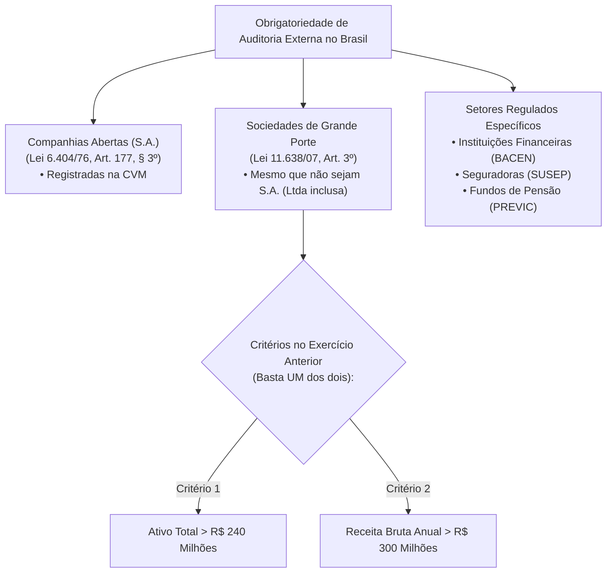
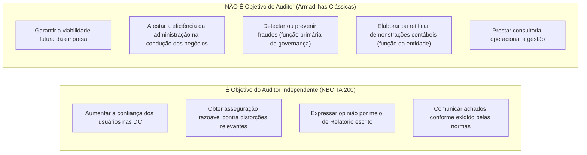
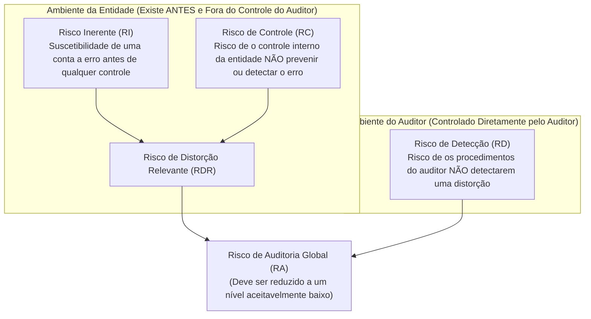

# NBC TA 200: Objetivos Gerais do Auditor e Conceitos Iniciais

> **BLUF (Bottom Line Up Front):**  
> O objetivo principal da Auditoria Independente é **aumentar o grau de confiança das demonstrações contábeis perante seus usuários previstos**, mediante a emissão de uma **opinião formal** sobre se as demonstrações foram elaboradas, em todos os aspectos relevantes, em conformidade com a estrutura de relatório financeiro aplicável. O auditor obtém **asseguração razoável** (segurança de nível elevado, mas **NÃO absoluta**) de que as demonstrações estão livres de distorções relevantes, sejam causadas por fraude ou por erro. O auditor **NÃO** garante a viabilidade futura da entidade, **NÃO** atesta a eficiência da gestão e **NÃO** tem como objetivo primário detectar fraudes.

---

## 1. Classificação Fundamental: Auditoria Interna vs. Externa

| Critério Comparativo | Auditoria Interna (NBC TI 01) | Auditoria Externa / Independente (NBC TA 200) |
| :--- | :--- | :--- |
| **Vínculo Funcional** | Funcionário da entidade (via de regra) ou prestador subordinado à alta gestão | Profissional independente, sem vínculo de subordinação com a entidade auditada |
| **Destinatário do Trabalho** | Administração, Diretoria e Comitê de Auditoria (uso interno) | Usuários previstos / Terceiros (acionistas, investidores, Fisco, bancos, sociedade) |
| **Objetivo Central** | Fortalecer os controles internos e a governança; promover eficiência operacional | Emitir uma opinião técnica sobre a adequação das Demonstrações Contábeis |
| **Grau de Independência** | Independência relativa (limitada à estrutura da organização) | Independência ampla e irrestrita (mental e na aparência) |
| **Responsabilidade Legal** | Trabalhista / Administrativa perante a governança da entidade | Civil, penal e profissional perante terceiros e órgãos reguladores (CVM, CFC) |

---

## 2. Obrigatoriedade Legal da Auditoria Externa no Brasil

A legislação brasileira impõe a auditoria independente obrigatória em situações taxativas:

> [!IMPORTANT]
> **Sociedades de Grande Porte (Lei 11.638/2007, art. 3º):**  
> Considera-se de grande porte a sociedade ou conjunto de sociedades sob controle comum que tiver, no exercício social anterior:
> - **Ativo total superior a R\$ 240.000.000,00**; **OU**
> - **Receita bruta anual superior a R\$ 300.000.000,00**.  
> *Atenção: Os requisitos são alternativos (**OU**), não cumulativos!*

---

## 3. O Escopo da NBC TA 200: O que É e o que NÃO É Papel do Auditor

---

## 4. Postura Operacional: Ceticismo vs. Julgamento Profissional

A NBC TA 200 exige a aplicação simultânea de duas atitudes intelectuais:

### A. Ceticismo Profissional (NBC TA 200, item 13-l)
Postura que inclui **mente questionadora**, alerta constante para condições que possam indicar possível distorção devida a erro ou fraude, e uma **avaliação crítica das evidências de auditoria**.
* **Implicação:** O auditor não assume que a administração é desonesta, mas também **não aceita registros contábeis como autênticos sem corroboração independente**.

### B. Julgamento Profissional (NBC TA 200, item 13-k)
Aplicação do treinamento, conhecimento e experiência acumulados pelo auditor para a tomada de decisões abalizadas sobre as ações apropriadas durante o trabalho de auditoria.
* **Aplica-se em:** Determinação da materialidade, cálculo do risco de auditoria, natureza, época e extensão dos testes, e suficiência das evidências obtidas.

---

## 5. Dinâmica do Risco de Auditoria

O **Risco de Auditoria (RA)** é o risco de que o auditor expresse uma opinião inadequada quando as demonstrações contábeis contiverem distorção relevante.

$$\text{Risco de Auditoria (RA)} = \text{Risco de Distorção Relevante (RDR)} \times \text{Risco de Detecção (RD)}$$

$$\text{Onde:} \quad \text{RDR} = \text{Risco Inerente (RI)} \times \text{Risco de Controle (RC)}$$

> [!TIP]
> **A Relação Inversa de Ouro:**  
> Existe uma **relação inversa** entre o Risco de Distorção Relevante (RDR) e o Risco de Detecção (RD):
> - Se o controle da empresa for péssimo e as operações complexas (**RDR Alto**), o auditor é obrigado a planejar testes mais profundos, com amostras maiores e procedimentos próximos ao encerramento do exercício, para que o **Risco de Detecção (RD) seja Baixo**.
> - O auditor **não altera o RDR** da entidade; ele apenas o avalia para dimensionar o seu próprio **RD**.

---

## 6. Evidência de Auditoria: Suficiência e Adequação

A evidência deve ser **suficiente** e **apropriada (adequada)** para fundamentar a opinião (NBC TA 500 / NBC TA 200):

* **Suficiência (Aspecto Quantitativo):** Refere-se à **quantidade** da evidência necessária. É afetada pela avaliação do auditor sobre os riscos de distorção relevante (quanto maior o risco, mais evidência necessária) e pela qualidade dessa evidência.
* **Adequação / Apropriação (Aspecto Qualitativo):** Refere-se à **qualidade**, isto é, à sua **relevância** e à sua **confiabilidade** para suportar as conclusões.

> [!NOTE]
> **Hierarquia da Confiabilidade das Evidências:**  
> 1. Evidências obtidas de **fontes externas independentes** são mais confiáveis que fontes internas.  
> 2. Evidências obtidas **diretamente pelo auditor** (ex: inspeção física) são mais confiáveis que obtidas indiretamente.  
> 3. Evidências em forma de **documentos originais** são mais confiáveis que fotocópias ou reproduções digitais.  
> 4. Evidências geradas internamente quando os **controles internos são eficazes** são mais confiáveis que sob controles frágeis.

---

## 7. Matriz Anti-Pegadinha de Bancas (FGV / Cebraspe / FCC)

| O que a Banca Afirma (Pegadinha) | O que a Norma Estabelece (A Verdade da Lei) | Justificativa Técnica |
| :--- | :--- | :--- |
| *"A auditoria independente visa atestar a eficácia operacional da gestão dos diretores."* | **ERRADO.** O objetivo é exclusivamente opinar sobre a conformidade das Demonstrações Contábeis. | Auditoria de eficiência é operacional/gestão, não auditoria de demonstrações. |
| *"O auditor independente assegura de forma absoluta a inexistência de fraudes nas contas."* | **ERRADO.** A asseguração é **razoável** (nível elevado, mas não absoluto). | Existem limitações inerentes (amostragem, conluio, julgamento). |
| *"O auditor é responsável pela detecção de qualquer fraude ocorrida na entidade."* | **ERRADO.** A responsabilidade primária pela prevenção e detecção de fraudes é da **Administração e dos responsáveis pela Governança**. | O auditor apenas busca asseguração razoável de que as DCs não contêm distorções relevantes decorrentes de fraudes. |
| *"O auditor independente deve ajustar as demonstrações contábeis quando identificar erros."* | **ERRADO.** O auditor **propõe** ajustes. Quem altera e publica as demonstrações é a **Administração**. | Fazer lançamentos contábeis violaria a independência do auditor. |
| *"Sociedade limitada com ativo de R$ 250 milhões não precisa de auditoria externa."* | **ERRADO.** Se o ativo > R\$ 240 mi, é Sociedade de Grande Porte (Lei 11.638/07) e a auditoria externa é **obrigatória**, independentemente da forma societária (S.A. ou Ltda). | Aplicação expressa do Art. 3º da Lei 11.638/07. |

---

## 8. Mnemônicos & Âncoras de Memória

> [!TIP]
> **Mnemônico: 5 Princípios Éticos do Auditor (NBC PA 01 / NBC PG 100)**  
> **`I-O-C-C-C`**  
> - **I** - **I**ntegridade (ser reto e honesto)  
> - **O** - **O**bjetividade (imparcialidade, sem conflito de interesses)  
> - **C** - **C**ompetência profissional e devido zelo  
> - **C** - **C**onfidencialidade (sigilo profissional das informações)  
> - **C** - **C**omportamento profissional (conformidade com leis e normas éticas)

---

## 9. Questões Paradigmáticas Comentadas

### Questão 1 (FGV - SEFAZ-MG - Auditor Fiscal da Receita Estadual)
**Enunciado:**  
De acordo com a NBC TA 200 (R1), ao conduzir a auditoria de demonstrações contábeis, os objetivos gerais do auditor independente são:  
I. Obter asseguração absoluta de que as demonstrações contábeis como um todo estão livres de distorção relevante, decorrente de fraude ou erro.  
II. Atestar a eficácia dos negócios e garantir a continuidade operacional futura da entidade nos próximos exercícios.  
III. Emitir relatório sobre as demonstrações contábeis e comunicar-se como exigido pelas NBC TAs, em conformidade com as constatações do auditor.  
Está correto apenas o que se afirma em:
- (A) I.
- (B) III.
- (C) I e II.
- (D) II e III.
- (E) I, II e III.

**Gabarito Oficial:** **B**  
**Fundamentação Objetiva:**  
- O item I está incorreto porque a asseguração obtida é **razoável**, nunca absoluta (NBC TA 200, item 5).
- O item II está incorreto porque a opinião sobre as demonstrações contábeis não assegura a viabilidade futura da entidade nem a eficácia ou a eficiência com a qual a administração conduziu os negócios (NBC TA 200, item A1).
- O item III está rigorosamente de acordo com a NBC TA 200, item 11(b).

---

### Questão 2 (Cebraspe - SEFAZ-AL - Auditor Fiscal da Receita Estadual)
**Enunciado:**  
Com relação ao risco de auditoria e seus componentes, julgue o item subsequente:  
*O risco de controle e o risco inerente diferem do risco de detecção pelo fato de que existem independentemente da auditoria das demonstrações contábeis, cabendo ao auditor apenas avaliá-los, e não alterá-los.*

**Gabarito Oficial:** **CERTO**  
**Fundamentação Objetiva:**  
Conforme expressamente estipulado na NBC TA 200 (itens A38 a A42), o Risco Inerente e o Risco de Controle formam o Risco de Distorção Relevante (RDR), que é uma característica da entidade auditada e de seus controles internos. Eles existem antes e independentemente da auditoria. O auditor não pode alterá-los diretamente; ele pode apenas avaliá-los para planejar procedimentos que reduzam o Risco de Detecção (RD), este sim sob seu controle direto.

---

## 10. Verbetes Correlatos

- 🔗 [Planejamento de Auditoria e Documentação (NBC TA 300 e 230)](planejamento-e-documentacao.md)
- 🔗 [Evidências e Procedimentos de Auditoria (NBC TA 500)](evidencias-e-procedimentos.md)
- 🔗 [Responsabilidade do Auditor em Relação a Fraude (NBC TA 240)](fraude-e-erro-auditoria.md)
